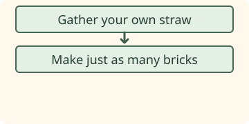

# Exodus 5 — Pharaoh makes the people gather their own straw

**About this chapter**

Moses and Aaron ask Pharaoh to let the Israelites go and worship.

Pharaoh answers by giving the workers more to do.

## Moses and Aaron speak to Pharaoh

## Exodus 5:1

Moses and Aaron went to Pharaoh, the king of Egypt.

They said, “The LORD, the God of Israel, says this.

‘Let my people go. Let them hold a feast for me in the wilderness.’”

## Exodus 5:2

Pharaoh answered, “Who is the LORD? Why should I obey him?

I do not know the LORD. I will not let Israel go.”

## Exodus 5:3

Moses and Aaron said, “The God of the Hebrews has met with us.

Please let us travel three days into the wilderness.

We must offer sacrifices to the LORD our God.

Otherwise he may strike us with disease or the sword.”

## Exodus 5:4

The king asked, “Moses and Aaron, why are you taking people away from work?

Get back to work!”

## Exodus 5:5

Pharaoh said, “Look how many people there are now.

You would stop all these people from working.”

**Pause and answer**

Why did Moses and Aaron ask to go into the wilderness?

## Pharaoh gives a new order

## Exodus 5:6

That same day Pharaoh spoke to the Egyptian slave drivers and the Israelite work leaders.

## Exodus 5:7

He said, “Stop giving the workers straw to make bricks.

Make them go and gather their own straw.

## Exodus 5:8

They must still make as many bricks as before.

They are lazy. That is why they keep asking to go and offer sacrifices to their God.

## Exodus 5:9

Make the men work harder. Keep them busy.

Then they will pay no attention to these lies.”

**Reading help**

The workers mixed straw into the mud they used for bricks.

**Pause and answer**

What extra job did Pharaoh give the workers?

## The workers search for straw

## Exodus 5:10

The slave drivers and work leaders went out to the workers.

They said, “Pharaoh says he will give you no more straw.

## Exodus 5:11

Go and find your own straw wherever you can.

You must still do all the work you did before.”

## Exodus 5:12

The people spread out across Egypt.

They gathered short stalks left in the fields to use as straw.

## Exodus 5:13

The slave drivers kept pushing them.

“Make the same number of bricks each day,” they said.

“Make as many as when we gave you straw.”

## Exodus 5:14

The slave drivers had put Israelite leaders in charge of the workers.

Now the slave drivers beat those leaders.

They asked, “Why did you make fewer bricks yesterday and today than before?”

| Daily work | Before Pharaoh’s order | After Pharaoh’s order |
| --- | --- | --- |
| Getting straw | Workers received straw. | Workers searched for their own straw. |
| Making bricks | Workers had to make a set number. | They still had to make that number. |

**Pause and answer**

Why was it harder to make enough bricks each day?

## The Israelite work leaders ask Pharaoh for help

## Exodus 5:15

The Israelite work leaders went to Pharaoh for help.

They asked, “Why do you treat your servants like this?

## Exodus 5:16

Your people give us no straw and still say, ‘Make bricks!’

They beat us. But your own people are at fault.”

## Exodus 5:17

Pharaoh answered, “Lazy! You are lazy!

That is why you keep asking to go and offer sacrifices to the LORD.

## Exodus 5:18

Now get back to work. You will get no straw.

You must still bring me the full number of bricks.”

Pharaoh added a job while demanding as many bricks as before.

## Exodus 5:19

The Israelite leaders knew they were in trouble.

Pharaoh still demanded the same number of bricks every day.

**Pause and answer**

What did Pharaoh say when the work leaders asked for help?

## Moses asks the LORD for help

## Exodus 5:20

When the leaders left Pharaoh, Moses and Aaron were waiting for them.

The leaders spoke angrily to them.

## Exodus 5:21

“May the LORD see what you have done and judge you!

You have made Pharaoh and his officials hate us.

It is as if you put a sword in their hands to kill us!”

## Exodus 5:22

Moses went back to the LORD. He asked, “Lord, why have you brought trouble on these people?

Is this why you sent me?

## Exodus 5:23

I spoke to Pharaoh in your name.

Ever since then he has treated your people badly.

You have done nothing to rescue them.”

**Pause and answer**

What did Moses tell the LORD had happened since he spoke to Pharaoh?
