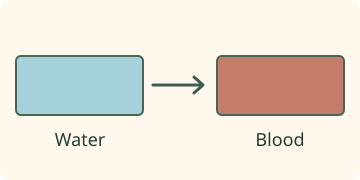

# Exodus 7 — Aaron lifts his staff at the Nile

**About this chapter**

Moses and Aaron bring God’s words to Pharaoh, the king of Egypt.

Pharaoh sees two signs. He still refuses to listen.

## God tells Moses and Aaron what to say

## Exodus 7:1

The LORD answered Moses, “I have made you like God to Pharaoh.

Your brother Aaron will be your prophet.

## Exodus 7:2

Say everything I command you. Aaron will speak to Pharaoh for you.

Aaron must tell him to let the Israelites leave Egypt.

## Exodus 7:3

I will harden Pharaoh’s heart.

I will do many signs and wonders in Egypt.

## Exodus 7:4

Pharaoh will still refuse to listen to you.

Then I will use my power to judge Egypt.

I will bring my people out of Egypt, group by group.

## Exodus 7:5

When I act against Egypt and lead the Israelites out, the Egyptians will know that I am the LORD.”

**Reading help**

A prophet speaks a message for someone else. Here Aaron speaks the message God gives to Moses.

A hard heart pictures someone who refuses to change.

## Exodus 7:6

Moses and Aaron did what the LORD told them.

## Exodus 7:7

Moses was 80 when they spoke to Pharaoh.

Aaron was 83.

**Pause and answer**

Who would tell Pharaoh to let the Israelites go?

## Aaron’s staff becomes a snake

## Exodus 7:8

The LORD spoke to Moses and Aaron again.

## Exodus 7:9

He said, “Pharaoh will ask you to show him a miracle.

Tell Aaron to throw his staff down in front of Pharaoh.

It will become a snake.”

## Exodus 7:10

Moses and Aaron went to Pharaoh and obeyed the LORD.

Aaron threw his staff down in front of Pharaoh and his officials.

The staff became a snake.

## Exodus 7:11

Pharaoh called for Egypt’s wise men and those who practiced magic.

The magicians did the same thing by their magic.

## Exodus 7:12

Each man threw down his staff. Each staff became a snake.

Then Aaron’s staff swallowed all their staffs.

## Exodus 7:13

Pharaoh stayed stubborn. He refused to listen to Moses and Aaron.

This was what the LORD had said would happen.

**Pause and answer**

What happened to the magicians’ staffs?

## God sends Moses to the riverbank

## Exodus 7:14

The LORD told Moses, “Pharaoh still refuses to let my people go.

## Exodus 7:15

In the morning he will go out to the water.

Wait for him on the bank of the Nile River.

Take the staff that turned into a snake.

## Exodus 7:16

Tell him, ‘The LORD, the God of the Hebrews, sent me.

He says, “Let my people go and worship me in the wilderness.”

Until now you have refused to listen.

## Exodus 7:17

The LORD says you will know by this sign that he is the LORD.

I will strike the Nile with the staff in my hand.

The water will turn to blood.

## Exodus 7:18

The fish will die. The river will smell terrible.

The Egyptians will be unable to drink its water.’”

**Pause and answer**

Where did God tell Moses to meet Pharaoh?

## The Nile turns to blood

## Exodus 7:19

The LORD told Moses, “Tell Aaron to take his staff.

Have him reach out his hand over the waters of Egypt.

That includes rivers, canals, ponds, and places where people store water.

The water will turn to blood throughout Egypt.

There will be blood even in wooden and stone containers.”

## Exodus 7:20

Moses and Aaron obeyed the LORD.

Pharaoh and his officials watched Aaron lift his staff.

Aaron struck the Nile. All its water turned to blood.

The river that had held water now held blood.

## Exodus 7:21

The fish died. The river smelled terrible.

The Egyptians could not drink its water. There was blood throughout Egypt.

## Exodus 7:22

Egypt’s magicians did the same thing by their magic.

Pharaoh stayed stubborn and refused to listen to Moses and Aaron.

It happened just as the LORD had said.

## Exodus 7:23

Pharaoh turned and went back into his palace.

He paid no attention to what had happened.

## Exodus 7:24

The Egyptians dug beside the Nile to find drinking water.

They could no longer drink from the river.

## Exodus 7:25

Seven full days passed after the LORD struck the Nile.

| Who | What they did after the water changed |
| --- | --- |
| Pharaoh | Went back into his palace |
| The Egyptians who needed water | Dug beside the Nile |

**Pause and answer**

Why did the Egyptians dig beside the river?
