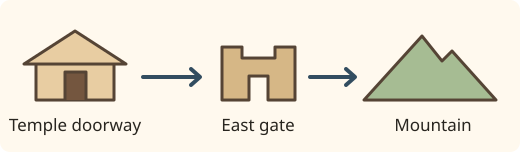

# Ezekiel 10 — The glory of the LORD moves to the east gate

**About this chapter**

Ezekiel is still seeing a vision of Jerusalem. He sees God’s glory move from the temple doorway to the east gate.

## The man in linen receives burning coals

## Ezekiel 10:1

I looked above the heads of the cherubim.

Cherubim are living creatures who serve God.

Something like a wide surface stretched above them.

Above it I saw what looked like a throne.

It shone like sapphire, a blue jewel.

## Ezekiel 10:2

The LORD spoke to the man in linen clothes.

“Go in among the wheels beneath the cherubim.

Fill your hands with burning coals from between the creatures.

Scatter the coals over the city.”

I watched the man go in.

## Ezekiel 10:3

The cherubim stood on the temple’s south side.

A cloud filled the inner courtyard.

## Ezekiel 10:4

The glory of the LORD rose above the creatures.

It moved to the temple doorway.

The cloud filled the temple.

The LORD’s glory shone brightly across the courtyard.

## Ezekiel 10:5

I could hear the creatures’ wings from the outer courtyard.

They sounded like the voice of God Almighty.

## Ezekiel 10:6

The LORD had told the man to get the fire.

The man went in and stood beside a wheel.

## Ezekiel 10:7

One creature reached into the fire between the creatures.

It gave burning coals to the man in linen.

He took the coals and went out.

## Ezekiel 10:8

Under their wings the creatures had what looked like human hands.

## The creatures and their wheels move together

## Ezekiel 10:9

I saw four wheels. Each creature had one beside it.

The wheels shone like a jewel called beryl.

## Ezekiel 10:10

All four wheels looked alike.

Each looked like one wheel inside another wheel.

## Ezekiel 10:11

The creatures could move in any of four directions.

They went straight where the head faced.

They did not need to turn around first.

## Ezekiel 10:12

Eyes covered the creatures’ bodies.

I saw eyes on their backs, hands, and wings.

Eyes covered all four wheels too.

## Ezekiel 10:13

I heard a name for these wheels.

Someone called them “the whirling wheels.”

## Ezekiel 10:14

Each creature had four faces.

The first was the face of a cherub.

A cherub is one of the cherubim.

The second face was human.

The third was a lion’s face. The fourth was an eagle’s.

## Ezekiel 10:15

Then the creatures rose.

I had seen these same living creatures by the Kebar River.

## Ezekiel 10:16

When the creatures moved, the wheels went with them.

The creatures spread their wings to rise from the ground.

Even then the wheels stayed beside them.

## Ezekiel 10:17

When the creatures stopped, the wheels stopped.

When the creatures rose, the wheels rose.

The spirit of the creatures was in the wheels.

## The glory of God moves to the east gate

## Ezekiel 10:18

The glory of the LORD left the temple doorway.

It stood above the cherubim.

## Ezekiel 10:19

I watched the creatures raise their wings.

They rose from the ground. The wheels went with them.

They stopped at the east gate of the LORD’s temple.

The glory of Israel’s God was above them.

## Ezekiel 10:20

I remembered the Kebar River.

There I had seen these creatures beneath Israel’s God.

Now I knew they were cherubim.

## Ezekiel 10:21

Each creature had four faces and four wings.

Under the wings I saw what looked like human hands.

## Ezekiel 10:22

I recognized the faces I had seen by the Kebar River.

Each creature went straight ahead.

**Think about it**

**Where did the creatures stop after they left the temple doorway?**
