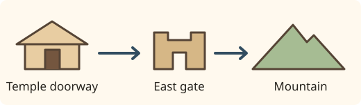

# Ezekiel 11 — God promises to bring his scattered people home

**About this chapter**

At the east gate, Ezekiel hears what Jerusalem’s leaders are saying. God also gives Ezekiel a message for the people who had to leave their homes.

## The leaders at the east gate

## Ezekiel 11:1

God’s Spirit lifted me up in the vision.

He brought me to the east gate of the LORD’s temple.

Twenty-five men stood at the entrance.

I saw two leaders there.

One was Jaazaniah son of Azzur.

The other was Pelatiah son of Benaiah.

## Ezekiel 11:2

The LORD called me “son of man.”

He said, “These men plan evil in Jerusalem.

They tell people here to do wrong.”

## Ezekiel 11:3

The men said, “Isn’t it nearly time to build houses?

The city is the cooking pot. We are the meat.”

They pictured themselves staying inside the city like meat inside a pot.

## Ezekiel 11:4

God said, “Son of man, speak my message against them.

Tell them what I say.”

## God answers the leaders

## Ezekiel 11:5

The Spirit of the LORD came upon me.

He told me to give Israel this answer from the LORD.

“I know what you are saying to yourselves.

I know the thoughts that come into your minds.”

## Ezekiel 11:6

“You have killed many people in Jerusalem.

You have filled the streets with their bodies.”

## Ezekiel 11:7

The Lord GOD said, “Think again about that pot.

The city is the pot.

Those you killed inside it are the meat.

As for you leaders, I will take you out.”

## Ezekiel 11:8

“You fear death by the sword.

I will bring the sword against you.”

## Ezekiel 11:9

“I will bring you out of Jerusalem.

I will hand you over to people from other nations.

I will judge you.”

## Ezekiel 11:10

“Enemies will kill you with swords.

My judgment will reach Israel’s borders.

Then you will know that I am the LORD.”

## Ezekiel 11:11

“This city will never be a pot that holds you.

You will never be the meat that stays inside.

I will judge you even at Israel’s borders.”

## Ezekiel 11:12

“Then you will know that I am the LORD.

You ignored my laws and disobeyed my commands.

You followed the ways of the nations around you.”

## Ezekiel 11:13

While I spoke God’s message, Pelatiah son of Benaiah died.

I fell with my face to the ground.

I cried out, “Oh, Lord GOD!

Will you put an end to everyone left in Israel?”

## God remembers the people far from home

## Ezekiel 11:14

Then the LORD gave me another message.

## Ezekiel 11:15

He said, “Think about your relatives and the other exiles.”

Exiles are people who must live away from their homeland.

God knew what Jerusalem’s people said about their fellow Israelites.

“They are far from the LORD. This land belongs to us now.”

## Ezekiel 11:16

The Lord GOD told me to give the exiles his answer.

“I scattered you among distant nations.

Yet for a time I have been your sanctuary there.”

A sanctuary is a holy place of safety.

God himself had been there for them.

## Ezekiel 11:17

“I will gather you from all those countries.

I will give you back the land of Israel.”

## Ezekiel 11:18

When the people return, they will clear away their idols.

They will remove the things God hates.

## Ezekiel 11:19

God said, “I will give them one heart.

I will put a new spirit within them.

I will take away their heart of stone.

I will give them a heart of flesh.”

A stone cannot respond. A living heart can.

Together the people will want to listen to God.

## Ezekiel 11:20

“Then they can follow my laws.

They can keep my commands and do what I say.

They will be my people. I will be their God.”

## Ezekiel 11:21

“But some people still want the things I hate.

I will hold them responsible for what they do.”

The Lord GOD said this.

## Ezekiel tells the exiles what he saw

## Ezekiel 11:22

The cherubim spread their wings.

These were the living creatures who served God.

The wheels were beside them.

The glory of Israel’s God was above them.

## Ezekiel 11:23

The glory of the LORD rose from the city.

It stopped over the mountain east of Jerusalem.

## Ezekiel 11:24

In the vision, God’s Spirit lifted me up.

He carried me back to the exiles in Chaldea.

Then the vision ended.

## Ezekiel 11:25

I told the exiles everything the LORD had shown me.

**Think about it**

**What land did God promise to give back to the exiles?**
