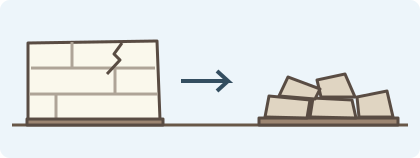

# Ezekiel 13 — False prophets promise peace

**About this chapter**

The LORD warns people who pretend to speak for him. Ezekiel tells how their promises are like a fresh coat of whitewash on a weak wall.

## The prophets make up messages

## Ezekiel 13:1

The LORD gave me a message.

## Ezekiel 13:2

He called me “son of man.”

He told me to speak against Israel’s prophets.

They were making up messages and calling them God’s words.

I was to tell them, “Listen to the LORD!”

## Ezekiel 13:3

The Lord GOD said trouble was coming to these foolish prophets.

They followed their own ideas.

God had shown them nothing.

## Ezekiel 13:4

“Israel, your prophets are like foxes among broken walls.”

Foxes roam through the ruins.

## Ezekiel 13:5

The prophets had left the gaps in Israel’s wall open.

They had done nothing to repair the wall.

How would Israel stand in battle when the LORD came to judge?

God’s people needed help to face that day.

## Ezekiel 13:6

The prophets claimed to see visions from God.

They told lies about what would happen.

They said, “The LORD says this.”

The LORD had never sent them.

Yet they expected their words to come true.

## Ezekiel 13:7

God asked, “Why do you say I have spoken?

Your visions are false. Your predictions are lies.

I never said those things.”

## Ezekiel 13:8

The Lord GOD said, “Your words are empty.

Your visions are false. I am against you.”

## Ezekiel 13:9

God would act against the prophets who told those lies.

They would lose their place among his people’s advisers.

Their names would have no place on Israel’s list of people.

They would never enter the land of Israel.

Then they would know he was the Lord GOD.

## The whitewashed wall falls

## Ezekiel 13:10

The prophets told the people, “There will be peace.”

Yet there was no peace. The prophets misled them.

It was like brushing whitewash onto a weak wall.

Whitewash is a thin white coating.

It makes a wall look fresh without making it strong.

## Ezekiel 13:11

God told me, “Tell those who whitewash the wall it will fall.

Heavy rain will pour down.

I will send hail, lumps of ice from the sky.

A fierce wind will blow.”

## Ezekiel 13:12

Once the wall fell, what would be left of its whitewash?

The coating could never hold the wall up.

## Ezekiel 13:13

The Lord GOD said, “In my anger I will send a windstorm.

Rain and hail will beat down and cause terrible damage.”

## Ezekiel 13:14

“I will knock down the wall you whitewashed.

Everyone will see the foundation where it stood.

The city will fall. You will die inside it.

Then you will know I am the LORD.”

## Ezekiel 13:15

The LORD would act in anger against the wall.

He would also act against those who whitewashed it.

Then he would say, “The wall is gone.

The people who coated it are gone too.”

## Ezekiel 13:16

Those people were Israel’s prophets.

They claimed God had shown them peace for Jerusalem.

But there was no peace.

## God will free his people

## Ezekiel 13:17

God told me to speak to women among my people.

They too made up messages and claimed to speak for him.

I was to speak against them.

## Ezekiel 13:18

The Lord GOD warned the women who sewed charms onto their wrists.

Charms are objects people think have magic power.

The women also made head coverings for people of every height.

God asked, “Will you trap my people to keep yourselves alive?”

## Ezekiel 13:19

“You have dishonored me for handfuls of barley and scraps of bread.

My people listened to your lies.

Because of you, people died who should have lived.

Others lived who should have died.”

## Ezekiel 13:20

The Lord GOD said, “I am against your charms.

You use them to trap people like birds.

I will tear the charms from your arms.

I will set the people you trapped free.”

## Ezekiel 13:21

“I will tear off your head coverings too.

I will rescue my people from your power.

You will no longer be able to trap them.

Then you will know I am the LORD.”

## Ezekiel 13:22

“Your lies discouraged people who did right.

I had given them no reason to lose heart.

You encouraged people who did evil to keep doing it.

They needed to turn from evil to save their lives.”

## Ezekiel 13:23

“You will stop seeing false visions.

You will stop trying to tell the future.

I will rescue my people from your power.

Then you will know I am the LORD.”

**Think about it**

**What happened to the weak wall after people covered it with whitewash?**
