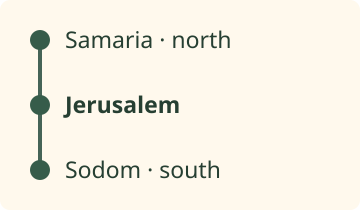

# Ezekiel 16 — Jerusalem forgets, but God remembers his promise

**About this chapter**

God tells Ezekiel a story about Jerusalem. He speaks to the city as if it were a woman. He remembers finding her as a baby and later making a marriage promise to her. Her other lovers stand for the nations and gods the people turned to.

## An abandoned baby

## Ezekiel 16:1

The LORD spoke to me, Ezekiel, again.

## Ezekiel 16:2

He said, “Son of man, tell Jerusalem plainly about the terrible things she has done.

## Ezekiel 16:3

Give Jerusalem this message from the Lord GOD.

You were born in the land of Canaan.

Your father was an Amorite.

Your mother was a Hittite.

## Ezekiel 16:4

When you were born, nobody cut your birth cord.

Nobody washed you, rubbed you with salt, or wrapped you in cloth.

## Ezekiel 16:5

Nobody cared enough to help you.

On the day you were born, people rejected you.

They left you in an open field.

## God cares for Jerusalem

## Ezekiel 16:6

I passed by and saw you struggling in your blood.

As you lay there, I said, ‘Live!’ Yes, I said to you, ‘Live!’

## Ezekiel 16:7

I helped you grow like a plant in a field.

You grew into a beautiful young woman.

Your breasts developed and your hair grew.

You still had no clothes.

## Ezekiel 16:8

When I passed by again, you were old enough for marriage.

I spread my cloak over you to cover you.

I made a solemn promise to you.

That promise was our covenant, and you became mine.

## Ezekiel 16:9

I washed the blood from you with water.

Then I rubbed oil on your skin.

## Gifts for a queen

## Ezekiel 16:10

I dressed you in cloth with patterns sewn into it.

I gave you fine leather sandals.

I wrapped you in fine linen and silk.

## Ezekiel 16:11

I gave you jewelry.

I put bracelets on your wrists and a chain around your neck.

## Ezekiel 16:12

I gave you a nose ring and earrings.

I placed a beautiful crown on your head.

## Ezekiel 16:13

You wore gold, silver, and fine clothes.

Your clothes were linen, silk, and cloth with sewn patterns.

You ate fine flour, honey, and oil.

You grew very beautiful and became a queen.

## Ezekiel 16:14

Other nations heard about your beauty.

The splendor I gave you made your beauty complete.

I, the Lord GOD, say this.

**Pause and answer**

What did God say to the baby in the field?

## Jerusalem gives God’s gifts to idols

## Ezekiel 16:15

You became famous and trusted in your own beauty.

You offered sex to anyone who passed by.

## Ezekiel 16:16

You used your clothes to make colorful places to worship.

There you took lovers.

Such things should never have happened!

## Ezekiel 16:17

You took the gold and silver jewelry I gave you.

You made idols shaped like men and gave yourself to them.

Idols are things people worship as gods.

## Ezekiel 16:18

You dressed the idols in your fine clothes.

You set my oil and incense before them.

Incense gives off a sweet smell when it burns.

## Ezekiel 16:19

I had fed you fine flour, oil, and honey.

You offered that food to the idols for its pleasing smell.

I, the Lord GOD, saw what happened.

## The people sacrifice their children

## Ezekiel 16:20

Was taking lovers not enough for you? You took the sons and daughters you had borne to me.

You offered them to the idols as food.

## Ezekiel 16:21

You killed my children.

You gave them to idols in the fire.

## Ezekiel 16:22

Through all these terrible acts, you forgot your early days.

You forgot how you lay naked in your blood.

## Ezekiel 16:23

How terrible it will be for you! I, the Lord GOD, say it again.

How terrible! You added more evil to all you had done.

## Shrines in every square

## Ezekiel 16:24

In every public square you piled up earth.

You built a high place there for worshiping idols.

## Ezekiel 16:25

You built your shrines at the entrance to every street.

You dishonored your beauty.

You offered sex to more and more people who passed by.

## Ezekiel 16:26

You took your eager neighbors, the Egyptians, as lovers.

You took more lovers to make me angry.

## Ezekiel 16:27

So I acted against you.

I reduced what you had.

I handed you over to the Philistine towns that hated you.

Even they felt ashamed of what you did.

## Ezekiel 16:28

You took the Assyrians as lovers.

Still you wanted more.

## Ezekiel 16:29

You went as far as Chaldea, where people buy and sell goods.

Even those lovers were never enough for you.

## Jerusalem pays her lovers

## Ezekiel 16:30

How little strength you had to resist, says the Lord GOD.

You acted like someone who sells sex without shame.

## Ezekiel 16:31

You built mounds on every street and shrines in every square.

Yet you would not accept payment.

## Ezekiel 16:32

You broke your marriage promise.

You welcomed strangers into your bed in place of your husband.

## Ezekiel 16:33

People give gifts to those they pay for sex.

You gave gifts to your lovers.

You paid them to come from all around to sleep with you.

## Ezekiel 16:34

No one came asking to pay you.

You were the one who paid.

You did the opposite of what others did.

## The lovers turn against Jerusalem

## Ezekiel 16:35

So listen to the LORD, you who have sold yourself.

## Ezekiel 16:36

I, the Lord GOD, saw you spend your wealth on lovers.

You exposed your body to them and gave yourself to idols I hate.

You even gave them the blood of your children.

## Ezekiel 16:37

So I will gather those lovers from all around.

I will bring both the ones you loved and the ones you hated.

I will uncover you before them.

They will see you naked.

## Ezekiel 16:38

I will judge you for breaking your marriage promise and for murder.

In jealous anger I will bring bloodshed upon you.

## Ezekiel 16:39

I will hand you over to your lovers.

They will level your mounds and tear down your shrines.

They will take your clothes and fine jewelry.

They will leave you naked.

## Ezekiel 16:40

They will bring a crowd against you.

The crowd will throw stones at you and cut you down with swords.

## The end of the shrines

## Ezekiel 16:41

They will burn your houses.

Many women will see them carry out your punishment.

I will end your trade in sex.

You will never pay your lovers again.

## Ezekiel 16:42

Then my jealous anger will come to an end.

I will be calm again.

## Ezekiel 16:43

You forgot your early days.

You made me angry by doing all these things.

Now you will face the results of your own actions.

You added shameful acts to the other terrible things you did.

I, the Lord GOD, say this.

## Jerusalem and her sisters

## Ezekiel 16:44

People will use this saying about you.

‘Like mother, like daughter.’

## Ezekiel 16:45

Your mother despised her husband and children.

Your sisters despised their husbands and children too.

You are just like them.

Your mother was a Hittite.

Your father was an Amorite.

## Ezekiel 16:46

Samaria was your older sister to the north.

Sodom was your younger sister to the south.

Their daughters lived with them.” The sisters picture cities.

Their daughters are the towns around them.

Find Jerusalem in the middle. The cities above and below it are called its sisters.

## Ezekiel 16:47

God said, “You copied the terrible things they did.

Soon you were doing even worse.

## Ezekiel 16:48

As surely as I live, Sodom and her towns never did what you and your towns have done.

I, the Lord GOD, say this.

## Sodom leaves poor people without help

## Ezekiel 16:49

Here is how Sodom and her towns sinned.

They were proud.

They had plenty to eat and lived at ease.

They did nothing to help people who were poor and in need.

## Ezekiel 16:50

They acted as if they were above others.

They did things I hated right in front of me.

So I removed them, as you saw.

## Ezekiel 16:51

Samaria did not commit half as many sins as you did.

You did so many terrible things that your sisters looked good beside you.

## Ezekiel 16:52

Now you must bear your shame.

Because your sins were worse, your sisters seem more just than you.

Your own acts have made them look good.

**Pause and answer**

Who needed help from the people of Sodom?

## God promises to restore the cities

## Ezekiel 16:53

I will bring Sodom and her towns back from captivity.

I will bring Samaria and her towns back too.

And I will bring you back with them.

## Ezekiel 16:54

You will feel ashamed of all you did.

Your actions gave your sisters reason to feel better about themselves.

## Ezekiel 16:55

Sodom and her towns will be as they were before.

Samaria and her towns will be as they were before.

You and your towns will be as you were before, too.

## Ezekiel 16:56

When you were proud, you used to speak of Sodom with contempt.

## Ezekiel 16:57

That was before everyone saw your own evil acts.

Now the towns of Edom and their neighbors mock you.

So do the Philistine towns and all around you who despise you.

## Ezekiel 16:58

You will face the results of your shameful and terrible acts.

I, the LORD, have spoken.

## God remembers his covenant

## Ezekiel 16:59

I, the Lord GOD, will deal with you according to what you did.

You treated your solemn promise as worthless.

You broke our covenant.

## Ezekiel 16:60

Yet I will remember the covenant I made with you when you were young.

I will make a covenant with you that will last forever.

## Ezekiel 16:61

You will welcome your older and younger sisters.

Then you will remember what you did and feel ashamed.

I will give them to you as daughters.

My earlier covenant did not require this.

## Ezekiel 16:62

I will establish my covenant with you.

Then you will know that I am the LORD.

## Ezekiel 16:63

I will make atonement for all you have done.

I will take away your guilt.

You will remember and feel ashamed.

You will have nothing more to say in your defense.

I, the Lord GOD, have spoken.”

**Pause and answer**

What promise does God say he will remember?
