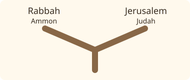

# Ezekiel 21 — The sword and the two roads

**About this chapter**

God tells Ezekiel that war is coming. A sword is the picture he uses for this warning. Later, Ezekiel marks out two roads for the king of Babylon.

## Ezekiel groans for Jerusalem

## Ezekiel 21:1

The LORD spoke to me.

## Ezekiel 21:2

He called me “son of man.”

“Face Jerusalem. Speak against its holy places.

Give my message to the land of Israel.”

## Ezekiel 21:3

“Tell Israel, ‘I am against you.

I will take my sword out of its sheath.’”

A sheath is a cover for a sword.

Both people who do right and people who do wrong will die.

## Ezekiel 21:4

The sword will come against everyone from south to north.

## Ezekiel 21:5

“Then everyone will know that I am the LORD.

I have drawn my sword. I will not put it away again.”

## Ezekiel 21:6

God told me, “Groan where the people can see you.

Let them see how deeply you grieve.”

## Ezekiel 21:7

“They will ask why you groan. Tell them bad news is coming.

People will lose courage. Their hands will hang limp.

Their knees will feel like water. Fear will leave them weak.

It will surely happen,” said the Lord GOD.

## A song about the sword

## Ezekiel 21:8

The LORD spoke to me again.

## Ezekiel 21:9

He told me to give the people this message.

“A sword! A sword! Its edge is sharp. Its blade shines.”

## Ezekiel 21:10

“It is ready to kill. It flashes like lightning.

Can we celebrate the royal staff of my son?”

A royal staff is a sign of a king’s power.

Against this sword, even that staff is only a stick.

## Ezekiel 21:11

The sword is sharp and bright.

It is ready for the hand of the one who will kill.

## Ezekiel 21:12

“Cry out, son of man! Grieve for my people.

The sword will come against them and all Israel’s princes.

Strike your thigh to show your grief.”

## Ezekiel 21:13

“The test is coming,” said the Lord GOD.

“What if even the royal staff does not last?”

The ruler himself could lose his power.

## Ezekiel 21:14

God told me, “Speak my message. Strike your hands together.

The sword strikes twice, then a third time.

Death closes in from every side.”

## Ezekiel 21:15

“At every gate a sword waits, flashing like lightning.

People will lose heart, and many will fall.”

## Ezekiel 21:16

The song calls on the sword to strike wherever it turns, to the right or to the left.

## Ezekiel 21:17

The LORD said, “I too will strike my hands together.

Then my anger will run its course. I have spoken.”

## Two roads from Babylon

## Ezekiel 21:18

The LORD gave me another message.

## Ezekiel 21:19

“Son of man, mark out two roads for Babylon’s king and his army.

Both start in the same land.

Put a sign where the road divides.”

## Ezekiel 21:20

One road leads to Rabbah, the city of the Ammonites.

The other leads into Judah, to Jerusalem with its strong walls.

## Ezekiel 21:21

The king of Babylon stops where the roads meet.

He looks for a sign to tell him which way to go.

He shakes arrows, asks his idols, and examines an animal’s liver.

## Ezekiel 21:22

The sign in his right hand points to Jerusalem.

His soldiers will shout their battle cry and surround the city.

They will bring heavy rams against its gates.

They will build a ramp and a wall around it.

## Ezekiel 21:23

The people who promised loyalty to Babylon will think the sign is false.

But their guilt will come to light.

Their enemies will take them prisoner.

## Ezekiel 21:24

The Lord GOD said, “Your actions have shown everyone your sins.

You have made your guilt plain.

Now your enemies will seize you.”

## Ezekiel 21:25

“Wicked prince of Israel, you have dishonored what is holy.

The day of your final punishment has come.”

## Ezekiel 21:26

“Take off the turban. Remove the crown.

Things will change. Raise up those who have little standing.

Bring down those in high places.”

## Ezekiel 21:27

“Ruins! Ruins! I will leave it all in ruins.

It will stay that way until the rightful ruler comes.

I have given him the right to judge.”

## A warning for Ammon

## Ezekiel 21:28

God told me to speak about the Ammonites and their insults.

“A sword is out of its sheath, ready to kill.

Its polished blade flashes like lightning.”

## Ezekiel 21:29

“People claim to see visions for you, but their predictions are lies.

The sword will fall on the necks of the wicked.

Their time of punishment has come.”

## Ezekiel 21:30

“Put the sword back in its sheath!

I will judge you in the land where you began.”

## Ezekiel 21:31

“My anger will come upon you like fire.

I will hand you over to cruel men who know how to destroy.”

## Ezekiel 21:32

“You will be like fuel that burns away.

Your blood will fall on your own land.

No one will remember you. I, the LORD, have spoken.”

**Think about it**

**Which city did the sign point to when Babylon’s king stopped at the two roads?**
