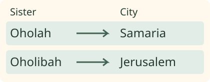

# Ezekiel 23 — Two sisters stand for Samaria and Jerusalem

**About this chapter**

God speaks to Ezekiel about two cities as if they were sisters. The sisters take other lovers. This shows how the people broke their promise to God. They turned to other nations and worshiped their gods.

## God names the sisters

## Ezekiel 23:1

The LORD spoke to me, Ezekiel, again.

## Ezekiel 23:2

He said, “Son of man, two sisters had the same mother.

## Ezekiel 23:3

In Egypt the sisters sold sex while they were still young.

Men touched their breasts there.

## Ezekiel 23:4

The older sister was Oholah.

The younger sister was Oholibah.

They became mine and had sons and daughters.

Oholah stands for Samaria.

Oholibah stands for Jerusalem.

**Pause and answer**

Which city does the younger sister stand for?

## Oholah turns to Assyria

## Ezekiel 23:5

Oholah was still mine when she took other lovers.

She longed for the warriors of Assyria.

## Ezekiel 23:6

They wore blue clothes.

They were governors and commanders.

They were handsome young men riding horses.

## Ezekiel 23:7

She gave herself to these powerful Assyrians.

She worshiped their idols and made herself unclean before me.

Idols are things people worship as gods.

## Ezekiel 23:8

She kept doing what she had done in Egypt.

When she was young, men there touched her and had sex with her.

## Ezekiel 23:9

So I gave Oholah over to her Assyrian lovers.

These were the very men she wanted.

## Ezekiel 23:10

The Assyrians stripped her and took her children away.

They killed her with the sword.

Other women used her name as a warning.

This was how the Assyrians carried out judgment on Samaria.

## Oholibah sees what happened

## Ezekiel 23:11

Her sister Oholibah saw what happened.

Yet she wanted other lovers even more than her sister did.

## Ezekiel 23:12

She too longed for the Assyrian governors and commanders.

These handsome young warriors rode horses and wore splendid clothes.

## Ezekiel 23:13

I saw that Oholibah too had made herself unclean.

Both sisters had done the same things.

## Ezekiel 23:14

Then Oholibah went further.

She saw pictures of men from Chaldea on a wall.

The figures had been carved and colored bright red.

## Ezekiel 23:15

They wore belts and long cloths wrapped around their heads.

They all looked like officers from Babylon.

Chaldea was their homeland.

## Ezekiel 23:16

As soon as she saw them, she wanted them.

She sent messengers to them in Chaldea.

## Oholibah turns back toward Egypt

## Ezekiel 23:17

The Babylonians came and had sex with her.

They made her unclean.

Then she wanted nothing more to do with them.

## Ezekiel 23:18

Oholibah took lovers openly and showed her naked body.

I turned from her in disgust, just as I had turned from her sister.

## Ezekiel 23:19

Still she took more lovers.

She remembered selling sex when she was young in Egypt.

## Ezekiel 23:20

She longed for her Egyptian lovers.

She compared their bodies and sexual power to those of donkeys and stallions.

## Ezekiel 23:21

Oholibah, you wanted to go back to those days.

You remembered how the Egyptians touched your breasts when you were young.

## The former lovers return as enemies

## Ezekiel 23:22

So hear what I, the Lord GOD, say.

I will turn your former lovers against you.

The men you came to hate will surround you.

## Ezekiel 23:23

Babylonians and all the Chaldeans will come.

Men from Pekod, Shoa, and Koa will come.

The Assyrians will join them.

Those handsome young men will ride horses.

Among them will be governors, commanders, officers, and famous men.

## Ezekiel 23:24

Armies from many peoples will come with weapons, chariots, and wagons.

Soldiers with shields and helmets will surround you.

I will let them judge you.

They will punish you by their own laws.

## Ezekiel 23:25

I am fiercely angry because you gave your love to others.

Your enemies will attack in anger.

They will cut off noses and ears.

Others will die by the sword.

They will take your children away.

Fire will destroy those who remain.

## Ezekiel 23:26

They will take your clothes and fine jewelry.

## Ezekiel 23:27

So I will end the sexual acts you began in Egypt.

You will stop looking to those lovers.

You will no longer think about Egypt.

## Jerusalem will suffer as Samaria did

## Ezekiel 23:28

I, the Lord GOD, will hand you over to the people you hate.

These are the people you turned away from in disgust.

## Ezekiel 23:29

They will treat you with hatred.

They will take everything you worked for.

They will leave you naked.

Everyone will see the shame of what you did.

## Ezekiel 23:30

This will happen because you gave yourself to other nations.

You made yourself unclean by worshiping their idols.

## Ezekiel 23:31

You did what your sister did.

So I will put her cup in your hand.” The cup stands for suffering the same punishment as Samaria.

## Ezekiel 23:32

The Lord GOD said, “You will drink from your sister’s cup.

It is deep and wide and holds so much.

People will laugh at you and mock you.

## Ezekiel 23:33

Your sister Samaria’s cup holds loss and ruin.

Drinking it will leave you drunk and full of grief.

## Ezekiel 23:34

You will drink every drop.

You will smash the cup and tear your breasts.

I, the Lord GOD, have spoken.

## Ezekiel 23:35

You forgot me.

You turned your back on me.

Now you must bear the results of taking other lovers.”

**Pause and answer**

What does the cup stand for?

## God names the wrongs of both cities

## Ezekiel 23:36

Then the LORD said to me, “Son of man, will you judge Oholah and Oholibah? Tell them the terrible things they have done.

## Ezekiel 23:37

They broke their marriage promise by worshiping idols.

They also took innocent lives.

The children they bore belonged to me.

Yet they burned those children as food for their idols.

## Ezekiel 23:38

That very day they also dishonored my holy place.

They treated my Sabbaths, my days of rest, as ordinary days.

## Ezekiel 23:39

On the day they killed their children for idols, they came into my holy place.

They dishonored me inside my own house.

## The sisters welcome other lovers

## Ezekiel 23:40

You sisters sent messengers to bring men from far away.

When the men came, you bathed, painted your eyes, and put on jewelry.

## Ezekiel 23:41

You sat on a fine couch beside a table.

On it you put my incense and my oil.

Incense gives off a sweet smell when it burns.

## Ezekiel 23:42

A noisy crowd enjoyed itself.

Drunken men from the desert joined the others.

They put bracelets on your wrists and beautiful crowns on your heads.

## Ezekiel 23:43

I spoke about the woman who had grown old taking other lovers.

I said, ‘Now let them treat her as a woman who sells sex.

That is all she has become.’

## Ezekiel 23:44

The men slept with both sisters, Oholah and Oholibah.

They treated them like women who sell sex.

## Judgment on both sisters

## Ezekiel 23:45

But men who do what is right will judge the sisters.

They will sentence them for breaking their marriage promises and for murder.

The sisters are guilty of both.

## Ezekiel 23:46

I, the Lord GOD, say to bring a crowd against them.

Let the crowd terrify them and take their possessions.

## Ezekiel 23:47

The crowd will kill the sisters with stones and swords.

They will kill their children and burn their houses.

## Ezekiel 23:48

In this way I will end these acts in the land.

All the women will hear the warning and learn to avoid what you did.

## Ezekiel 23:49

You will face punishment for what you did.

You will bear the results of worshiping idols.

Then you will know that I am the Lord GOD.”

**Pause and answer**

What did the people worship when they turned away from God?
