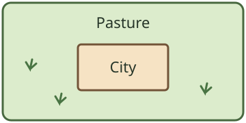

# Ezekiel 25 — The LORD speaks to Judah’s neighbors

**About this chapter**

Some neighbors cheered when Judah suffered.

Others tried to take revenge on Judah.

The LORD tells Ezekiel what will happen to these nations.

## Ammon cheered when Judah suffered

## Ezekiel 25:1

The LORD spoke to me, Ezekiel.

## Ezekiel 25:2

He said, “Son of man, turn toward the people of Ammon.

Speak my message against them.”

## Ezekiel 25:3

The Lord GOD told me what to say to Ammon.

“Listen to the Lord GOD.

You shouted, ‘Aha!’ when enemies showed disrespect for my holy temple.

You cheered when enemies ruined Israel’s land.

You were glad when they took Judah’s people away from home.

## Ezekiel 25:4

“So I will give your land to people from the east.

They will camp in your land and put up their tents.

They will eat your fruit and drink your milk.

## Ezekiel 25:5

“I will turn Rabbah into pasture where camels graze.

Sheep will lie down to rest in Ammon.

Then you will know that I am the LORD.”

## Ezekiel 25:6

The Lord GOD says, “You clapped your hands and stamped your feet.

You looked down on Israel.

You celebrated what happened to its land.

## Ezekiel 25:7

“So I will reach out my hand against you.

Other nations will take what belongs to you.

I will destroy you as a people.

You will have no place among the other nations.

Then you will know that I am the LORD.”

## Moab’s border cities will lie open

## Ezekiel 25:8

The Lord GOD says, “The people of Moab and Seir said,

‘Look! Judah is just like every other nation.’

## Ezekiel 25:9

“So I will open Moab’s border to its enemies.

I will start with the cities Moab takes pride in.

They are Beth-jeshimoth, Baal-meon, and Kiriathaim.

## Ezekiel 25:10

“I will give Moab and Ammon to the people from the east.

The other nations will no longer remember the people of Ammon.

## Ezekiel 25:11

“I will punish Moab.

Then its people will know that I am the LORD.”

## Edom took revenge on Judah

## Ezekiel 25:12

The Lord GOD says, “Edom took revenge on Judah’s people.

Edom bears great guilt for what it did.”

## Ezekiel 25:13

So the Lord GOD says, “I will reach out my hand against Edom.

I will wipe out people and animals alike.

I will leave the land empty and ruined.

From Teman to Dedan, people will die by the sword.

## Ezekiel 25:14

“I will use my people Israel to punish Edom.

What Israel does to Edom will show my great anger.

Then Edom will know that I have repaid them for what they did.”

These are the words of the Lord GOD.

## The Philistines tried to destroy Judah

## Ezekiel 25:15

The Lord GOD says, “The Philistines have hated Judah for a long time.

They wanted revenge.

In their hatred they tried to destroy Judah.

## Ezekiel 25:16

“So I will reach out my hand against the Philistines.

I will wipe out the Cherethites.

I will destroy the people who remain along the coast.

## Ezekiel 25:17

“In my great anger I will punish them severely.

When I repay them, they will know that I am the LORD.”

**Pause and answer**

How did the people of Ammon react when Judah lost its home?
