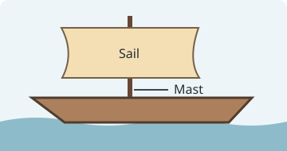

# Ezekiel 27 — A song for Tyre, the city like a ship

**About this chapter**

Tyre trades with people on many shores. In this song, the city is like a beautiful ship. Ezekiel describes the people and goods on board before he tells of the ship going down.

## A ship made with care

## Ezekiel 27:1

The LORD spoke to me.

## Ezekiel 27:2

He called me “son of man.”

He told me to sing a lament for Tyre.

A lament is a song of grief.

## Ezekiel 27:3

Tyre stood at the entrance to the sea.

People from many coasts traded there.

The Lord GOD said, “Tyre, you say, ‘My beauty is perfect.’”

## Ezekiel 27:4

“Your borders reach into the sea.

Your builders made you beautiful.”

The song describes Tyre as if its builders made a ship.

## Ezekiel 27:5

They made your wooden planks from the cypress trees of Senir.

They made your mast from a tall cedar of Lebanon.

The mast is the pole that holds the sail.

## Ezekiel 27:6

They used oak from Bashan to make your oars.

They made your deck from wood from the coasts of Cyprus.

They fitted pieces of ivory into the wood.

## Ezekiel 27:7

Fine linen from Egypt made your sail.

People stitched designs on it. It was your flag.

Blue and purple cloth from Elishah’s coasts made your shade cover.

## People who served Tyre

## Ezekiel 27:8

Men from Sidon and Arvad pulled your oars.

Skilled men from Tyre served as your captains.

## Ezekiel 27:9

Experienced elders from Gebal repaired your ship when it leaked.

Other ships came alongside you.

Their sailors exchanged goods with you.

## Ezekiel 27:10

Soldiers from Persia, Lydia, and Put served in your army.

Their shields and helmets hung on your walls.

They added to your splendor.

## Ezekiel 27:11

Men from Arvad and Helech guarded your walls.

Men from Gammad stood in your towers.

Their shields hung all around your walls and added to your beauty.

## What people brought to trade

## Ezekiel 27:12

Tarshish traded with you because you had so much to sell.

Its traders brought silver, iron, tin, and lead.

## Ezekiel 27:13

Traders from Javan, Tubal, and Meshech brought bronze utensils.

They also traded people they held as slaves.

## Ezekiel 27:14

Beth-togarmah brought horses, war horses, and mules in exchange for goods.

## Ezekiel 27:15

People from Dedan and many coastlands were your customers.

They paid with ivory tusks and ebony, a dark wood.

## Ezekiel 27:16

Aram wanted the many things you sold.

Its traders brought turquoise, coral, and rubies.

They brought purple cloth, fine linen, and cloth with stitched designs.

## Ezekiel 27:17

Judah and Israel brought wheat from Minnith.

They traded cakes, honey, oil, and balm.

Balm was a soothing substance people put on the skin.

## Ezekiel 27:18

Damascus wanted the many goods you had.

Its traders brought wine from Helbon and wool from Zahar.

## Ezekiel 27:19

They also brought barrels of wine from Izal.

People traded shaped iron, cassia, and sweet cane for your goods.

Cassia and sweet cane were plants with a sweet smell.

## Ezekiel 27:20

Dedan traded cloths for riders to put on their animals.

## Ezekiel 27:21

Arabia and the rulers of Kedar were your customers.

They brought lambs, rams, and goats.

## Ezekiel 27:22

Sheba and Raamah brought gold and precious stones.

They also traded their finest spices for your goods.

## Ezekiel 27:23

Haran, Canneh, and Eden traded with you.

So did traders from Sheba, Asshur, and Chilmad.

## Ezekiel 27:24

In your market they traded fine blue clothes and cloth with stitched designs.

They brought rugs of many colors.

The cords in the rugs were tightly twisted and knotted.

## Ezekiel 27:25

Ships from Tarshish carried the goods you sold.

Like a ship out at sea, you were full of heavy cargo.

Cargo is the load a ship carries.

## The east wind breaks the ship

## Ezekiel 27:26

Your rowers have taken you far out to sea.

There the east wind will break you apart.

## Ezekiel 27:27

On the day you fall, your riches and goods will sink.

So will your sailors, captains, and the workers who repair your ship.

Your traders, soldiers, and everyone else aboard will go down too.

## Ezekiel 27:28

The cries of your sailors will shake the countryside.

## Ezekiel 27:29

Rowers will leave their ships.

Sailors and captains will stand on the shore.

## Ezekiel 27:30

They will cry aloud in grief over you.

They will throw dust on their heads and roll in ashes.

## Ezekiel 27:31

They will shave their heads and put on rough cloth.

These are signs of grief.

They will weep bitterly over you.

## The sailors’ song

## Ezekiel 27:32

As they weep, they will sing this lament.

“Who was ever like Tyre?

Now you lie silent in the middle of the sea.”

## Ezekiel 27:33

“Your ships took goods to many nations and supplied their needs.

Your trade and your riches made kings wealthy.”

## Ezekiel 27:34

“Now the sea has broken you apart.

Your goods and your people have sunk with you into deep water.”

## Ezekiel 27:35

“People on every coast look on in horror.

Their kings tremble. Fear twists their faces.”

## Ezekiel 27:36

“Traders from other nations hiss at you.

You have come to a terrible end.

You will be gone forever.”

**Think about it**

**What happens to the ship when the east wind strikes it?**
