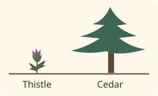

# Ezekiel 31 — The tall cedar falls

**About this chapter**

God gives Ezekiel a story to tell Egypt’s king. In the story, a tall tree stands for the powerful nation of Assyria.

## A tree taller than all the others

## Ezekiel 31:1

The LORD spoke to me in the eleventh year.

It was the first day of the third month.

## Ezekiel 31:2

God called me “son of man.”

He told me to speak to Pharaoh and his people.

Pharaoh was the king of Egypt.

God asked them, “Who was ever as great as you?”

## Ezekiel 31:3

“Look at Assyria,” God said.

Assyria was like a tall cedar tree in Lebanon.

Its beautiful branches shaded the forest.

Its top reached into the clouds.

## Ezekiel 31:4

Springs deep underground fed streams around the tree.

Water also flowed out to the other trees.

## Ezekiel 31:5

With so much water, the cedar grew tall.

It rose above every other tree in the field.

It grew more branches. They spread far out.

## Ezekiel 31:6

Birds built nests in the branches.

Wild animals had their young under the tree.

Whole nations lived in its shade.

Assyria was powerful enough to give those nations shelter.

## Ezekiel 31:7

The roots reached deep into plenty of water.

That was why the tree grew so well.

Its long branches made it beautiful.

## Ezekiel 31:8

Even the cedars in God’s garden could not match it.

Neither cypress trees nor plane trees had branches like its branches.

No other tree in God’s garden was so beautiful.

## Ezekiel 31:9

God said, “I gave it all those beautiful branches.”

Eden was God’s garden.

The other trees in Eden wished they were as beautiful.

## The great tree falls

## Ezekiel 31:10

The Lord GOD said the cedar grew proud.

Its top reached into the clouds.

The tree’s height shows how powerful Assyria had become.

## Ezekiel 31:11

God said, “I drove it away.

I handed it over to a ruler of nations.”

That ruler would punish Assyria for the evil it had done.

## Ezekiel 31:12

Cruel people came from other nations and cut the tree down.

They left its branches scattered over mountains and valleys.

Broken limbs lay in deep gullies.

All the nations that once sheltered there went away.

## Ezekiel 31:13

Birds settled on the fallen trunk.

Wild animals lived among the fallen branches.

## Ezekiel 31:14

The fall of this tree was a warning to others.

No tree beside the water should lift itself so high.

Even trees with plenty of water would die.

Those powerful nations would go down to the Pit.

The Pit is a name for the place of the dead.

## The nations hear the tree fall

## Ezekiel 31:15

The Lord GOD said, “I brought the tree down to Sheol.”

Sheol means the place of the dead.

God made the land grieve. He covered the deep springs.

He held back the rivers that had watered the tree.

Lebanon mourned. The trees in the fields grew weak.

## Ezekiel 31:16

Nations shook when they heard the great tree fall.

God sent it down to join the dead.

Eden’s trees and Lebanon’s finest trees were already there.

Those trees, once so well watered, now found comfort.

## Ezekiel 31:17

These trees stood for nations that had helped Assyria.

Once they had lived in its shade.

They too went down to the place of the dead.

There they joined those who had died in battle.

## Ezekiel 31:18

God asked Pharaoh, “Which tree in Eden could match your greatness?

Yet you too will go down to join those trees.”

Pharaoh would lie among the uncircumcised and those killed in battle.

Circumcision is a mark made on a man’s body.

The Lord GOD said this would happen to Pharaoh and his people.

**Think about it**

**Which powerful nation did the tall cedar stand for?**
