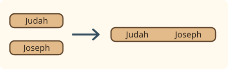

# Ezekiel 37 — Dry bones live and two sticks become one

**About this chapter**

Ezekiel sees dry bones in a valley. God shows him what they mean. Later God gives him two sticks to show how Israel will become one nation again.

## A valley full of bones

## Ezekiel 37:1

I felt the LORD’s power upon me.

His Spirit carried me to the middle of a valley.

The valley was full of bones.

## Ezekiel 37:2

God led me around among the bones.

So many lay on the ground. They were very dry.

## Ezekiel 37:3

God called me “son of man.”

He asked, “Can these bones come alive?”

I answered, “Lord GOD, only you know.”

## Ezekiel 37:4

God told me, “Speak my message to these bones.

Say, ‘Dry bones, listen to the LORD!’”

## Ezekiel 37:5

The Lord GOD told the bones, “I will put breath in you.

You will come alive.”

## Ezekiel 37:6

“I will give you tendons.”

Tendons are strong bands that join muscles to bones.

“I will make flesh grow and cover you with skin.

I will put breath in you. You will live.

Then you will know that I am the LORD.”

## The bones come together

## Ezekiel 37:7

I spoke as God told me.

Suddenly I heard a rattling sound.

The bones came together, bone to bone.

## Ezekiel 37:8

As I watched, tendons appeared. Flesh grew over the bones.

Skin covered the bodies. But they had no breath.

## Ezekiel 37:9

God told me, “Speak my message to the breath.

Say, ‘Breath, come from all four winds!

Breathe into these people who were killed. Let them live!’”

## Ezekiel 37:10

I spoke as God told me.

Breath entered them. They came alive and stood up.

There before me stood a great army.

## God explains the vision

## Ezekiel 37:11

God said, “Son of man, these bones stand for all Israel.

My people say, ‘Our bones have dried up.

We have lost all hope. We are cut off.’”

## Ezekiel 37:12

God told me to give his people this message.

“My people, I will open your graves.

I will lift you out and bring you home to Israel.”

## Ezekiel 37:13

“When I open your graves and bring you out, you will know who I am.

I am the LORD.”

## Ezekiel 37:14

“I will put my Spirit in you. You will live.

I will settle you in your own land.

Then you will know that I, the LORD, have spoken.

I will do what I have said.”

## Two sticks become one

## Ezekiel 37:15

The LORD spoke to me again.

## Ezekiel 37:16

He said, “Take one stick. Write on it that it belongs to Judah and the Israelites with him.

Take another stick for Joseph. This is Ephraim’s stick.

Write that it belongs to Joseph and the Israelites with him.”

## Ezekiel 37:17

“Join the two sticks together.

They will become one stick in your hand.”

## Ezekiel 37:18

God said the people would ask me a question.

“Will you tell us what these sticks mean?”

## Ezekiel 37:19

He told me to give them his answer.

“I will take Joseph’s stick from Ephraim’s hand.

It stands for Ephraim and the tribes with him.

I will join it to Judah’s stick.

They will be one stick in my hand.”

## Ezekiel 37:20

God told me to hold up the sticks I had written on.

Everyone should be able to see them.

## Ezekiel 37:21

The Lord GOD gave me this message for the people.

“I will gather the Israelites from every nation where they live.

I will bring them home to their own land.”

## Ezekiel 37:22

“I will make them one nation on Israel’s mountains.

One king will rule them all.

They will never split into two kingdoms again.”

## Ezekiel 37:23

“They will stop making themselves unclean by worshiping idols and doing wrong.

I will rescue them from the ways they turned against me.

I will make them clean.

They will be my people. I will be their God.”

## God promises to live among his people

## Ezekiel 37:24

“My servant David will be their king.

Like one shepherd caring for a whole flock, he will lead them all.

They will follow my laws and obey my commands.”

## Ezekiel 37:25

“They will live where their ancestors lived.

That is the land I gave my servant Jacob.

They, their children, and their grandchildren will live there forever.

My servant David will be their ruler forever.”

## Ezekiel 37:26

“I will make a covenant of peace with them.”

A covenant is a firm promise. This one will last forever.

God will settle his people and help them grow in number.

His sanctuary, his holy place, will be among them forever.

## Ezekiel 37:27

“I will live with them.

I will be their God. They will be my people.”

## Ezekiel 37:28

“My holy place will be among them forever.

Then the nations will know that I am the LORD.

I am the one who sets Israel apart as holy.”

**Think about it**

**What did the two sticks becoming one show about Israel’s future?**
