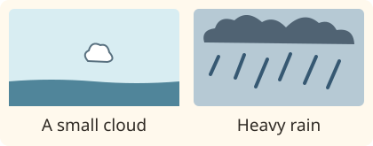

# Ezekiel 38 — Gog comes against Israel

**About this chapter**

Israel’s people have come home and live in peace. The LORD tells Ezekiel about a ruler named Gog who will come against them.

## A message for Gog

## Ezekiel 38:1

The LORD gave me a message.

## Ezekiel 38:2

He called me “son of man.”

He told me to speak against Gog from Magog.

Gog was the chief ruler of Meshech and Tubal.

## Ezekiel 38:3

The Lord GOD said, “Gog, chief ruler of Meshech and Tubal, I am against you.”

## Ezekiel 38:4

“I will turn you around and put hooks in your jaws.”

God pictured Gog as a creature he could pull along.

“I will bring you out with your whole army.

Your riders will come on horses, dressed in armor.

Your soldiers will carry large and small shields and raise their swords.”

## Ezekiel 38:5

Soldiers from Persia, Cush, and Put will come with Gog.

They will bring their shields and helmets.

## Ezekiel 38:6

Gomer and Beth-togarmah will send all their troops.

Beth-togarmah is in the far north.

People from many nations will join Gog.

## Ezekiel 38:7

God told Gog, “Get ready, you and everyone gathered around you.

You will guard them.”

## Ezekiel 38:8

“Much later, you will receive a call to go.

You will enter a land that has recovered from war.

The mountains of Israel stood empty for a long time.

Now the people have come home from many countries.

They live there in safety.”

## Ezekiel 38:9

Gog and his army will come like a thunderstorm.

So many will come that they will cover the land like a cloud.

## Gog wants to take what belongs to Israel

## Ezekiel 38:10

The Lord GOD told Gog, “That day a thought will come to you.

You will make an evil plan.”

## Ezekiel 38:11

“You will say, ‘I will go against those villages.

The people live quietly and feel safe.

They have no walls around their villages.

They have no gates with bars to lock them.’”

## Ezekiel 38:12

Gog will want to take what belongs to these people.

Their homes once stood empty. Now families live there again.

The people have gathered from many nations.

They own livestock and other things.

They live at the center of the land.

## Ezekiel 38:13

People in Sheba and Dedan will question Gog.

So will the traders of Tarshish and its villages.

“Have you gathered this crowd to rob people?

Have you come for silver, gold, cattle, and goods?

Do you mean to carry all that wealth away?”

## The LORD speaks about the day Gog comes

## Ezekiel 38:14

God told me to give Gog this message.

“When my people Israel live in safety, you will notice.”

## Ezekiel 38:15

“You will come from your home in the far north.

People from many nations will ride horses with you.

Together you will be a huge army.”

## Ezekiel 38:16

“You will come against my people like a cloud covering the land.

Gog, in days to come I will bring you against my land.

The nations will see how I deal with you.

I will show them that I am holy. They will know me.”

## Ezekiel 38:17

The Lord GOD asked Gog, “Are you the one I spoke about long ago?

For years my servants, the prophets of Israel, gave my message.

They said I would bring you against Israel.”

## Ezekiel 38:18

The Lord GOD said, “When Gog comes against Israel, my anger will burn.”

## Ezekiel 38:19

“In my fierce anger I tell you what will happen.

A great earthquake will shake Israel that day.”

## Ezekiel 38:20

“Fish, birds, wild animals, and creatures that crawl will tremble before me.

So will every person on earth.

Mountains will fall. Cliffs will break apart.

Every wall will fall to the ground.”

## Ezekiel 38:21

“On all my mountains I will call for swords against Gog.

His men will turn their swords against one another.”

## Ezekiel 38:22

“I will judge Gog with deadly sickness and bloodshed.

Heavy rain and hailstones will fall.

Fire and sulfur will rain down too.”

Sulfur is a substance that burns.

This judgment will reach Gog, his army, and the nations with him.

## Ezekiel 38:23

“I will show many nations how great and holy I am.

They will see what I do.

Then they will know that I am the LORD.”

**Think about it**

**What does Gog want to take from the people who have come home to Israel?**
