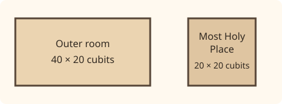

# Ezekiel 41 — The man measures the temple rooms

**About this chapter**

In his vision, Ezekiel follows a man into the temple. Ezekiel tells us the size of the rooms and describes the carvings on the walls and doors.

## Two holy rooms

## Ezekiel 41:1

The man brought me into the outer sanctuary.

This was the outer holy room of the temple.

He measured the pillars on either side.

Each was 6 cubits wide.

A cubit was a measure of length based on the forearm.

## Ezekiel 41:2

The doorway was 10 cubits wide.

On each side of it was a space of 5 cubits.

The outer room was 40 cubits long and 20 cubits wide.

## Ezekiel 41:3

The man went into the inner sanctuary.

The pillars at its entrance were 2 cubits wide.

The entrance was 6 cubits wide.

The wall on each side was 7 cubits wide.

## Ezekiel 41:4

Then the man measured the room beyond the entrance.

It was 20 cubits long and 20 cubits wide.

He told me, “This is the Most Holy Place.”

## Rooms around the temple

## Ezekiel 41:5

The temple wall was 6 cubits thick.

Side rooms ran around the temple.

Each was 4 cubits wide.

## Ezekiel 41:6

There were three levels with 30 rooms on each level.

Ledges stuck out from the temple wall.

The side rooms rested on these ledges.

Their supports did not have to go into the temple wall.

## Ezekiel 41:7

The temple wall got thinner as it rose.

So the side rooms got wider on each higher level.

Stairs led from the lowest level to the middle one.

From there the stairs continued to the top.

## Ezekiel 41:8

I saw a raised base around the temple.

It supported the side rooms.

It measured one full rod, or 6 long cubits.

A rod was a pole used for measuring.

## Ezekiel 41:9

The outside wall of the side rooms was 5 cubits thick.

Beyond the side rooms there was open space.

## Ezekiel 41:10

The distance from the side rooms to the outer rooms was 20 cubits.

This space ran all around the temple.

## Ezekiel 41:11

The side rooms had entrances facing the open area.

One entrance faced north. The other faced south.

An open strip 5 cubits wide ran all around.

## The building west of the temple

## Ezekiel 41:12

A building stood west of the temple courtyard, facing it.

The building was 70 cubits wide and 90 cubits long.

Its walls were 5 cubits thick all around.

## Ezekiel 41:13

The man measured the temple. It was 100 cubits long.

He also measured the courtyard and the building with its walls.

Together they measured 100 cubits in length.

## Ezekiel 41:14

He measured across the courtyard on the east side.

Including the temple front, the width was 100 cubits.

## Ezekiel 41:15

Behind the temple, the building facing the courtyard had galleries.

These were walkways along its sides.

With the galleries, the building measured 100 cubits long.

I also saw the two sanctuaries and the porches facing the courtyard.

## Wood panels and carvings

## Ezekiel 41:16

Wood covered the rooms, the porches, and the doorways.

It covered the sloping window edges and the three levels of galleries.

Wood panels reached from the floor to the windows.

The windows had coverings too.

## Ezekiel 41:17

I saw carvings above the entrance to the inner room.

The carvings were evenly spaced around both holy rooms.

## Ezekiel 41:18

The pattern showed a cherub, then a palm tree, then another cherub.

Cherubim are heavenly beings who serve God.

Each carved cherub had two faces.

## Ezekiel 41:19

A human face looked toward the palm tree on one side.

A young lion’s face looked toward the palm tree on the other.

The pattern continued all around the temple.

## Ezekiel 41:20

On the outer room’s walls, these carvings began at the floor.

The cherubim and palm trees reached above the entrance.

## A wooden altar and double doors

## Ezekiel 41:21

The outer room had a rectangular doorframe.

The other holy room had a similar frame.

## Ezekiel 41:22

I saw a wooden altar, 3 cubits high.

Its top was a square, 2 cubits on each side.

Its corners, base, and sides were wood.

The man told me, “This is the table before the LORD.”

## Ezekiel 41:23

Both the outer room and the inner room had double doors.

## Ezekiel 41:24

Each door had two panels that could swing.

There were two panels on one door and two on the other.

## Ezekiel 41:25

I saw cherubim and palm trees carved on the outer room’s doors.

They matched the carvings on the walls.

A wooden covering hung over the front of the porch.

## Ezekiel 41:26

The porch had windows with sloping edges in its side walls.

Palm trees decorated those walls.

The side rooms also had coverings over them.

**Think about it**

**Which room did the man call the Most Holy Place?**
