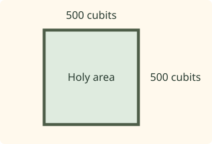

# Ezekiel 42 — Rooms for the priests and a wall around the holy area

**About this chapter**

In his vision, Ezekiel follows a man through the temple area.

The man shows him where the priests eat and change clothes.

Then he measures the wall around the whole area.

## Rooms on the north side

## Ezekiel 42:1

The man led me north into the outer courtyard.

He showed me rooms on the north side.

They stood opposite the temple courtyard and the outer wall.

## Ezekiel 42:2

The building had a door facing north.

It was 100 cubits long and 50 cubits wide.

A cubit was a measure of length.

## Ezekiel 42:3

On one side was a space of 20 cubits in the inner courtyard.

On the other was the paved part of the outer courtyard.

There were galleries on three levels.

These raised walkways faced each other.

## Ezekiel 42:4

An inner path ran in front of the rooms.

It was 10 cubits wide and 100 cubits long.

The doors of the rooms faced north.

## Ezekiel 42:5

The rooms at the top were smaller.

The raised walkways took up more room on that floor.

The rooms below had more space inside.

## Ezekiel 42:6

The rooms were on three floors.

The courtyards had pillars, but these rooms had none.

The top rooms stood farther back than the rooms below.

## Ezekiel 42:7

An outer wall ran in front of the rooms for 50 cubits.

It ran alongside the rooms and the outer courtyard.

## Ezekiel 42:8

The row of rooms by the outer courtyard was 50 cubits long.

The row facing the temple was 100 cubits long.

## Ezekiel 42:9

Below the rooms was an entrance on the east.

People coming from the outer courtyard could enter there.

## Rooms on the south side

## Ezekiel 42:10

The south side also had rooms along the outer courtyard wall.

They stood next to the courtyard, across from the building.

## Ezekiel 42:11

A path ran in front of them, as on the north side.

Both sets of rooms had the same length and width.

Their exits were alike too.

## Ezekiel 42:12

The rooms on this side had doors facing south.

There was also a door at the start of the path.

The path ran beside the wall that stretched east.

## Why the priests need these rooms

## Ezekiel 42:13

The man told me, “Look at the rooms facing the temple courtyard.

Both the north rooms and the south rooms are holy.

That means they are set apart for God.

Priests who come near the LORD eat the most holy offerings here.

They also put those gifts here because the rooms are holy.

These include grain offerings, sin offerings, and guilt offerings.”

Sin and guilt offerings were gifts people brought for wrongs they had done.

## Ezekiel 42:14

The man said, “The clothes priests wear to serve the LORD are holy.

The priests must leave those clothes inside the holy area.

Before going into the outer courtyard, they must change clothes.

Then they may go where the people gather.”

## The man measures all four sides

## Ezekiel 42:15

The man finished measuring inside the temple area.

He led me out through the east gate.

Then he measured all the way around the area.

## Ezekiel 42:16

With his measuring rod, he measured the east side.

It was 500 cubits long.

## Ezekiel 42:17

He measured the north side.

It was 500 cubits long too.

## Ezekiel 42:18

He measured the south side.

It also measured 500 cubits.

## Ezekiel 42:19

He went around to the west side and measured it.

That side was 500 cubits long.

## Ezekiel 42:20

Now he had measured all four sides.

The wall enclosed a square, 500 cubits long and 500 cubits wide.

It marked the boundary between the holy area and the land for everyday use.

**Pause and answer**

What did the priests do before leaving the holy area to join the people?
