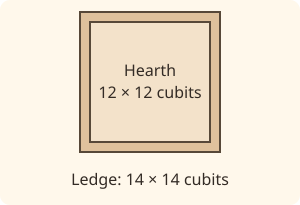

# Ezekiel 43 — The glory of the LORD returns to the temple

**About this chapter**

In his vision, Ezekiel sees the LORD’s glory enter the temple. He hears why the temple is holy and how the priests will prepare its altar.

## The LORD enters through the east gate

## Ezekiel 43:1

The man led me back to the gate facing east.

## Ezekiel 43:2

I saw the glory of Israel’s God coming from the east.

His voice sounded like the roar of rushing water.

His glory lit up the earth.

## Ezekiel 43:3

I remembered the vision of God coming to destroy Jerusalem.

I remembered the visions beside the Kebar River.

What I saw now was like those visions.

I fell with my face to the ground.

## Ezekiel 43:4

The glory of the LORD entered the temple through the east gate.

## Ezekiel 43:5

The Spirit lifted me and brought me into the inner courtyard.

The glory of the LORD filled the temple.

## Ezekiel 43:6

The man stood beside me.

I heard a voice from inside the temple.

## God will live among his people

## Ezekiel 43:7

God called me “son of man.”

“Here is my throne. Here is where I rest my feet.

I will live among the people of Israel forever.

My people and their kings must never again dishonor my holy name.

They were unfaithful to me, like someone who sells sex.

They also brought offerings for their dead kings.”

## Ezekiel 43:8

“They put their doorways right beside mine.

Only a wall stood between us.

The terrible things they did there dishonored my holy name.

In my anger I destroyed them.”

## Ezekiel 43:9

“Now they must put their unfaithfulness far from me.

They must remove the offerings for their dead kings.

I will live among them forever.”

## Ezekiel 43:10

“Describe the temple to the people of Israel.

Let them study its plan and its measurements.

Then they may feel ashamed of their sins.”

## Ezekiel 43:11

“If they are ashamed, show them the whole plan.

Show them how the rooms fit together.

Show them the entrances and the exits.

Teach them every rule for the temple.

Write it all down while they watch.

Then they can follow the plan and obey the rules.”

## Ezekiel 43:12

“This is the law of the temple.

All the land around it on the mountaintop is most holy.”

## The altar and its ledges

## Ezekiel 43:13

God gave me the measurements of the altar.

An altar is a place where people offer sacrifices to God.

The unit here is a long cubit.

That is an ordinary cubit plus the width of a hand.

A channel around the base is one cubit deep and one cubit wide.

Its rim measures one span, the width of a stretched hand.

## Ezekiel 43:14

From the channel to the lower ledge is 2 cubits.

That ledge is one cubit wide.

From the smaller ledge to the larger one is 4 cubits.

That ledge is also one cubit wide.

## Ezekiel 43:15

The hearth is the part where offerings burn.

It stands 4 cubits high.

Four points called horns rise from it.

## Ezekiel 43:16

The hearth is square.

It measures 12 cubits on each side.

## Ezekiel 43:17

The ledge is square too, with sides of 14 cubits.

Its rim measures half a cubit.

A channel one cubit wide runs around it.

The altar steps face east.

## Seven days to prepare the altar

## Ezekiel 43:18

The Lord GOD told me what to do when the altar was built.

The priests would use it to burn offerings and sprinkle blood.

## Ezekiel 43:19

“Give a young bull to the priests from Zadok’s family.

They belong to the tribe of Levi.

They come near me to serve me.

The bull is an offering for sin.”

## Ezekiel 43:20

“Put some of its blood on the four horns.

Put blood on all four corners of the ledge.

Put it all around the rim too.”

This would make atonement for the altar.

It would make the altar clean for worship.

## Ezekiel 43:21

“Take the bull to the place set aside for burning it.

That place is inside the temple grounds but outside the holy building.

Burn the bull there.”

## Ezekiel 43:22

“On the second day, bring a male goat without defects.

Offer it for sin.

Cleanse the altar as you did with the bull.”

## Ezekiel 43:23

“After cleansing the altar, bring a young bull and a ram.

A ram is a male sheep.

Both animals must be free from defects.”

## Ezekiel 43:24

“Present them to the LORD.

The priests will sprinkle salt on them.

Then they will burn them as an offering to the LORD.”

## Ezekiel 43:25

“Each day for seven days, provide a male goat as an offering for sin.

Also bring a young bull and a ram without defects.”

## Ezekiel 43:26

“For seven days the priests will make atonement for the altar.

They will cleanse it and set it apart for my service.”

## Ezekiel 43:27

“From the eighth day on, the priests will present your burnt offerings.

They will also bring your peace offerings to the altar.

Then I will accept you,” said the Lord GOD.

**Think about it**

**Which gate did the glory of the LORD enter?**
