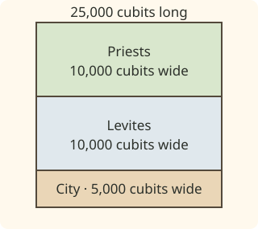

# Ezekiel 45 — Shares of land and fair measures

**About this chapter**

God tells Israel which land to set apart. He tells the rulers to stop taking land from the people. He also explains what the people and their prince must provide for worship.

## Land for the temple and the city

## Ezekiel 45:1

God said, “Draw lots to give each family its share of land.

Set apart one holy area for the LORD.”

It will be 25,000 cubits long and 20,000 cubits wide.

A cubit is a measure of length based on the forearm.

The whole area will be holy.

## Ezekiel 45:2

Inside it, mark out a square for the sanctuary, the holy place.

Each side will be 500 cubits long.

Leave a strip of open land 50 cubits wide around it.

## Ezekiel 45:3

Measure out part of the holy land.

Make it 25,000 cubits long and 10,000 cubits wide.

The sanctuary, the Most Holy Place, will be there.

## Ezekiel 45:4

This land is for the priests who come near the LORD to serve him.

Their houses will be there.

Within that land is the holy area for the sanctuary.

## Ezekiel 45:5

The Levites who serve in the temple will have the land beside it.

Their strip will also be 25,000 cubits long and 10,000 cubits wide.

Their towns will be there.

## Ezekiel 45:6

Beside the holy land, set apart land for the city.

It will be 25,000 cubits long and 5,000 cubits wide.

It belongs to all the people of Israel.

## Ezekiel 45:7

The prince will have land on both sides of these areas.

One part will reach west to the western border.

The other will reach east to the eastern border.

His land will run in the same direction as the tribal lands.

## Ezekiel 45:8

God said, “This will be the prince’s share in Israel.

My rulers must stop mistreating my people.

They must give the rest of the land to Israel’s tribes.”

## Rulers must be fair

## Ezekiel 45:9

The Lord GOD said, “Enough, rulers of Israel!

Stop using violence. Stop hurting my people.

Do what is fair and right.

Stop taking their land away.”

## Ezekiel 45:10

Use scales that weigh things honestly.

Use honest measures for grain and liquids too.

An ephah measures dry goods. A bath measures liquids.

## Ezekiel 45:11

An ephah and a bath must hold the same amount.

Measure both against a larger unit called a homer.

Ten ephahs fill a homer. Ten baths also fill a homer.

## Ezekiel 45:12

Use these weights too. Twenty gerahs weigh one shekel.

Add 20 shekels, 25 shekels, and 15 shekels.

Together those 60 shekels weigh one mina.

## Gifts from the people and the prince

## Ezekiel 45:13

For every homer of wheat, give one sixth of an ephah.

Give the same share for every homer of barley.

## Ezekiel 45:14

For each cor of oil, give one tenth of a bath.

A cor holds 10 baths.

That is the same amount as a homer.

## Ezekiel 45:15

Give one sheep for every 200 sheep in Israel’s well-watered pastures.

These gifts are for grain offerings, burnt offerings, and peace offerings.

The offerings make atonement for the people.

That means they deal with the sins that come between people and God.

## Ezekiel 45:16

Everyone in the land must give their share to the prince of Israel.

## Ezekiel 45:17

The prince must provide burnt offerings, grain offerings, and drink offerings.

He must do this for the weekly Sabbath rest days, the start of each new month, and all Israel’s feasts.

He must also provide the sin offerings and peace offerings.

These offerings make atonement for Israel.

## Offerings for the temple and the feasts

## Ezekiel 45:18

The Lord GOD said, “On day one of the first month, take a young bull.

It must have no defects. Use it to cleanse the sanctuary.”

## Ezekiel 45:19

The priest must take some blood from this sin offering.

He must put it on the temple doorposts.

He must put it on the four corners of the altar ledge.

He must also put it on the inner courtyard’s gateposts.

## Ezekiel 45:20

Repeat this on day seven of the month.

Do it for anyone who did wrong by mistake or without knowing.

In this way you make atonement for the temple.

## Ezekiel 45:21

Celebrate Passover on day 14 of the first month.

During the seven days of the feast, eat bread made without yeast.

## Ezekiel 45:22

That day the prince must provide a bull as a sin offering.

It is for himself and everyone in the land.

## Ezekiel 45:23

On each of the seven days, the prince must provide seven bulls and seven rams.

These animals must have no defects.

They are burnt offerings to the LORD.

Each day he must also provide a male goat as a sin offering.

## Ezekiel 45:24

With each bull, the prince must give one ephah of grain.

He must give another ephah with each ram.

For every ephah of grain, give one hin of olive oil.

A hin is a measure for liquids.

## Ezekiel 45:25

Another feast begins on day 15 of the seventh month.

It also lasts seven days.

The prince must provide the same sin offerings and burnt offerings.

He must provide the same grain offerings and oil.

**Think about it**

**Who shares the land set apart for the city?**
