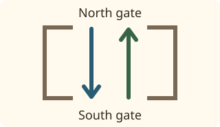

# Ezekiel 46 — The people come to worship

**About this chapter**

God tells Ezekiel when to open the east gate of the inner courtyard. He explains how the prince and the people will worship. Then Ezekiel sees the temple kitchens.

## The east gate of the inner courtyard

## Ezekiel 46:1

The Lord GOD said, “Keep the inner courtyard’s east gate shut on the six workdays.

Open it on the Sabbath, the weekly day of rest.

Open it at the new moon, when a new month begins.”

## Ezekiel 46:2

The prince must come from outside through the porch of the gateway.

He must stand by the gatepost.

The priests will offer his burnt offerings and peace offerings.

The prince must bow at the doorway and leave.

The gate must stay open until evening.

## Ezekiel 46:3

On Sabbaths and new moons the people will worship there too.

They will bow before the LORD at the entrance.

## Ezekiel 46:4

Every Sabbath the prince must bring six male lambs and one ram.

A ram is an adult male sheep.

All seven animals must be free from defects.

They are burnt offerings to the LORD.

## Ezekiel 46:5

With the ram, give one ephah of grain.

An ephah is a measure for grain.

With the lambs, the prince may give as much grain as he can.

For each ephah, add one hin of oil.

A hin is a measure for liquids.

## Ezekiel 46:6

At the new moon, the prince must bring a young bull without defects.

He must also bring six lambs and a ram without defects.

## Ezekiel 46:7

Give one ephah of grain with the bull and one with the ram.

With the lambs, give as much grain as the prince can provide.

Again, give one hin of oil for each ephah of grain.

## How people enter and leave at the feasts

## Ezekiel 46:8

The prince must enter through the porch of the gateway.

He must leave by the same porch.

## Ezekiel 46:9

At the appointed feasts, people come before the LORD to worship.

Those who enter the north gate must leave through the south gate.

Those who enter the south gate must leave through the north gate.

Each person leaves through the opposite gate.

## Ezekiel 46:10

The prince must go in when the people go in.

He must leave when they leave.

## Ezekiel 46:11

At the feasts, offer one ephah of grain for each bull.

Offer one ephah for each ram.

With the lambs, give as much grain as you can.

Add one hin of oil for each ephah of grain.

## Ezekiel 46:12

The prince may also choose to bring an extra offering.

It may be a burnt offering or a peace offering.

Open the east gate for him.

He will bring the offering as he does on the Sabbath.

This time, close the gate when he leaves.

## An offering every morning

## Ezekiel 46:13

Every morning bring the LORD a year-old lamb without defects.

It is a daily burnt offering.

## Ezekiel 46:14

Bring one sixth of an ephah of fine flour with it.

Moisten the flour with one third of a hin of oil.

This is the grain offering to the LORD.

This rule will always apply.

## Ezekiel 46:15

Every morning, provide the lamb, the grain, and the oil.

This is the regular morning offering.

## The prince must respect each family’s land

## Ezekiel 46:16

The Lord GOD said, “Suppose the prince gives some land to a son.

It will belong to that son and his descendants.”

This is an inheritance, property a family passes down.

## Ezekiel 46:17

Suppose the prince gives some family land to a servant.

The servant may keep it until the year of freedom.

That is when the land goes back to the prince.

Only his sons may inherit it for good.

## Ezekiel 46:18

“The prince must never force my people off their land.

He must give his sons land from his own property.

None of my people should lose their home because of him.”

## Places for cooking the offerings

## Ezekiel 46:19

The man led me through an entrance beside the gate.

We came into the priests’ holy rooms, which faced north.

He showed me a place at the far western end.

## Ezekiel 46:20

“Here the priests will boil the guilt offerings and sin offerings.

Here they will bake the grain offerings.”

The priests must keep these holy offerings out of the outer courtyard.

Then the people there will not touch them and share their holiness.

## Ezekiel 46:21

The man took me to the outer courtyard.

He led me around its four corners.

In each corner I saw a separate courtyard.

## Ezekiel 46:22

Walls enclosed the four smaller courtyards.

Each was 40 cubits long and 30 cubits wide.

A cubit was a measure of length based on the forearm.

## Ezekiel 46:23

Stonework lined the inside walls of each small courtyard.

At the foot of the walls were ovens on every side.

## Ezekiel 46:24

The man told me, “These are the kitchens for the temple workers.

Here they will cook the sacrifices the people bring.”

**Think about it**

**At a feast, which gate should someone use to leave after coming in through the north gate?**
