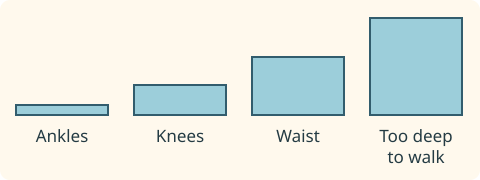

# Ezekiel 47 — A river flows from the temple

**About this chapter**

Ezekiel follows water flowing from the temple. He sees what the water does for trees and fish. Then the LORD describes the land the people will share.

## Water from under the doorway

## Ezekiel 47:1

The man brought me back to the temple entrance.

The temple faced east. Water flowed east from under its doorway.

It came from under the temple’s south side.

It passed south of the altar.

## Ezekiel 47:2

The man led me out through the north gate.

We went around the outside to the east gate.

There I saw water trickling out on the south side.

## Ezekiel 47:3

The man walked east with a measuring line.

He measured 1,000 cubits. A cubit was a measure of length.

He led me through the water. It reached my ankles.

## Ezekiel 47:4

He measured another 1,000 cubits and led me through again.

The water reached my knees.

He measured another 1,000 cubits.

This time the water reached my waist.

## Ezekiel 47:5

He measured another 1,000 cubits.

Now the stream was a river, deep enough to swim in.

I could no longer walk across it.

## Ezekiel 47:6

The man asked me, “Son of man, do you see this?”

Then he led me back to the riverbank.

## The river brings life

## Ezekiel 47:7

When I got there, I saw many trees.

They grew on both sides of the river.

## Ezekiel 47:8

The man said, “This water flows east.

It goes down into the valley called the Arabah.

Then it flows into the Dead Sea.

It makes the salty water there fresh.”

## Ezekiel 47:9

“Many living creatures will thrive wherever the river flows.

There will be many fish because the water becomes fresh.

Wherever the river goes, it brings life.”

## Ezekiel 47:10

“Fishers will stand along the shore.

From En-gedi to En-eglaim they will spread their nets.

They will catch many kinds of fish.

There will be as many kinds as in the Great Sea.”

## Ezekiel 47:11

“The marshes and swamps will stay salty.

They will be places to get salt.”

## Ezekiel 47:12

“All kinds of fruit trees will grow on both riverbanks.

Their leaves will stay green. They will bear fruit every month.

Water from the sanctuary, God’s holy place, flows to them.

Their fruit will feed people. Their leaves will bring healing.”

## The borders of the land

## Ezekiel 47:13

The Lord GOD told Israel, “Here are the borders of your land.

Divide the land among the twelve tribes of Israel.

Give Joseph’s family two shares.”

## Ezekiel 47:14

“Make the shares equal. I raised my hand and made a promise.

I promised this land to your ancestors.

Now it will be yours to pass on to your families.”

## Ezekiel 47:15

The northern border starts at the Great Sea, the Mediterranean.

It follows the way to Hethlon.

It goes through Lebo-hamath to Zedad.

## Ezekiel 47:16

It continues to Berothah and Sibraim.

Sibraim lies between Damascus and Hamath.

The border reaches Hazer-hatticon, on the edge of Hauran.

## Ezekiel 47:17

So the northern border runs from the sea to Hazar-enan.

It follows the northern edge of Damascus.

The land of Hamath lies to the north.

## Ezekiel 47:18

The eastern border runs between Hauran and Damascus.

It follows the Jordan River between Gilead and Israel.

It reaches the Eastern Sea, also called the Dead Sea.

It extends as far as Tamar.

## Ezekiel 47:19

The southern border runs from Tamar to the waters of Meribath-kadesh.

Then it follows the Brook of Egypt to the Great Sea.

## Ezekiel 47:20

The Great Sea forms the western border.

It runs north to a point opposite Lebo-hamath.

## A share for families from other lands

## Ezekiel 47:21

God said, “Divide this land among the tribes of Israel.”

## Ezekiel 47:22

“Give shares to your families.

Give shares also to foreigners living among you who have children.

Treat them like people born in Israel.

Their families will receive land alongside yours.”

## Ezekiel 47:23

“Give each foreign family land in the tribe where they live.”

This was the word of the Lord GOD.

**Think about it**

**What happens to the salty water when the river reaches the Dead Sea?**
