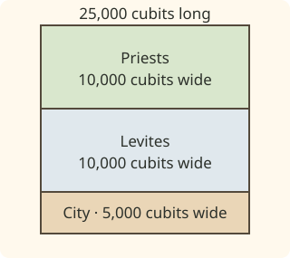

# Ezekiel 48 — The tribes receive land and the city receives a name

**About this chapter**

The LORD names the tribes in order from north to south. He sets land aside for the temple and the city. At the end, he tells Ezekiel what people will call the city.

## Seven tribes north of the temple land

## Ezekiel 48:1

Dan will receive the northernmost strip of land.

Its border follows the road from Hethlon to Lebo-hamath.

It continues to Hazar-enan on the border of Damascus.

Hamath lies to the north.

Dan’s strip reaches from the eastern border to the western border.

## Ezekiel 48:2

Asher’s strip will be beside Dan’s.

It will run from east to west.

## Ezekiel 48:3

Naphtali’s strip will be beside Asher’s.

It will run from east to west.

## Ezekiel 48:4

Manasseh’s strip will be beside Naphtali’s.

It will run from east to west.

## Ezekiel 48:5

Ephraim’s strip will be beside Manasseh’s.

It will run from east to west.

## Ezekiel 48:6

Reuben’s strip will be beside Ephraim’s.

It will run from east to west.

## Ezekiel 48:7

Judah’s strip will be beside Reuben’s.

It too will run from east to west.

## Land set apart for the LORD

## Ezekiel 48:8

Beside Judah, set apart another strip of land.

From east to west it will be as long as a tribe’s strip.

It will be 25,000 cubits wide.

A cubit was a measure of length based on the forearm.

The sanctuary, the LORD’s holy place, will be in the center.

## Ezekiel 48:9

Within this strip, set apart a special portion for the LORD.

It will be 25,000 cubits long and 10,000 cubits wide.

## Ezekiel 48:10

This holy portion is for the priests.

Its north and south sides will each measure 25,000 cubits.

Its east and west sides will each measure 10,000 cubits.

The LORD’s sanctuary will stand in the center.

## Ezekiel 48:11

These priests come from Zadok’s family.

God set them apart to serve him.

Other Levites turned away when Israel turned away from God.

Zadok’s family kept doing the work God gave them.

## Ezekiel 48:12

Their land will be a most holy portion.

It will lie beside the land of the Levites.

## Ezekiel 48:13

The Levites’ own strip will run alongside the priests’ strip.

It too will measure 25,000 cubits long and 10,000 cubits wide.

## Ezekiel 48:14

The Levites must never sell, trade, or give away this land.

This best part of the land belongs to the LORD.

It is holy.

## Land for the city and the prince

## Ezekiel 48:15

The remaining strip will be for the city’s everyday use.

It will be 5,000 cubits wide and 25,000 cubits long.

It will have houses and land for grazing animals.

The city itself will be in the middle.

## Ezekiel 48:16

The city will be square.

Each side will measure 4,500 cubits.

## Ezekiel 48:17

Grazing land will extend beyond the city on all four sides.

It will reach 250 cubits in each direction.

## Ezekiel 48:18

Farmland will lie on either side of the city’s grazing land.

It will run alongside the holy land.

It will extend 10,000 cubits east and 10,000 cubits west.

Its crops will feed the city workers.

## Ezekiel 48:19

People from every tribe of Israel will work this land.

## Ezekiel 48:20

Set apart the holy land together with the city’s land.

Together these three strips will form a square.

Each side of the square will measure 25,000 cubits.

## Ezekiel 48:21

The prince will have land on both sides of this square.

His eastern land will reach from the square to Israel’s eastern border.

His western land will reach to Israel’s western border.

The holy land and the temple will lie between his two shares.

## Ezekiel 48:22

The Levites’ land and the city’s land will also lie between his two shares.

This whole strip lies between Judah and Benjamin.

## Five tribes south of the temple land

## Ezekiel 48:23

Benjamin will receive a strip from east to west.

## Ezekiel 48:24

Simeon’s strip will be beside Benjamin’s.

It will run from east to west.

## Ezekiel 48:25

Issachar’s strip will be beside Simeon’s.

It will run from east to west.

## Ezekiel 48:26

Zebulun’s strip will be beside Issachar’s.

It will run from east to west.

## Ezekiel 48:27

Gad’s strip will be beside Zebulun’s.

It too will run from east to west.

## Ezekiel 48:28

Gad’s southern border will start at Tamar.

It will reach the waters of Meribath-kadesh.

Then it will follow the Brook of Egypt to the Great Sea.

## Ezekiel 48:29

The Lord GOD said, “Give the tribes of Israel these shares.

This is the land their families will inherit.”

## Twelve gates and a name for the city

## Ezekiel 48:30

The LORD described the ways out of the city.

He began with the north side, 4,500 cubits long.

## Ezekiel 48:31

Each gate will have the name of a tribe of Israel.

The three north gates will bear the names Reuben, Judah, and Levi.

## Ezekiel 48:32

The east side will be 4,500 cubits long.

Its three gates will bear the names Joseph, Benjamin, and Dan.

## Ezekiel 48:33

The south side will be 4,500 cubits long.

Its three gates will bear the names Simeon, Issachar, and Zebulun.

## Ezekiel 48:34

The west side will be 4,500 cubits long.

Its three gates will bear the names Gad, Asher, and Naphtali.

## Ezekiel 48:35

The distance all the way around the city will be 18,000 cubits.

From that day on, the city will have this name.

“The LORD Is There.”

**Think about it**

**What name did the LORD give the city?**
