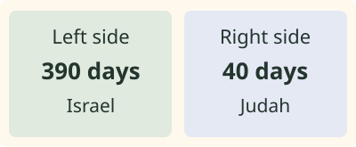

# Ezekiel 4 — Ezekiel shows what will happen to Jerusalem

**About this chapter**

God asks Ezekiel to act out a message for Israel.

A drawing on a brick stands for Jerusalem.

Small portions of bread and water show what the people will face.

## A picture of a city under siege

## Ezekiel 4:1

God said to me, “Son of man, take a brick.

Set it in front of you.

Draw the city of Jerusalem on it.

## Ezekiel 4:2

“Show what a siege of Jerusalem would look like.”

A siege happens when an army surrounds a city.

God told me to show the army’s wall, ramp, and camps.

All around the model city were to be battering rams.

These were heavy objects armies used to strike city walls or gates.

## Ezekiel 4:3

God said, “Stand an iron plate between you and the city.

It will be like an iron wall.

Face the city and act as the army surrounding it.

This will be a sign for the people of Israel.”

## A day for each year

## Ezekiel 4:4

God said, “Lie on your left side.

Take on yourself the guilt of Israel’s people.

Carry their guilt for as many days as you lie there.

## Ezekiel 4:5

“I have set the time at 390 days.

Each day stands for a year of Israel’s wrongdoing.

That is how you will carry Israel’s guilt.

## Ezekiel 4:6

“After those days, lie on your right side.

This time carry the guilt of Judah’s people.

I have set the time at 40 days.

Again, each day stands for one year.

## Ezekiel 4:7

“Face your picture of Jerusalem under siege.

Uncover your arm and speak my message against the city.

## Ezekiel 4:8

“I will tie you with ropes.

You will be unable to turn from side to side.

You must finish the days set for the siege.”

## A small share of bread and water

## Ezekiel 4:9

God said, “Gather wheat, barley, beans, lentils, millet, and spelt.

Put them all in one container.

Use the mixture to make your bread.

Eat it during the 390 days you lie on your side.

## Ezekiel 4:10

“Weigh your food each day.

Your share is twenty shekels.”

A shekel was a measure of weight.

God told me to eat at set times.

## Ezekiel 4:11

I also had to measure my drinking water.

God allowed me one sixth of a hin of water.

A hin was a measure for liquids.

I had to drink at set times too.

## Ezekiel 4:12

God told me to eat the bread like a barley cake.

He said, “Let the people see you bake it.

Use dried human waste as fuel for the fire.”

## Ezekiel 4:13

The LORD explained, “I will send the Israelites away to other nations.

There they will eat bread that is unclean under my law.”

## Ezekiel 4:14

I answered, “Oh, Lord GOD!

I have kept myself clean under your law since I was young.

I have never eaten an animal I found dead.

I have never eaten one torn by wild animals.

I have never eaten unclean meat.”

## Ezekiel 4:15

God answered, “You may use dried cow dung for the fire instead.

You may bake your bread over that.”

## What the measured food means

## Ezekiel 4:16

God said, “Son of man, I will cut off Jerusalem’s food supply.

The people will weigh out small shares of bread.

They will eat in fear.

They will measure out their water and drink without hope.

## Ezekiel 4:17

“They will run short of food and water.

They will watch each other grow thinner and weaker.

What they see will fill them with horror.

This will happen because of their sins.”

**Pause and answer**

What did each day on Ezekiel’s side stand for?
