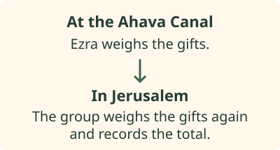

# Ezra 8 — Ezra and the families bring the gifts to Jerusalem

**About this chapter**

Ezra names the families traveling with him. Before leaving, they pray for a safe journey. They weigh the gifts for the temple before they leave and again when they arrive.

## Ezra names the families who came with him

## Ezra 8:1

These family leaders returned from Babylon with me while Artaxerxes was king.

Here is the record of their families.

**Reading help**

Ezra is telling the story. When he says “I,” he means himself.

## Ezra 8:2

Gershom came from the family of Phinehas.

Daniel came from the family of Ithamar.

Hattush came from the family of David.

## Ezra 8:3

Hattush belonged to the family line of Shecaniah.

Zechariah came from the family of Parosh.

The list named 150 men with Zechariah.

## Ezra 8:4

From Pahath-Moab’s family came Eliehoenai, son of Zerahiah.

With him came 200 men.

## More families join the journey

## Ezra 8:5

From Zattu’s family came Shecaniah, son of Jahaziel.

With him came 300 men.

## Ezra 8:6

From Adin’s family came Ebed, son of Jonathan.

With him came 50 men.

## Ezra 8:7

From Elam’s family came Jeshaiah, son of Athaliah.

With him came 70 men.

## Ezra 8:8

From Shephatiah’s family came Zebadiah, son of Michael.

With him came 80 men.

## Ezra 8:9

From Joab’s family came Obadiah, son of Jehiel.

With him came 218 men.

## The last families on the list

## Ezra 8:10

From Bani’s family came Shelomith, son of Josiphiah.

With him came 160 men.

## Ezra 8:11

From Bebai’s family came Zechariah, son of Bebai.

With him came 28 men.

## Ezra 8:12

From Azgad’s family came Johanan, son of Hakkatan.

With him came 110 men.

## Ezra 8:13

From the later members of Adonikam’s family came Eliphelet, Jeiel, and Shemaiah.

With them came 60 men.

## Ezra 8:14

From Bigvai’s family came Uthai and Zaccur.

With them came 70 men.

## Ezra looks for Levites

## Ezra 8:15

I gathered the people at the canal flowing to Ahava.

We camped there for three days.

I checked who had come. I found people and priests, but no Levites.

## Ezra 8:16

I called for the leaders Eliezer, Ariel, Shemaiah, Elnathan, and Jarib.

I also called for another Elnathan, Nathan, Zechariah, and Meshullam.

Two teachers came too. Their names were Joiarib and Elnathan.

## Ezra 8:17

I sent them to Iddo, the leader at Casiphia.

They spoke to Iddo and his relatives, the temple servants there.

I asked them to send us people to serve in God’s house.

## Helpers come from Casiphia

## Ezra 8:18

God was kind to us and helped us.

They brought Sherebiah, a man with good judgment.

His family went back to Mahli, son of Levi and grandson of Israel.

Sherebiah came with his sons and brothers, 18 men.

## Ezra 8:19

Hashabiah came too, along with Jeshaiah from Merari’s family.

With their brothers and sons, the group numbered 20 men.

## Ezra 8:20

They also brought 220 temple servants. Each one was on the list by name.

David and his officials had given temple servants the work of helping the Levites.

**Pause and answer**

Who came to help the Levites?

## The families pray before leaving

## Ezra 8:21

Beside the Ahava Canal I asked everyone to fast.

We wanted to humble ourselves before God.

We asked God to keep us, our children, and our belongings safe on the journey.

## Ezra 8:22

I felt ashamed to ask the king for soldiers and riders to protect us on the road.

We had told him, “Our God takes care of everyone who seeks him.

He is very angry with those who turn away from him.”

## Ezra 8:23

So we went without food and asked God for help.

God answered our prayer.

**Reading help**

To fast means to go without food for a time. Here the families fasted while they asked God for help.

**Pause and answer**

What did the families ask God to do?

## Ezra weighs the temple gifts

## Ezra 8:24

I chose twelve of the leading priests.

I also chose Sherebiah, Hashabiah, and ten of their brothers.

## Ezra 8:25

I weighed out the silver, gold, and other gifts and gave them to these men.

The king, his advisers, his officials, and the Israelites there had given these gifts for God’s house.

## Ezra 8:26

I handed over 650 talents of silver.

The silver objects weighed another 100 talents.

The gold weighed 100 talents.

## Ezra 8:27

I also gave them 20 gold bowls worth 1,000 darics in all.

Two objects of fine polished bronze were as precious as gold.

**Reading help**

A talent was a large unit of weight. A daric was a gold coin. Ezra gives the weight of the silver and the value of the bowls.

## The priests and Levites take charge

## Ezra 8:28

I told them, “You belong to the LORD. These objects belong to him too.

People freely gave the silver and gold to the LORD, the God of your ancestors.

## Ezra 8:29

Guard the gifts carefully until you reach the LORD’s temple in Jerusalem.

Weigh them in the temple rooms in front of the leading priests, the Levites, and the family leaders.”

## Ezra 8:30

The priests and Levites took charge of the gifts I had weighed.

They would carry them to God’s temple in Jerusalem.

## The families arrive in Jerusalem

## Ezra 8:31

We left the Ahava Canal on the twelfth day of the first month.

We set out for Jerusalem. God protected us from enemies and robbers along the way.

## Ezra 8:32

We reached Jerusalem and rested for three days.

## Ezra 8:33

On the fourth day we weighed the gifts in God’s house.

We handed them to the priest Meremoth, son of Uriah.

Eleazar, son of Phinehas, was with him.

Two Levites were also there, Jozabad son of Jeshua and Noadiah son of Binnui.

## Ezra 8:34

We checked the number and weight of every item.

We wrote down the total weight that day.

**Pause and answer**

What did the group write down after checking the gifts?

## The people give thanks with offerings

## Ezra 8:35

The people who had returned from exile gave burnt offerings to Israel’s God.

They gave 12 bulls for all Israel, 96 rams, and 77 lambs.

They gave 12 male goats as a sin offering.

They offered all these animals to the LORD.

## Ezra 8:36

They delivered the king’s written orders to his chief officials and governors west of the Euphrates River.

Those officials then helped the people and supported the work of God’s house.
