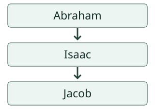

# Galatians 4 — God welcomes us as his children

**About this chapter**

Paul describes a child waiting to receive an inheritance.

Later he uses two mothers in Abraham’s family to explain freedom.

## A child who will inherit everything

## Galatians 4:1

Think about a child who owns a whole estate.

While still a child, that owner has no more say than a slave.

## Galatians 4:2

Others care for the child and manage the property.

They do this until the day the father has set.

## Galatians 4:3

It was like that for us when we were children.

The basic rules of this world held us like slaves.

## Galatians 4:4

Then the time God had set arrived.

God sent his Son.

A woman gave birth to him, and he lived under the law.

## Galatians 4:5

God sent him to free those under the law.

God wanted to adopt us as his children.

## Galatians 4:6

Because you are his children, God sent his Son’s Spirit into our hearts.

The Spirit calls out, “Abba, Father!”

**Help with these words**

Abba is a word for father.

## Galatians 4:7

So you have gone from being a slave to being God’s child.

As his child, you will receive what God has for his family.

**Pause and answer**

Whom did God send into the hearts of his children?

## Why go back?

## Galatians 4:8

Before you knew God, you served things that were never really gods.

You were like slaves to them.

## Galatians 4:9

Now you know God.

Better still, God knows you.

Why go back to weak rules that cannot help you?

Do you want to be slaves to them again?

## Galatians 4:10

You are keeping special days, months, seasons, and years.

## Galatians 4:11

I am worried about you.

Has all my work among you been for nothing?

**Pause and answer**

What does Paul fear the believers will go back to?

## Remember how you welcomed Paul

## Galatians 4:12

Brothers and sisters, please become like me, as I became like you.

You have done me no wrong.

## Galatians 4:13

You remember why I first told you the good news.

I was ill at the time.

## Galatians 4:14

My illness made things hard for you.

Yet you welcomed me instead of turning me away.

You welcomed me like an angel from God, like Christ Jesus himself.

## Galatians 4:15

Where is the joy you had then?

I saw how much you wanted to help.

If you could, you would have given me your own eyes.

## Galatians 4:16

Have I become your enemy because I tell you the truth?

**Pause and answer**

How did the Galatians treat Paul when he was ill?

## Why Paul longs to see them

## Galatians 4:17

Those people are eager to win you over.

Their purpose is harmful.

They want to cut you off from us so you will seek them out.

## Galatians 4:18

It is good to care deeply about a good cause.

That is true even when I am far away.

## Galatians 4:19

My dear children, once again I feel like a mother giving birth.

I feel this pain until Christ takes shape in your lives.

**Help with these words**

Paul calls them his children because he loves and cares for them.

He longs to see them grow more like Christ.

## Galatians 4:20

I wish I could be there now and speak differently.

I do not know what to make of what is happening to you.

**Pause and answer**

Why do the other teachers want the Galatians to lose touch with Paul?

## Two mothers in Abraham’s family

## Galatians 4:21

Some of you want to live under the law.

Do you hear what the law itself says?

## Galatians 4:22

Scripture tells about two sons of Abraham.

One mother was a slave.

The other mother was free.

## Galatians 4:23

The enslaved woman’s son was born in the ordinary way.

The free woman had her son because God kept his promise.

## Galatians 4:24

I use these women as a picture of two covenants.

Hagar stands for the covenant God made at Mount Sinai.

In this picture, her children are born into slavery.

**Help with these words**

A covenant is a lasting agreement.

Hagar was the enslaved woman.

Sarah was the free woman and the mother of Isaac.

## Galatians 4:25

Hagar stands for Mount Sinai in Arabia.

She also stands for the Jerusalem of our time.

In this picture, the city and her children live in slavery.

## Galatians 4:26

But the Jerusalem in heaven is free.

She is our mother.

## Galatians 4:27

Scripture tells a woman who has never given birth to sing for joy.

It tells her to cry out with happiness.

The deserted woman will have more children than the woman with a husband.

**Pause and answer**

In Paul’s picture, which Jerusalem is free?

## Children of the promise

## Galatians 4:28

Brothers and sisters, you are children of God’s promise, like Isaac.

## Galatians 4:29

The son born in the ordinary way mistreated the son born through the Spirit.

We see the same thing happening now.

## Galatians 4:30

What does Scripture say happened in Abraham’s family?

It says to send the enslaved woman and her son away.

Her son would not share the inheritance with the free woman’s son.

## Galatians 4:31

Brothers and sisters, we are children of the free woman.

We do not belong to the enslaved woman’s family.

**Pause and answer**

Which son does Paul compare the believers to?
