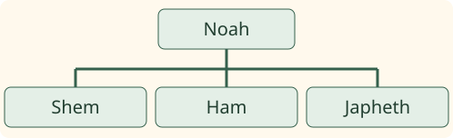

# Genesis 10 — The families of Noah’s three sons

**About this chapter**

Follow one family at a time.

Some names belong to people. Others name whole peoples who came from those families.

## Japheth’s family and the peoples by the sea

## Genesis 10:1

Noah’s sons were Shem, Ham and Japheth.

After the flood they had sons of their own.

Here is their family record.

The record follows each son’s family after the flood.

## Genesis 10:2

Japheth’s sons were Gomer, Magog, Madai, Javan, Tubal, Meshech and Tiras.

## Genesis 10:3

Gomer’s sons were Ashkenaz, Riphath and Togarmah.

## Genesis 10:4

From Javan came Elishah, Tarshish, the Kittites and the Rodanites.

## Genesis 10:5

From these families came the peoples who lived by the sea.

They settled in their own lands.

They formed nations with their own family groups and languages.

**Pause and answer**

Which son of Noah was Javan’s father?

## Ham’s family and Nimrod’s cities

## Genesis 10:6

Ham’s sons were Cush, Mizraim, Put and Canaan.

## Genesis 10:7

Cush’s sons were Seba, Havilah, Sabtah, Raamah and Sabteca.

Raamah’s sons were Sheba and Dedan.

## Genesis 10:8

Cush was also the father of Nimrod.

Nimrod became a powerful man on earth.

## Genesis 10:9

Nimrod was a great hunter before the LORD.

People even had a saying about him.

“Like Nimrod, a great hunter before the LORD.”

## Genesis 10:10

Nimrod’s kingdom began in the land of Shinar.

There he ruled Babylon, Erech, Accad and Calneh.

## Genesis 10:11

From Shinar, Nimrod went to Assyria.

There he built Nineveh, Rehoboth-Ir and Calah.

## Genesis 10:12

Nimrod also built Resen.

It stood between Nineveh and the great city of Calah.

**Pause and answer**

What was Nimrod well known for?

## The families of Mizraim and Canaan

## Genesis 10:13

Several peoples came from Mizraim’s family.

They included the Ludites, Anamites, Lehabites and Naphtuhites.

## Genesis 10:14

The Pathrusites, Casluhites and Caphtorites also came from Mizraim.

The Philistines came from the Casluhites.

## Genesis 10:15

Canaan’s first son was Sidon.

The Hittites also came from Canaan.

## Genesis 10:16

The Jebusites, Amorites and Girgashites came from Canaan.

## Genesis 10:17

So did the Hivites, Arkites and Sinites.

## Genesis 10:18

The Arvadites, Zemarites and Hamathites also came from Canaan.

Later these Canaanite families spread out.

## Genesis 10:19

Canaan’s border ran from Sidon toward Gerar, as far as Gaza.

It ran toward Sodom, Gomorrah, Admah and Zeboiim, as far as Lasha.

## Genesis 10:20

These were the families of Ham.

They had their own languages, lands and nations.

**Pause and answer**

From which family did the Philistines come?

## Shem’s family and Eber’s sons

## Genesis 10:21

Shem was Japheth’s older brother.

Shem also had sons.

Everyone in Eber’s family came from Shem’s line.

## Genesis 10:22

Shem’s sons were Elam, Asshur, Arphaxad, Lud and Aram.

## Genesis 10:23

Aram’s sons were Uz, Hul, Gether and Mash.

## Genesis 10:24

Arphaxad was Shelah’s father.

Shelah was Eber’s father.

## Genesis 10:25

Eber had two sons.

One was named Peleg because the earth was divided during his lifetime.

His brother’s name was Joktan.

**Follow one family line**

| Father | Sons named here |
| --- | --- |
| Shem | Arphaxad |
| Arphaxad | Shelah |
| Shelah | Eber |
| Eber | Peleg and Joktan |

**Pause and answer**

What was the name of Peleg’s brother?

## Joktan’s family in the eastern hills

## Genesis 10:26

Joktan’s sons included Almodad, Sheleph, Hazarmaveth and Jerah.

## Genesis 10:27

Hadoram, Uzal and Diklah were also Joktan’s sons.

## Genesis 10:28

So were Obal, Abimael and Sheba.

## Genesis 10:29

Ophir, Havilah and Jobab were his sons too.

All these men were sons of Joktan.

## Genesis 10:30

Their land stretched from Mesha to Sephar in the eastern hills.

## Genesis 10:31

These were the families of Shem.

They had their own languages, lands and nations.

## Genesis 10:32

These family lines show the nations that came from Noah’s sons.

After the flood, these nations spread across the earth.

**Pause and answer**

Where did Joktan’s family live?
