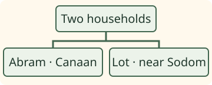

# Genesis 13 — Abram lets Lot choose land

**About this chapter**

Abram and Lot have more animals than the land can feed.

Abram asks Lot to choose where to live.

## Abram returns to his old campsite

## Genesis 13:1

Abram left Egypt and went up to the Negev.

His wife and Lot went with him.

Abram took everything he owned.

## Genesis 13:2

Abram was very rich.

He owned many animals and much silver and gold.

## Genesis 13:3

Abram traveled from place to place toward Bethel.

He reached his old campsite between Bethel and Ai.

## Genesis 13:4

Abram had built an altar there before.

There he called on the LORD.

**Pause and answer**

What did Abram do at his old altar?

## Two families need room

## Genesis 13:5

Lot traveled with Abram.

Lot also had flocks, herds and tents.

## Genesis 13:6

They owned so much that the land could not support them both.

They could no longer stay together.

## Genesis 13:7

The people who cared for Abram’s animals argued with those who cared for Lot’s animals.

Canaanites and Perizzites also lived in the land then.

## Genesis 13:8

Abram said to Lot, “Please, let us stop this quarrel.

Our herders should not fight either.

We are family.

## Genesis 13:9

“Look at all the land before you.

Choose a place to live apart from me.

If you go left, I will go right.

If you go right, I will go left.”

**Pause and answer**

Who got to choose land first?

## Lot chooses the Jordan plain

## Genesis 13:10

Lot looked across the plain of the Jordan.

Water was plentiful all the way to Zoar.

It reminded him of the LORD’s garden and the land of Egypt.

This was before the LORD destroyed Sodom and Gomorrah.

## Genesis 13:11

Lot chose the whole Jordan plain for himself.

He traveled east.

So Abram and Lot went their separate ways.

## Genesis 13:12

Abram lived in Canaan.

Lot lived among the cities on the plain.

He set up his tent toward Sodom.

The two households now have separate places for their flocks.

**Reading help**

| Who? | Where did he settle? |
| --- | --- |
| Abram | In Canaan |
| Lot | On the Jordan plain, near Sodom |

## Genesis 13:13

The men of Sodom did great wrong.

They sinned against the LORD.

**Pause and answer**

Near which city did Lot set up his tent?

## The LORD speaks to Abram

## Genesis 13:14

After Lot left, the LORD spoke to Abram.

“Look around you from where you stand.

Look north, south, east and west.

## Genesis 13:15

“I will give you all the land you see.

It will belong to you and your descendants forever.

## Genesis 13:16

“Your descendants will be like the dust on the ground.

Only someone who could count all that dust could count them.

**Reading help**

Descendants are children and the generations who come after them. Picture trying to count each tiny speck of dust.

## Genesis 13:17

“Get up and walk the length and width of the land.

I will give it to you.”

## Genesis 13:18

Abram moved his tent to the oak trees of Mamre at Hebron.

There he built an altar to the LORD.

**Pause and answer**

What did the LORD promise Abram about his family?
