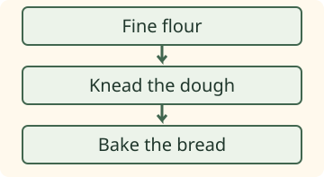

# Genesis 18 — Abraham welcomes three visitors

**About this chapter**

Three visitors eat with Abraham. Later, Abraham asks the LORD to spare the people of a city called Sodom.

## Abraham shares a meal with his visitors

## Genesis 18:1

The LORD appeared to Abraham near the oak trees at Mamre. It was the hottest part of the day. Abraham sat at the entrance to his tent.

## Genesis 18:2

Abraham looked up and saw three men standing nearby. He ran to meet them and bowed low to the ground.

## Genesis 18:3

Abraham said, “My lord, if you are pleased with me, please stop here.

## Genesis 18:4

Let me bring water so you can wash your feet. You can rest under the tree.

## Genesis 18:5

Since you have come this way, let me bring you bread. Then you will have strength for the rest of your trip.”

The men said, “Yes, please do that.”

## Genesis 18:6

Abraham hurried into the tent. He told Sarah, “Quick! Take three large measures of fine flour. Work it into dough and bake bread.”

Follow Sarah’s work from top to bottom.

## Genesis 18:7

Abraham ran to his herd and chose a good young calf with tender meat. He gave it to a servant who hurried to prepare it.

## Genesis 18:8

Abraham brought thickened milk, fresh milk and the cooked meat. He set the food before the men. He stood near them under the tree while they ate.

**Pause and answer**

Where did the visitors sit and eat?

## Sarah hears a promise

## Genesis 18:9

The visitors asked Abraham, “Where is your wife Sarah?”

“In the tent,” he said.

## Genesis 18:10

The LORD said, “I will come back at this time next year. Your wife Sarah will have a son.” Sarah was listening at the tent entrance behind him.

## Genesis 18:11

Abraham and Sarah were both very old. Sarah was past the age when women usually have children.

## Genesis 18:12

Sarah laughed to herself. She thought, “My body is worn out, and my husband is old. Can I still have this joy?”

## Genesis 18:13

The LORD asked Abraham, “Why did Sarah laugh? Why did she ask if she could have a child at her age?

## Genesis 18:14

Is anything too hard for the LORD? I will come back at the time I have promised, about a year from now. Sarah will have a son.”

## Genesis 18:15

Sarah was afraid. She said, “I did not laugh.”

The LORD answered, “Yes, you did laugh.”

**Pause and answer**

What promise did Sarah hear from the tent?

## The LORD speaks about Sodom

## Genesis 18:16

The men got up to leave and looked down toward Sodom. Abraham walked with them for part of the way.

## Genesis 18:17

The LORD said, “Should I hide from Abraham what I am about to do?

## Genesis 18:18

His family will become a great and powerful nation. Through him all the nations on earth will receive a blessing.

## Genesis 18:19

I chose Abraham so he would teach his children and his household to follow my ways. They must do what is right and fair. Then I will do what I promised Abraham.”

## Genesis 18:20

The LORD said, “I have heard many cries against Sodom and Gomorrah. The people there have done terrible wrong.

## Genesis 18:21

I will go down and see for myself. I will find out whether they have done everything I have heard about.”

## Genesis 18:22

Two of the men turned and went toward Sodom. Abraham stayed there before the LORD.

**Pause and answer**

What did the LORD want Abraham to teach his household?

## Abraham asks the LORD to spare the city

## Genesis 18:23

Abraham came closer. He asked, “Will you destroy the people who do what is right along with those who do evil?

## Genesis 18:24

What if 50 people in the city do what is right? Will you spare the city for their sake?

## Genesis 18:25

Surely you would never kill those who do right along with those who do evil. That would treat them all alike. You judge the whole earth. Surely you will do what is right!”

## Genesis 18:26

The LORD said, “If I find 50 people in Sodom who do what is right, I will spare the whole city for their sake.”

## Genesis 18:27

Abraham said, “I am only dust and ashes. Still, I have dared to speak to my Lord.

## Genesis 18:28

What if there are five fewer than 50? Will you destroy the city because five are missing?”

The LORD said, “If I find 45, I will spare the city.”

## Genesis 18:29

Abraham asked again, “What if you find 40?”

The LORD said, “For the sake of those 40, I will spare it.”

## Genesis 18:30

Abraham said, “Please do not be angry with me, my Lord. What if you find 30?”

The LORD said, “If I find 30, I will spare it.”

## Genesis 18:31

Abraham said, “I have dared to speak to my Lord. What if you find 20?”

The LORD said, “For the sake of those 20, I will spare it.”

## Genesis 18:32

Abraham said, “Please do not be angry, my Lord. Let me ask one more time. What if you find ten?”

The LORD said, “For the sake of those ten, I will spare the city.”

## Genesis 18:33

When the LORD finished speaking, he left. Abraham went home.

**Pause and answer**

How many people did Abraham ask about the last time?
