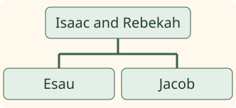

# Genesis 25 — Esau sells his birthright to Jacob

**About this chapter**

Isaac and Ishmael bury their father Abraham.

Later, Isaac and Rebekah have twin sons, Esau and Jacob.

## Keturah and Abraham’s family

## Genesis 25:1

Abraham had taken another wife. Her name was Keturah.

## Genesis 25:2

Keturah and Abraham had six sons.

Their names were Zimran, Jokshan, Medan, Midian, Ishbak, and Shuah.

## Genesis 25:3

Jokshan’s sons were Sheba and Dedan.

Three groups of people came from Dedan’s family.

They were the Asshurites, the Letushites, and the Leummites.

## Genesis 25:4

Midian’s sons were Ephah, Epher, Hanoch, Abida, and Eldaah.

All these families came from Keturah.

## Genesis 25:5

Abraham left everything he owned to Isaac.

## Genesis 25:6

While Abraham was alive, he gave gifts to his other sons.

Their mothers were Abraham’s concubines.

Abraham sent these sons east, away from Isaac.

**Reading help**

A concubine was a partner with fewer rights than a wife.

**Pause and answer**

Where did Abraham send the sons of his concubines?

## Isaac and Ishmael bury Abraham

## Genesis 25:7

Abraham lived for 175 years.

## Genesis 25:8

He was old and content with his life.

He took his last breath and died.

He joined his people who had died before him.

## Genesis 25:9

Isaac and Ishmael buried their father in the cave of Machpelah.

The cave was near Mamre, in a field that once belonged to Ephron.

Ephron was the son of Zohar the Hittite.

## Genesis 25:10

Abraham had bought this field from the Hittites.

His sons buried Abraham beside his wife Sarah.

## Genesis 25:11

After Abraham died, God blessed Isaac.

Isaac lived near Beer-lahai-roi.

**Pause and answer**

Who buried Abraham beside Sarah?

## Ishmael’s family

## Genesis 25:12

Here is the story of Ishmael’s family.

Abraham was Ishmael’s father.

His mother was Hagar, Sarah’s Egyptian servant.

## Genesis 25:13

Here are Ishmael’s sons, starting with the oldest.

Nebaioth was born first.

Kedar, Adbeel, and Mibsam came next.

## Genesis 25:14

Then came Mishma, Dumah, and Massa.

## Genesis 25:15

After them came Hadad, Tema, Jetur, Naphish, and Kedemah.

## Genesis 25:16

These twelve sons became twelve leaders.

Each led a tribe, a large family group.

Their villages and camps carried their names.

## Genesis 25:17

Ishmael lived for 137 years.

Then he took his last breath and died.

He joined his people who had died before him.

## Genesis 25:18

Ishmael’s family settled across the land from Havilah to Shur.

Shur is near Egypt’s border on the way to Asshur.

Ishmael’s family treated all their relatives as enemies.

**Pause and answer**

How many sons of Ishmael became leaders?

## Rebekah asks the LORD about her children

## Genesis 25:19

Here is the story of Isaac’s family.

Abraham was Isaac’s father.

## Genesis 25:20

Isaac was 40 when he married Rebekah.

Rebekah’s father was Bethuel, an Aramean from Paddan-aram.

Her brother Laban was also an Aramean.

## Genesis 25:21

Rebekah could not have children.

Isaac prayed to the LORD for her.

The LORD heard Isaac’s prayer, and Rebekah became pregnant.

## Genesis 25:22

The babies struggled against each other inside her.

Rebekah asked, “Why is this happening to me?”

She went to ask the LORD.

## Genesis 25:23

The LORD told Rebekah, “You are carrying two children.

Their families will become two separate nations.

One nation will be stronger than the other.

The older child will serve the younger one.”

**Pause and answer**

What would the children’s families become?

## Esau and Jacob are born

## Genesis 25:24

When Rebekah gave birth, she had twins.

## Genesis 25:25

The first boy was red all over.

His thick hair looked like a coat of fur.

His parents named him Esau.

## Genesis 25:26

The second boy came out holding Esau’s heel.

His parents named him Jacob.

Isaac was 60 when the twins were born.

Esau was born first. Jacob followed him.

## Genesis 25:27

The boys grew up.

Esau loved the open fields and became a skilled hunter.

Jacob was quiet and liked to stay at home.

## Genesis 25:28

Isaac loved Esau because he enjoyed the meat Esau hunted.

Rebekah loved Jacob.

**Pause and answer**

Which twin was born first?

## Esau asks Jacob for stew

## Genesis 25:29

One day Jacob was cooking stew.

Esau came in from the fields very hungry.

## Genesis 25:30

Esau said, “Give me some of that red stew!

I am so hungry!”

That is why people also called Esau “Edom.”

**Reading help**

The name Edom sounds like the Hebrew word for “red.”

## Genesis 25:31

Jacob replied, “Sell me your birthright first.”

**Reading help**

Esau’s birthright was his special right as the oldest son.

It gave him a claim to part of the family property.

## Genesis 25:32

Esau said, “Look! I am about to die.

What good is my birthright to me now?”

## Genesis 25:33

Jacob said, “First give me your solemn promise.”

Esau promised. He sold his birthright to Jacob.

## Genesis 25:34

Jacob gave Esau bread and stew made with lentils.

Esau ate and drank. Then he got up and left.

Esau had treated his birthright as worthless.

**Pause and answer**

What did Esau give Jacob in exchange for food?

**The twins**

| Son | At birth | As a grown man |
| --- | --- | --- |
| Esau | Came out first | Hunted in the fields |
| Jacob | Held Esau’s heel | Liked to stay at home |
