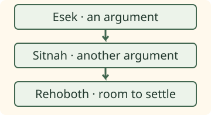

# Genesis 26 — Isaac finds water and makes peace

**About this chapter**

The LORD promises to stay with Isaac.

Isaac moves from place to place as his household looks for water.

## The LORD tells Isaac where to stay

## Genesis 26:1

There was very little food in the land.

This had happened before, when Abraham was alive.

Isaac went to Gerar to see Abimelech, king of the Philistines.

## Genesis 26:2

The LORD appeared to Isaac.

He said, “Stay out of Egypt.

Live in the land I show you.

## Genesis 26:3

Stay here as a guest. I will be with you.

I will bless you.

I will give these lands to you and your descendants.

I will keep the promise I made to your father Abraham.

## Genesis 26:4

Your descendants will be as many as the stars in the sky.

I will give them all these lands.

Through your family I will bless every nation on earth.

## Genesis 26:5

I will do this because Abraham listened to me.

He followed my instructions and obeyed all my laws.”

## Genesis 26:6

So Isaac stayed in Gerar.

**Pause and answer**

What did the LORD promise Isaac about his family?

## Isaac is afraid to tell the truth

## Genesis 26:7

The men there asked Isaac about Rebekah.

Isaac said, “She is my sister.”

He was afraid to say she was his wife.

He thought, “Rebekah is beautiful. They might kill me to take her.”

## Genesis 26:8

Isaac had lived there a long time.

One day King Abimelech looked down from a window.

To his surprise, he saw Isaac stroking Rebekah tenderly.

## Genesis 26:9

Abimelech sent for Isaac. “She really is your wife!” he said.

“Why did you say she was your sister?”

Isaac answered, “I was afraid someone would kill me because of her.”

## Genesis 26:10

Abimelech asked, “What have you done to us?

Someone here might have had sex with your wife.

Then you would have brought guilt on us.”

## Genesis 26:11

Abimelech warned his people, “Anyone who harms Isaac or Rebekah will face death.”

**Pause and answer**

How did Abimelech protect Isaac and Rebekah?

## The king tells Isaac to leave

## Genesis 26:12

Isaac planted seed in that land.

That year he harvested a hundred times what he planted.

The LORD blessed Isaac.

## Genesis 26:13

Isaac grew richer and richer until he was very wealthy.

## Genesis 26:14

He had many sheep, herds of animals, and servants.

The Philistines wanted what Isaac had.

## Genesis 26:15

Long ago, Abraham’s servants had dug wells there.

The Philistines filled all those wells with dirt.

## Genesis 26:16

Abimelech told Isaac, “Leave us.

You have become far too powerful for us.”

## Genesis 26:17

Isaac left and set up camp in the valley of Gerar.

He stayed there.

**Pause and answer**

What did the Philistines put into the wells?

## Isaac’s servants dig for water

## Genesis 26:18

After Abraham died, the Philistines had filled his wells with dirt.

Isaac opened those wells again.

He kept the names his father had given them.

## Genesis 26:19

Isaac’s servants dug in the valley.

They found fresh water flowing into the well.

## Genesis 26:20

The herders from Gerar argued with Isaac’s herders.

They said, “The water belongs to us!”

Isaac named the well Esek because they argued with him.

## Genesis 26:21

Isaac’s servants dug another well.

The herders argued over this one too.

Isaac named this well Sitnah.

## Genesis 26:22

Isaac moved on and dug another well.

This time nobody argued over it.

Isaac named it Rehoboth.

He said, “At last the LORD has made room for us.

Now we can grow and do well in this land.”

| Well | What happened there |
| --- | --- |
| Esek | The herders argued over the water. |
| Sitnah | The herders argued again. |
| Rehoboth | Isaac’s people had room and water. |

Follow the wells in the order Isaac’s people dug them.

**Pause and answer**

What was different at Rehoboth?

## The LORD speaks to Isaac at Beersheba

## Genesis 26:23

Isaac went on to Beersheba.

## Genesis 26:24

That night the LORD appeared to Isaac.

“I am the God of your father Abraham,” he said.

“Do not be afraid. I am with you.

For the sake of my servant Abraham, I will bless you.

I will give you many descendants.”

## Genesis 26:25

Isaac built an altar there and prayed to the LORD.

He set up his tent there too.

His servants dug a well.

**Reading help**

An altar is a place where people give offerings to God.

**Pause and answer**

What reason did the LORD give Isaac to feel safe?

## Isaac and the king make peace

## Genesis 26:26

Later, Abimelech came from Gerar to visit Isaac.

Ahuzzath, who advised the king, came with him.

Phicol, who led the king’s army, came too.

## Genesis 26:27

Isaac asked, “Why have you come to me?

You hated me and sent me away.”

## Genesis 26:28

They answered, “We can see the LORD is with you.

Let us make a covenant together.

Let us promise each other peace.

## Genesis 26:29

Promise you will do us no harm.

We did you good and sent you away in peace.

Now the LORD has blessed you.”

**Reading help**

A covenant is a firm agreement people promise to keep.

## Genesis 26:30

Isaac made a feast for his visitors.

They ate and drank together.

## Genesis 26:31

Early the next morning they made solemn promises to each other.

Then Isaac sent his visitors home. They left in peace.

## Genesis 26:32

That same day, Isaac’s servants came to him.

They had news about the well they had dug.

“We have found water!” they said.

## Genesis 26:33

Isaac called the well Shibah.

To this day the town bears the name Beersheba.

**Pause and answer**

How did the visitors and Isaac part?

## Esau marries two Hittite women

## Genesis 26:34

At 40, Esau married two women.

One was Judith, daughter of Beeri the Hittite.

The other was Basemath, daughter of Elon the Hittite.

## Genesis 26:35

Esau’s wives brought deep sorrow to Isaac and Rebekah.

**Pause and answer**

How did Isaac and Rebekah feel?
