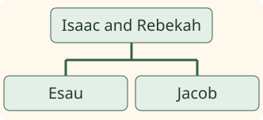

# Genesis 27 — Jacob takes Esau’s blessing

**About this chapter**

Isaac wants to bless Esau, his older son.

Jacob, his younger son, pretends to be Esau.

## Isaac calls for Esau

## Genesis 27:1

Isaac was old. He could no longer see.

He called Esau, his older son. “My son!”

“Here I am,” Esau answered.

## Genesis 27:2

Isaac said, “I am old now.

I do not know when I will die.

## Genesis 27:3

Take your bow and your arrows.

Go out and hunt some wild meat for me.

## Genesis 27:4

Cook the food I love. Bring it to me.

After I eat, I want to bless you before I die.”

**Reading help**

Here Isaac gives a blessing by speaking words about his son’s future.

He asks God to give his son good things.

**Pause and answer**

Which son did Isaac ask to bring him food?

## Rebekah tells Jacob her plan

## Genesis 27:5

Rebekah heard what Isaac said to Esau.

Then Esau went out to hunt for meat.

## Genesis 27:6

Rebekah told Jacob, “I heard your father talking to Esau.

## Genesis 27:7

Your father said, ‘Bring me meat from your hunt.

Cook me a meal I will enjoy.

Then I will bless you before the LORD before I die.’

## Genesis 27:8

Now, my son, listen carefully.

Do exactly what I tell you.

## Genesis 27:9

Bring me two fine young goats from the flock.

I will cook the food your father loves.

## Genesis 27:10

Take it to your father to eat.

Then he can bless you before he dies.”

**Pause and answer**

What did Rebekah want Jacob to take to Isaac?

## Jacob wears his brother’s clothes

## Genesis 27:11

Jacob said, “Mother, Esau has hairy skin.

My skin is smooth.

## Genesis 27:12

What if my father touches me?

He will know I am trying to trick him.

He might curse me when I want him to bless me.”

## Genesis 27:13

Rebekah said, “My son, let the curse fall on me.

Do as I say. Bring me the goats.”

## Genesis 27:14

Jacob brought the two goats to his mother.

Rebekah cooked the food Isaac loved.

## Genesis 27:15

Rebekah took Esau’s best clothes from the house.

She dressed Jacob in his older brother’s clothes.

## Genesis 27:16

She covered Jacob’s hands with the young goats’ skins.

She covered the smooth part of his neck too.

## Genesis 27:17

Then Rebekah gave Jacob the meal and bread she had made.

**Pause and answer**

Why did Rebekah cover Jacob’s hands?

## Isaac hears Jacob’s voice

## Genesis 27:18

Jacob went to Isaac and called, “Father!”

Isaac answered, “Here I am. Which son are you?”

## Genesis 27:19

Jacob said, “I am Esau, your oldest son.

I did what you asked.

Please sit up and eat the meat I hunted.

Then give me your blessing.”

## Genesis 27:20

Isaac asked, “How did you find it so quickly, son?”

Jacob answered, “The LORD your God brought it to me.”

## Genesis 27:21

Isaac said, “Come closer so I can touch you.

Are you really my son Esau?”

## Genesis 27:22

Jacob came close. Isaac felt his hands.

Isaac said, “The voice sounds like Jacob.

But the hands feel like Esau’s hands.”

## Genesis 27:23

The hands felt hairy like Esau’s.

So Isaac did not recognize Jacob, and he blessed him.

## Genesis 27:24

Isaac asked again, “Are you really my son Esau?”

Jacob answered, “I am.”

| What Isaac noticed | Who it reminded him of |
| --- | --- |
| The voice | Jacob |
| The hairy hands | Esau |

**Pause and answer**

Whose voice did Isaac think he heard?

## Isaac gives Jacob the blessing

## Genesis 27:25

Isaac said, “Bring me some of the meat you hunted, my son.

I will eat it and bless you.”

Jacob brought the food, and Isaac ate.

Then Jacob brought wine, and Isaac drank.

## Genesis 27:26

Isaac said, “Come close and kiss me, my son.”

## Genesis 27:27

Jacob came close and kissed him.

Isaac smelled Esau’s clothes and gave Jacob this blessing.

“My son smells like a field the LORD has blessed.

## Genesis 27:28

May God give you dew from the sky and rich soil.

May you have plenty of grain and new wine.

## Genesis 27:29

May peoples serve you. May nations bow to you.

May you rule over your brothers.

May your mother’s sons bow to you.

May a curse come on those who curse you.

May a blessing come on those who bless you.”

**Reading help**

Dew is the water you see on the ground in the morning.

**Pause and answer**

What did Isaac ask God to give his son from the land?

## Esau comes home

## Genesis 27:30

Isaac finished blessing Jacob. Jacob had just left his father.

Then Esau came back from hunting.

Jacob had just left his father when his twin Esau came in.

## Genesis 27:31

Esau cooked a meal and brought it to Isaac.

He said, “Father, sit up and eat the meat I hunted.

Then give me your blessing.”

## Genesis 27:32

Isaac asked, “Who are you?”

“I am Esau, your oldest son,” he answered.

## Genesis 27:33

Isaac shook all over.

“Then who brought me meat from a hunt?” he asked.

“I ate it all before you came.

I blessed him, and that blessing will stand.”

## Genesis 27:34

Esau gave a loud cry of pain.

“Father, bless me too!” he begged.

## Genesis 27:35

Isaac answered, “Your brother tricked me.

He took your blessing.”

## Genesis 27:36

Esau said, “Jacob’s name fits him! He has cheated me twice.

He took my birthright. Now he has taken my blessing.”

Esau asked, “Did you save a blessing for me?”

**Reading help**

Esau’s birthright was his special right as the oldest son.

Earlier, he had sold that right to Jacob for food.

**Pause and answer**

What did Esau ask his father to do?

## Isaac speaks about Esau’s future

## Genesis 27:37

Isaac told Esau, “I have made Jacob your master.

I have said that all his relatives will serve him.

I have given him grain and new wine in my blessing.

What is left for you, my son?”

## Genesis 27:38

Esau said, “Father, do you have only one blessing?

Please bless me too, Father!”

Then Esau cried aloud.

## Genesis 27:39

Isaac answered, “You will live far from rich soil.

You will live far from the dew that falls from the sky.

## Genesis 27:40

You will live by fighting with your sword.

You will serve your brother.

But one day you will rise against him.

Then you will break free from his rule.”

**Pause and answer**

Who did Isaac say Esau would serve?

## Rebekah warns Jacob

## Genesis 27:41

Esau stayed angry with Jacob because Isaac had blessed him.

Esau thought, “Soon my father will die, and we will mourn him.

Then I will kill my brother Jacob.”

## Genesis 27:42

Someone told Rebekah what Esau had said.

She called Jacob and said, “Esau comforts himself with one thought.

He plans to kill you.

## Genesis 27:43

Listen to me, my son. Leave at once!

Go to my brother Laban in Haran.

## Genesis 27:44

Stay with Laban for a while.

Give Esau time to calm down.

## Genesis 27:45

Wait until his anger passes and he forgets what you did.

Then I will send for you to come home.

Why should I lose both my sons in one day?”

## Genesis 27:46

Then Rebekah told Isaac, “Esau’s Hittite wives have made my life miserable.

What if Jacob marries a Hittite woman from here too?

What joy would I have in life?”

**Pause and answer**

Where did Rebekah want Jacob to go?
