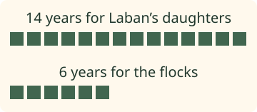

# Genesis 31 — Jacob leaves Laban and heads home

**About this chapter**

God tells Jacob to go home.

Laban follows him. The two men meet in the hills.

## God tells Jacob to go home

## Genesis 31:1

Jacob heard what Laban’s sons were saying about him.

They said, “Jacob took everything our father owned.

That is how Jacob got rich.”

## Genesis 31:2

Jacob saw the change in Laban’s face.

Laban no longer felt the same way about him.

## Genesis 31:3

The LORD told Jacob, “Go home to your people.

Go back to the land of your fathers.

I will be with you.”

## Genesis 31:4

Jacob sent for Rachel and Leah.

He asked them to meet him out among his flocks.

## Genesis 31:5

Jacob told them, “Your father looks at me differently now.

But my father’s God has stayed with me.

## Genesis 31:6

You know how hard I have worked for your father.

## Genesis 31:7

He cheated me. He changed my pay ten times.

But God kept him from hurting me.

## Genesis 31:8

Suppose he said the speckled animals were my pay.

Then all the mothers gave birth to speckled young.

When he promised me streaked animals, the young had streaks.

## Genesis 31:9

That is how God took animals from your father and gave them to me.”

**Pause and answer**

What did God promise Jacob when he told him to leave?

## Jacob tells his wives about a dream

## Genesis 31:10

Jacob continued, “When the animals were mating, I had a dream.

The males mating with the females had streaks or spots or speckles.

## Genesis 31:11

In my dream God’s angel called, ‘Jacob!’

I answered, ‘Here I am.’

## Genesis 31:12

He said, ‘Look up at the males mating with the flock.

They all have streaks or spots or speckles.

I have seen everything Laban has done to you.

## Genesis 31:13

I am the God who met you at Bethel.

There you poured oil on an upright stone.

You made a solemn promise to me there.

Now leave this land. Go back to your homeland.’”

## Genesis 31:14

Rachel and Leah answered, “What is left for us in our father’s home?

Will we ever receive any of his property?

## Genesis 31:15

He treats us like strangers.

He sold us and wasted everything he received for us.

## Genesis 31:16

The wealth God took from him belongs to us and our children.

Do what God told you to do.”

**Pause and answer**

What did Rachel and Leah tell Jacob to do?

## Jacob leaves without telling Laban

## Genesis 31:17

Jacob put his children and his wives on camels.

## Genesis 31:18

He drove his animals ahead of him.

He took everything he had gained in Paddan-aram.

He set out for Canaan, where his father Isaac lived.

## Genesis 31:19

Laban was away cutting the wool from his sheep.

While he was away, Rachel stole her father’s household idols.

**Reading help**

These idols were objects that Laban treated as gods.

## Genesis 31:20

Jacob kept his plans secret from Laban the Aramean.

He left without telling Laban he was going.

## Genesis 31:21

Jacob fled with everything he owned.

He crossed the Euphrates River and headed for the hills of Gilead.

**Pause and answer**

What did Rachel take from her father?

## Laban follows Jacob

## Genesis 31:22

On the third day, Laban heard that Jacob had fled.

## Genesis 31:23

Laban took his relatives and followed Jacob for seven days.

He caught up with Jacob in the hills of Gilead.

## Genesis 31:24

That night God spoke to Laban in a dream.

God warned him, “Be careful what you say to Jacob.

Say nothing to him, either good or bad.”

## Genesis 31:25

Jacob had set up his tent in the hills of Gilead.

When Laban caught up, he and his relatives camped there too.

## Genesis 31:26

Laban said to Jacob, “What have you done?

You tricked me. You took my daughters away like prisoners of war!

## Genesis 31:27

Why did you slip away without telling me?

I would have sent you off with joy and singing.

We could have played tambourines and harps.

## Genesis 31:28

You never let me kiss my grandchildren and daughters goodbye.

What a foolish thing to do!

## Genesis 31:29

I have the power to hurt you.

But last night your father’s God warned me.

He said, ‘Say nothing to Jacob, either good or bad.’

## Genesis 31:30

I know you long to see your father’s home.

But why did you steal my gods?”

**Pause and answer**

What did Laban say he wanted to do before his daughters left?

## Laban looks for his idols

## Genesis 31:31

Jacob answered, “I was afraid.

I thought you would take your daughters from me by force.

## Genesis 31:32

If you find anyone here with your gods, that person must die.

Search while our relatives watch.

Take back anything you find that belongs to you.”

Jacob did not know Rachel had taken the idols.

## Genesis 31:33

Laban searched the tents of Jacob, Leah, and the two women servants.

He found nothing. Then he went into Rachel’s tent.

## Genesis 31:34

Rachel had hidden the idols in her camel’s saddlebag.

She sat on the bag.

Laban searched the whole tent but found nothing.

## Genesis 31:35

Rachel said, “Please do not be angry with me, sir.

I cannot stand up to greet you. I have my period.”

Laban kept looking. He never found the idols.

**Pause and answer**

What did Rachel know that Jacob did not know?

## Jacob speaks about his twenty years of work

## Genesis 31:36

Jacob grew angry. He asked Laban, “What crime have I committed?

What wrong did I do that made you chase me?

## Genesis 31:37

You searched everything I own.

Did you find anything from your house?

Put it here for our relatives to see.

Let them decide which of us is right.

## Genesis 31:38

I spent twenty years with you.

Your sheep and goats never lost their young before birth.

I never ate a ram from your flock.

## Genesis 31:39

When wild animals killed one of yours, I paid for the loss myself.

I never brought the dead animal to you.

If anyone stole an animal, you made me pay.

It made no difference whether it was day or night.

## Genesis 31:40

I worked in the burning heat by day.

I worked in the freezing cold at night.

Often I could not sleep.

## Genesis 31:41

I served your household for twenty years.

I worked fourteen years for your daughters and six for your flocks.

You changed my pay ten times!

Each square stands for one year.

## Genesis 31:42

My father’s God was with me.

He is Abraham’s God, the God my father Isaac fears.

Without him, you would have sent me away with nothing.

God saw how I suffered and how hard I worked.

Last night he gave his judgment.”

| What Jacob worked for | How long he worked |
| --- | --- |
| To marry Laban’s daughters | 14 years |
| To earn animals for his flock | 6 years |
| Total | 20 years |

**Pause and answer**

Who saw how hard Jacob worked?

## Jacob and Laban set up stones

## Genesis 31:43

Laban answered, “These are my daughters. Their children are mine.

The flocks are mine. Everything you see is mine!

Yet what can I do now about my daughters and their children?

## Genesis 31:44

Come, let us make a covenant.

It will stand as a witness to our promises.”

**Reading help**

A covenant is a firm agreement. A witness helps show what people agreed to.

## Genesis 31:45

Jacob took a stone and stood it upright.

## Genesis 31:46

He told his relatives, “Gather stones.”

They made a pile of stones and ate beside it.

## Genesis 31:47

Laban named the pile Jegar-sahadutha. Jacob named it Galeed.

## Genesis 31:48

Laban said, “Today this pile is a witness between us.”

That is why the place was called Galeed.

**Reading help**

The pile would remind them of the promise they made there.

## Genesis 31:49

The place also had the name Mizpah.

Laban said, “May the LORD watch over us when we are apart.

## Genesis 31:50

Do not mistreat my daughters or marry other women.

Even when nobody else is there, God sees what you do.”

**Pause and answer**

What would the stones remind Jacob and Laban of?

## They promise to keep the peace

## Genesis 31:51

Laban said, “Look at this pile of stones.

Look at the upright stone I have set between us.

## Genesis 31:52

These stones are witnesses to our promise.

I will never cross this pile to hurt you.

You must never cross these stones to hurt me.

## Genesis 31:53

May the God of Abraham and the God of Nahor judge between us.

He is the God of their father.”

Jacob made his promise before the God his father Isaac feared.

## Genesis 31:54

Jacob gave an offering to God on the mountain.

He invited his relatives to share a meal.

They ate and spent the night there.

## Genesis 31:55

Early the next morning, Laban kissed his grandchildren and daughters.

He blessed them. Then he went home.

**Pause and answer**

What did Jacob and Laban promise about crossing the stones?
