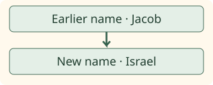

# Genesis 32 — Jacob prepares to meet Esau and receives a new name

**About this chapter**

Jacob hears that his brother Esau is coming.

Jacob prays for help. Later, a man wrestles with him through the night.

## Jacob sends a message to Esau

## Genesis 32:1

Jacob went on his way. God’s angels met him.

## Genesis 32:2

When Jacob saw them, he said, “This is God’s camp!”

He named the place Mahanaim.

## Genesis 32:3

Jacob sent messengers ahead to his brother Esau.

Esau lived in Seir, in the land of Edom.

## Genesis 32:4

Jacob said, “Give my master Esau this message from his servant Jacob.

Tell him I have been living with Laban until now.

## Genesis 32:5

I have oxen, donkeys, and flocks of animals.

I have servants, both men and women.

I am sending you this news, my master.

I hope you will welcome me.”

## Genesis 32:6

The messengers came back and told Jacob, “We went to Esau.

He is coming to meet you with 400 men.”

**Pause and answer**

What news did the messengers bring back?

## Jacob prays for his family

## Genesis 32:7

Jacob was very afraid and troubled.

He divided his people and animals into two camps.

He divided the flocks, the herds, and the camels.

## Genesis 32:8

Jacob thought, “Esau might attack one camp.

Then the other camp can escape.”

## Genesis 32:9

Jacob prayed, “LORD, you are the God of my grandfather Abraham.

You are the God of my father Isaac.

You told me to go home to my people.

You promised to help me do well.

## Genesis 32:10

I am your servant. You have been kind and faithful to me.

I do not deserve all you have done.

When I crossed the Jordan River, I had only my walking stick.

Now my people and animals fill two camps.

## Genesis 32:11

Please save me from my brother Esau.

I am afraid he will attack me.

He might attack the mothers and children too.

## Genesis 32:12

You promised to help me do well.

You said my descendants would be like sand by the sea.

There would be too many to count.”

**Pause and answer**

Who else did Jacob fear Esau might hurt?

## Jacob chooses a gift

## Genesis 32:13

Jacob stayed there that night.

He chose animals to give his brother Esau.

## Genesis 32:14

He chose 200 female goats and 20 male goats.

He chose 200 female sheep and 20 male sheep.

## Genesis 32:15

He chose 30 mother camels with their young.

He added 40 cows and 10 bulls.

He also chose 20 female donkeys and 10 male donkeys.

## Genesis 32:16

Jacob gave his servants separate herds to lead.

“Go ahead of me,” he said.

“Leave space between one herd and the next.”

**Pause and answer**

How did Jacob tell the servants to lead the herds?

## The servants go ahead of Jacob

## Genesis 32:17

Jacob told the first servant, “Esau may ask whose servant you are.

He may ask where you are going and whose animals these are.

## Genesis 32:18

Tell him, ‘They belong to your servant Jacob.

He sends them as a gift to you, my lord Esau.

Jacob is coming behind us.’”

## Genesis 32:19

Jacob spoke to the second servant and the third.

He told everyone following the herds, “Give Esau the same message.

## Genesis 32:20

Be sure to say, ‘Your servant Jacob is right behind us.’”

Jacob thought, “Perhaps my gift will calm Esau.

Then, when I see him, he may welcome me.”

## Genesis 32:21

So the servants took Jacob’s gifts ahead.

Jacob stayed in the camp that night.

**Pause and answer**

What did Jacob hope Esau would do when they met?

## Jacob wrestles through the night

## Genesis 32:22

During the night, Jacob got up.

He took his two wives, two women servants, and eleven sons to the Jabbok.

They crossed where the stream was shallow.

## Genesis 32:23

Jacob sent his family across the stream.

He sent everything he owned across too.

## Genesis 32:24

Jacob stayed behind alone.

A man wrestled with him until the first light of morning.

## Genesis 32:25

The man saw that he could not overcome Jacob.

As they wrestled, he struck Jacob’s hip.

Jacob’s hip came out of its joint.

## Genesis 32:26

The man said, “Let me go. Day is breaking.”

Jacob answered, “Bless me first. Then I will let you go.”

**Pause and answer**

What did Jacob ask the man to do?

## Jacob receives the name Israel

## Genesis 32:27

The man asked, “What is your name?”

“Jacob,” he answered.

## Genesis 32:28

The man told him, “From now on your name is Israel.

You have struggled with God and with people, and you have won.”

Both names belong to the man who wrestled through the night.

## Genesis 32:29

Jacob asked, “Please tell me your name.”

The man answered, “Why do you ask my name?”

Then the man blessed Jacob there.

## Genesis 32:30

Jacob named the place Peniel.

He said, “I saw God face to face, and I am still alive!”

## Genesis 32:31

The sun rose as Jacob passed Penuel.

He walked with a limp because of his hip.

## Genesis 32:32

This is why the Israelites avoid eating a certain tendon in an animal’s hip.

It is the tendon near the place where the man struck Jacob.

**Reading help**

A tendon is a strong band that joins muscle to bone.

**Two names to remember**

| Name | Who or what received this name? |
| --- | --- |
| Israel | Jacob received this name after wrestling. |
| Peniel | Jacob gave this name to the place. Penuel is another spelling. |

**Pause and answer**

What new name did Jacob receive?
