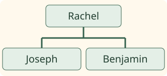

# Genesis 43 — Benjamin goes to Egypt with his brothers

**About this chapter**

Jacob’s family needs food again.

This time Benjamin goes with his brothers to Egypt.

## Judah reminds Jacob of the warning

## Genesis 43:1

Food was still very hard to find in Canaan.

## Genesis 43:2

The family ate the last of the grain from Egypt.

Jacob told his sons, “Go back and buy us a little more food.”

## Genesis 43:3

Judah answered, “The governor gave us a serious warning.

He said, ‘You cannot see me again unless your brother comes too.’

## Genesis 43:4

Send Benjamin with us. Then we will go and buy food for you.

## Genesis 43:5

If you keep him here, we will stay here too.

The governor said we must bring our brother to see him.”

## Genesis 43:6

Their father Jacob, also called Israel, asked, “Why bring me this trouble?

Why tell him you had another brother?”

## Genesis 43:7

They answered, “He asked us all about our family.

He asked, ‘Is your father alive? Do you have another brother?’

We answered his questions. How could we know he would ask us to bring Benjamin?”

**Pause and answer**

Why did Judah want Benjamin to go with them?

## Judah promises to bring Benjamin back

## Genesis 43:8

Judah told his father, “Send Benjamin with me. We will leave now.

Then we can all stay alive, including you and our children.

## Genesis 43:9

I will answer for his safety.

If I fail to bring him back to you, blame me for the rest of my life.

## Genesis 43:10

We have waited so long. We could have gone and come back twice.”

## Genesis 43:11

Jacob answered, “If he must go, do this.

Take some of the best things our land produces.

Give the governor a little balm and honey, spices and myrrh.

Take pistachio nuts and almonds too.

## Genesis 43:12

Take twice as much silver this time.

Return the silver you found at the top of your sacks.

Someone may have put it there by mistake.

## Genesis 43:13

Take Benjamin and go back to the governor at once.

## Genesis 43:14

May God Almighty help him show you mercy.

May he let Simeon and Benjamin come home with you.

If I lose my children, I must bear the loss.”

**Pause and answer**

What did Judah promise his father?

## Joseph invites his brothers to eat

## Genesis 43:15

The brothers took the gifts and twice as much silver.

With Benjamin they hurried to Egypt and stood before Joseph.

## Genesis 43:16

Joseph saw Benjamin with them. He spoke to his house manager.

“Take these men to my house. Kill an animal and cook it.

They will eat with me at noon.”

## Genesis 43:17

The manager did as Joseph said.

He took the brothers to Joseph’s house.

## Genesis 43:18

The brothers were afraid. They said, “This must be about the silver we found in our sacks last time.

They plan to seize us and make us slaves.

They will take our donkeys too.”

**Pause and answer**

Why did Joseph send the men to his house?

## The brothers explain about the silver

## Genesis 43:19

At the entrance to the house, the brothers spoke to the manager.

## Genesis 43:20

“Please listen, sir,” they said. “The first time we came, we came to buy food.

## Genesis 43:21

When we stopped for the night, we opened our sacks.

Each of us found his silver at the top of his sack.

It was all there. We brought it back with us.

## Genesis 43:22

We also brought more silver to buy food.

We have no idea who put the silver in our sacks.”

## Genesis 43:23

The manager answered, “All is well. Do not be afraid.

Your God, the God of your father, gave you that treasure.

I received your silver.” Then he brought Simeon out to them.

## Genesis 43:24

He took the brothers inside and gave them water to wash their feet.

He also gave their donkeys food.

## Genesis 43:25

The brothers heard that they would eat there.

They got their gifts ready for Joseph to come home at noon.

| What the brothers brought | Why they brought it |
| --- | --- |
| Silver from their sacks | To give it back |
| Extra silver | To buy more food |
| Gifts from Canaan | To give to the governor |

**Pause and answer**

Who came out to join the brothers?

## Joseph sees Benjamin

## Genesis 43:26

When Joseph came home, his brothers gave him their gifts.

They bowed to the ground before him.

## Genesis 43:27

Joseph asked how they were. Then he asked about their father.

“You told me about your elderly father. Is he well?

Is he still alive?”

## Genesis 43:28

They answered, “Our father, your servant, is well.

He is still alive.” They bowed to show Joseph respect.

## Genesis 43:29

Joseph looked up at Benjamin. They had the same mother.

Joseph asked, “Is this the youngest brother you told me about?”

He told Benjamin, “May God be kind to you, my son.”

Benjamin is Joseph’s younger brother.

## Genesis 43:30

Seeing his brother brought Joseph close to tears.

He hurried to a room where he could cry alone.

## Genesis 43:31

Joseph washed his face and came back.

When he felt calm again, he said, “Serve the meal.”

**Pause and answer**

Why did Joseph leave the room?

## The brothers eat with Joseph

## Genesis 43:32

The servants served Joseph by himself. They served his brothers together.

The Egyptians ate apart from both Joseph and his brothers.

Those Egyptians thought it was shameful to eat with Hebrews.

## Genesis 43:33

The brothers sat facing Joseph in order of age.

The oldest sat first, all the way down to the youngest.

The brothers looked at each other in amazement.

## Genesis 43:34

The servants brought food from Joseph’s table.

Benjamin received five times as much as any other brother.

They enjoyed the feast and drank freely with Joseph.

**Pause and answer**

What surprised the brothers about their seats?
