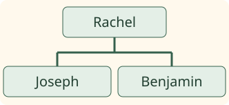

# Genesis 45 — Joseph tells his brothers who he is

**About this chapter**

Joseph speaks to his brothers alone.

Then he sends them home with news for their father.

## Joseph speaks to his brothers alone

## Genesis 45:1

Joseph could no longer hold back his feelings.

“Send everyone out!” he cried to his servants.

Only his brothers were there when he told them who he was.

## Genesis 45:2

Joseph cried so loudly that the Egyptians heard him.

Soon everyone in Pharaoh’s house heard about it.

## Genesis 45:3

Joseph said, “I am Joseph! Is my father still alive?”

His brothers were too afraid to answer.

## Genesis 45:4

“Please come closer,” Joseph said. His brothers came close.

“I am your brother Joseph. You sold me into Egypt.

The man speaking is Joseph. Benjamin is his younger brother.

## Genesis 45:5

Please do not be upset or angry with yourselves for selling me.

God sent me ahead of you to save lives.

## Genesis 45:6

For two years there has been a famine in the land.

For five more years nobody will plow or gather crops.

## Genesis 45:7

God sent me ahead to rescue you.

He wanted to keep your family alive on earth.

## Genesis 45:8

It was God who sent me here.

He made me like a father to Pharaoh.

I run Pharaoh’s whole household. I govern all Egypt.”

**Reading help**

Pharaoh was the king of Egypt.

Joseph helped and advised the king, as a father might.

| Years of famine already past | Years of famine still to come |
| --- | --- |
| 2 years | 5 years |

**Pause and answer**

Why did Joseph say God sent him to Egypt?

## Joseph asks his father to come

## Genesis 45:9

Joseph said, “Hurry back to my father.

Give him this message from me, his son Joseph.

‘God has made me ruler of all Egypt. Come here quickly.

## Genesis 45:10

You can live near me in Goshen.

Bring your children, grandchildren, flocks, and herds.

Bring everything you own.

## Genesis 45:11

I will take care of you there.

Five more years of famine are coming.

Without help, you and your family could lose everything.’

## Genesis 45:12

You can see for yourselves who is speaking to you.

Benjamin, my brother, can see that it really is me.

## Genesis 45:13

Tell my father how much honor I have in Egypt.

Tell him everything you have seen. Bring him here quickly.”

## Genesis 45:14

Joseph threw his arms around Benjamin and cried.

Benjamin held him and cried too.

## Genesis 45:15

Joseph kissed each of his brothers and wept.

After that, his brothers talked with him.

**Pause and answer**

Where did Joseph want his father to live?

## Pharaoh offers land and wagons

## Genesis 45:16

News of the brothers’ visit reached Pharaoh’s house.

Pharaoh and his servants were glad they had come.

## Genesis 45:17

Pharaoh told Joseph, “Give your brothers this message.

‘Load your animals and go home to Canaan.

## Genesis 45:18

Bring your father and your families back here.

I will give you the best land in Egypt.

You will eat the best food this land grows.’

## Genesis 45:19

Also tell them, ‘Take Egyptian wagons for your children and wives.

Bring your father back with you.

## Genesis 45:20

Do not worry about the things you leave behind.

The best of Egypt will be yours.’”

**Pause and answer**

Who could ride in the wagons on the way to Egypt?

## Joseph sends gifts for the journey

## Genesis 45:21

Jacob’s sons did as Pharaoh asked.

Joseph gave them the wagons Pharaoh had promised.

He also gave his brothers supplies for their journey.

## Genesis 45:22

Joseph gave each brother new clothes.

He gave Benjamin five sets of clothes and 300 shekels of silver.

**Reading help**

A shekel was a measure of weight for silver.

## Genesis 45:23

Joseph sent his father ten donkeys carrying Egypt’s finest goods.

Ten female donkeys carried grain, bread, and supplies for his father’s journey.

## Genesis 45:24

Joseph sent his brothers home.

As they left, he said, “Do not argue on the way!”

**Pause and answer**

What did Joseph ask his brothers to avoid on the journey?

## Jacob hears that Joseph is alive

## Genesis 45:25

The brothers left Egypt and reached their father Jacob in Canaan.

## Genesis 45:26

They told him, “Joseph is still alive! He governs all Egypt!”

Jacob was stunned. He could not believe them.

## Genesis 45:27

Then his sons told him everything Joseph had said.

Jacob saw the wagons Joseph had sent to carry him.

Jacob felt hope again.

## Genesis 45:28

Jacob, also called Israel, said, “That is enough!

My son Joseph is alive! I will go see him before I die.”

**Pause and answer**

What did Jacob see that helped him believe his sons?
