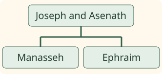

# Genesis 46 — Jacob sees Joseph again in Egypt

**About this chapter**

Jacob takes his family to Egypt.

On the way, God tells Jacob he will go with him.

## God speaks to Jacob at Beersheba

## Genesis 46:1

Jacob, also called Israel, set out with everything he had.

At Beersheba he offered sacrifices to the God of his father Isaac.

## Genesis 46:2

That night God spoke to Jacob in a vision.

“Jacob! Jacob!” God called. “Here I am,” Jacob answered.

## Genesis 46:3

God said, “I am God, the God of your father.

Do not be afraid to go to Egypt.

There I will make your family into a great nation.

## Genesis 46:4

I will go with you to Egypt.

I will bring you back again.

When you die, Joseph himself will close your eyes.”

## Genesis 46:5

Jacob left Beersheba. His sons took him in the wagons Pharaoh had sent.

Their children and wives rode in the wagons too.

## Genesis 46:6

They took their animals and everything they owned in Canaan.

Jacob and his whole family went to Egypt.

## Genesis 46:7

Jacob took his sons and grandsons, his daughters and granddaughters.

All his descendants went with him.

**Pause and answer**

What did God promise Jacob about going to Egypt?

## Leah’s family

## Genesis 46:8

Here are the names of Jacob’s family who went to Egypt.

Reuben was Jacob’s oldest son.

## Genesis 46:9

Reuben’s sons were Hanoch, Pallu, Hezron, and Carmi.

## Genesis 46:10

Simeon’s sons were Jemuel, Jamin, Ohad, Jachin, Zohar, and Shaul.

Shaul’s mother was a Canaanite woman.

## Genesis 46:11

Levi’s sons were Gershon, Kohath, and Merari.

## Genesis 46:12

Judah’s sons were Er, Onan, Shelah, Perez, and Zerah.

Er and Onan had died in Canaan.

Perez had two sons, Hezron and Hamul.

## Genesis 46:13

Issachar’s sons were Tola, Puvah, Job, and Shimron.

## Genesis 46:14

Zebulun’s sons were Sered, Elon, and Jahleel.

## Genesis 46:15

Leah had her sons with Jacob in Paddan-aram.

Their daughter Dinah was also in this family.

This part of the list counts 33 people in all.

**Pause and answer**

What was the name of Leah and Jacob’s daughter?

## Zilpah’s family

## Genesis 46:16

Gad’s sons were Ziphion, Haggi, Shuni, Ezbon, Eri, Arodi, and Areli.

## Genesis 46:17

Asher’s sons were Imnah, Ishvah, Ishvi, and Beriah.

Their sister was Serah. Beriah’s sons were Heber and Malchiel.

## Genesis 46:18

Gad and Asher were sons of Jacob and Zilpah.

Laban had given Zilpah to his daughter Leah.

This part of the family numbered 16.

**Pause and answer**

Who was the sister of Beriah?

## Rachel’s family and Bilhah’s family

## Genesis 46:19

Jacob and his wife Rachel had two sons, Joseph and Benjamin.

## Genesis 46:20

In Egypt, Joseph and Asenath had two sons, Manasseh and Ephraim.

Asenath’s father was Potiphera, the priest of On.

Both sons were born in Egypt.

## Genesis 46:21

Benjamin’s sons were Bela, Becher, Ashbel, Gera, and Naaman.

His other sons were Ehi, Rosh, Muppim, Huppim, and Ard.

## Genesis 46:22

These were the families of Rachel’s sons with Jacob.

They numbered 14 in all.

## Genesis 46:23

Dan’s son was Hushim.

## Genesis 46:24

Naphtali’s sons were Jahzeel, Guni, Jezer, and Shillem.

## Genesis 46:25

Dan and Naphtali were sons of Jacob and Bilhah.

Laban had given Bilhah to his daughter Rachel.

This part of the family numbered seven.

**Pause and answer**

Which two sons of Joseph were born in Egypt?

## The whole family in Egypt

## Genesis 46:26

Of Jacob’s own descendants, 66 traveled with him to Egypt.

This count leaves out his sons’ wives.

## Genesis 46:27

Joseph already had two sons in Egypt.

There were 70 people in Jacob’s family in all.

| People counted | Number |
| --- | --- |
| Jacob’s descendants who traveled with him | 66 |
| Jacob himself | 1 |
| Joseph and his two sons already in Egypt | 3 |
| Whole family in this count | 70 |

**Pause and answer**

How many of Jacob’s descendants traveled with him?

## Joseph meets his father

## Genesis 46:28

Jacob sent Judah ahead to ask Joseph the way to Goshen.

Then Jacob’s family arrived in Goshen.

## Genesis 46:29

Joseph got his chariot ready and rode to meet his father.

When Joseph saw Jacob, he put his arms around him.

Joseph held his father and wept.

## Genesis 46:30

Jacob told Joseph, “Now I can die.

I have seen your face. I know you are alive!”

**Pause and answer**

What did Jacob now know for himself?

## Joseph prepares his family to meet Pharaoh

## Genesis 46:31

Joseph spoke to his brothers and the whole family.

“I will go to Pharaoh and tell him about you.

I will say, ‘My brothers and my father’s family have come from Canaan.

## Genesis 46:32

They are shepherds. They raise animals.

They have brought their flocks, herds, and everything they own.’

## Genesis 46:33

Pharaoh will call for you and ask, ‘What work do you do?’

## Genesis 46:34

Tell him, ‘We have raised animals since we were young.

Our fathers did the same work.’

Then you can settle in Goshen, because Egyptians look down on shepherds.”

**Pause and answer**

What work would the brothers tell Pharaoh about?
