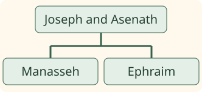

# Genesis 48 — Jacob blesses Ephraim and Manasseh

**About this chapter**

Joseph brings his sons to their grandfather Jacob.

Jacob calls them his own sons and blesses them.

## Jacob remembers God’s promise

## Genesis 48:1

Later, Joseph heard that his father was sick.

Joseph took his sons Manasseh and Ephraim to see him.

## Genesis 48:2

Someone told Jacob, “Your son Joseph is here.”

Jacob, also called Israel, gathered his strength.

He sat up in bed.

## Genesis 48:3

Jacob told Joseph, “God Almighty appeared to me at Luz in Canaan.

God blessed me there.

## Genesis 48:4

God said, ‘I will make your family grow large.

Many peoples will come from you.

I will give this land to your descendants forever.’

## Genesis 48:5

Your two sons were born in Egypt before I came here.

I will count Ephraim and Manasseh as my own sons.

They will be my sons just as Reuben and Simeon are.

## Genesis 48:6

Any children you have after them will be yours.

They will share in the land of Ephraim or Manasseh.

They will belong to the family groups named for their brothers.

## Genesis 48:7

When I came back from Paddan, Rachel died on the journey.

I grieved for her. We were in Canaan, still some distance from Ephrath.

I buried her beside the road to Ephrath.”

Ephrath is also called Bethlehem.

**Pause and answer**

Who did Jacob say he would count as his own sons?

## Joseph brings his sons close

## Genesis 48:8

Jacob saw Joseph’s sons and asked, “Who are these?”

## Genesis 48:9

Joseph said, “They are the sons God gave me here.”

Jacob answered, “Please bring them close so I can bless them.”

## Genesis 48:10

Jacob was old and could hardly see.

Joseph brought his sons to him.

Jacob kissed them and put his arms around them.

## Genesis 48:11

Jacob told Joseph, “I never thought I would see you again.

Now God has let me see your children too.”

## Genesis 48:12

Joseph drew his sons away from Jacob’s knees.

Then Joseph bowed with his face to the ground.

**Pause and answer**

Why was seeing Joseph’s sons such a surprise to Jacob?

## Jacob crosses his hands

## Genesis 48:13

Joseph brought both sons close to Jacob again.

With his right hand, Joseph led Ephraim to Jacob’s left side.

With his left hand, Joseph led Manasseh to Jacob’s right side.

## Genesis 48:14

Jacob crossed his hands.

He put his right hand on the head of Ephraim, the younger son.

He put his left hand on Manasseh, the older son.

| Joseph’s son | Where Joseph placed him | Which hand Jacob put on him |
| --- | --- | --- |
| Manasseh, the older son | At Jacob’s right | Jacob’s left hand |
| Ephraim, the younger son | At Jacob’s left | Jacob’s right hand |

Jacob is the grandfather blessing these two boys.

## Genesis 48:15

Jacob blessed Joseph with these words.

“My grandfather Abraham and my father Isaac followed God.

God has been my shepherd all my life.

## Genesis 48:16

His angel has rescued me from every kind of harm.

May he bless these boys.

May they carry my name and the names of Abraham and Isaac.

May their families grow large on the earth.”

**Reading help**

A shepherd guides a flock and cares for it.

Jacob meant that God had cared for him all his life.

**Pause and answer**

Whose head did Jacob touch with his right hand?

## Jacob explains his choice

## Genesis 48:17

Joseph was unhappy to see Jacob’s right hand on Ephraim’s head.

He took Jacob’s hand to move it to Manasseh’s head.

## Genesis 48:18

Joseph said, “Father, Manasseh is my firstborn son.

Put your right hand on his head.”

## Genesis 48:19

Jacob refused. “I know, my son. I know,” he said.

“Manasseh’s family will become a great people too.

But his younger brother Ephraim will be greater.

Many nations will come from Ephraim.”

## Genesis 48:20

That day Jacob blessed the two boys.

He said, “The people of Israel will use your names when they bless others.

They will say, ‘May God make you like Ephraim and Manasseh.’”

Jacob named Ephraim first.

**Pause and answer**

Why did Jacob name Ephraim first?

## Jacob gives Joseph land

## Genesis 48:21

Jacob said to Joseph, “I am about to die.

God will be with you.

He will bring you back to the land of your fathers.

## Genesis 48:22

I give you a place of honor above your brothers.

I give you the ridge of land I took from the Amorites.

I took it with my sword and bow.”

**Pause and answer**

What did Jacob say God would do after Jacob died?
