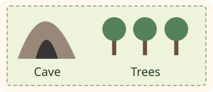

# Genesis 49 — Jacob speaks to his twelve sons

**About this chapter**

Jacob calls his sons to his bed.

He speaks about their lives and the families that will come from them.

## Reuben, Simeon, and Levi

## Genesis 49:1

Jacob called his sons. “Gather around me,” he said.

“I will tell you what lies ahead.

## Genesis 49:2

Come together, sons of Jacob. Listen to your father Israel.

## Genesis 49:3

Reuben, you are my firstborn. You were the first sign of my strength.

You held first place in honor and power.

## Genesis 49:4

But you were like rushing water that nobody can control.

You will no longer have first place.

You dishonored my bed by having sex with my concubine.

## Genesis 49:5

Simeon and Levi are brothers. They use their swords to hurt people.

## Genesis 49:6

Keep me out of their meetings. I want no part in their plans.

When angry, they killed men.

When they felt like it, they crippled oxen.

## Genesis 49:7

I curse their fierce anger. Their rage is cruel.

I will scatter their families throughout Israel.”

**Pause and answer**

What did Jacob say was cruel about Simeon and Levi?

## Judah and the lion

## Genesis 49:8

Jacob said, “Judah, your brothers will praise you.

You will take hold of your enemies by the neck.

Your brothers will bow down to you.

## Genesis 49:9

Judah, my son, you are like a young lion returning from a hunt.

The lion crouches and lies down.

Who would dare disturb a resting lioness?

## Genesis 49:10

Judah will keep the royal scepter.

The ruler’s staff will stay between his feet until Shiloh comes.

The nations will obey him.

**Reading help**

A scepter is a special staff that a ruler holds.

Here it stands for the right to rule.

## Genesis 49:11

He ties his donkey to a grapevine.

He ties its young one to the finest branch.

He washes his clothes in wine, the red juice of grapes.

## Genesis 49:12

His eyes are darker than wine. His teeth are whiter than milk.”

**Reading help**

Jacob pictures so many grapes that wine flows like wash water.

**Pause and answer**

What does the ruler’s staff tell us about Judah’s family?

## Zebulun, Issachar, and Dan

## Genesis 49:13

Jacob said, “Zebulun will live beside the sea.

Ships will find a safe harbor there.

His land will reach as far as Sidon.

## Genesis 49:14

Issachar is like a strong donkey resting between sheep pens.

## Genesis 49:15

He sees a good place to rest and pleasant land.

He bends his shoulder to carry the load.

He agrees to work as a servant.

## Genesis 49:16

Dan’s family will be one of Israel’s tribes.

Dan will judge his people fairly.

## Genesis 49:17

Dan will be like a snake beside a road.

The snake bites a horse on the heel.

Its rider falls backward.

## Genesis 49:18

LORD, I wait for you to save me.”

**Pause and answer**

Which son did Jacob say would live beside the sea?

## Gad, Asher, and Naphtali

## Genesis 49:19

Jacob said, “Raiders will attack Gad. Gad will strike back as they leave.

## Genesis 49:20

Asher will have rich food. He will serve food fit for a king.

## Genesis 49:21

Naphtali is like a mother deer running free.

She gives birth to beautiful young deer.”

**Pause and answer**

Which son did Jacob compare to a deer?

## Joseph and Benjamin

## Genesis 49:22

Jacob said, “Joseph is like a vine that bears much fruit.

Water from a spring feeds it. Its branches climb over a wall.

## Genesis 49:23

Men with bows hated him. They aimed their arrows at him.

## Genesis 49:24

Yet Joseph held his bow steady. The Mighty God of Jacob strengthened his arms.

God is the Shepherd and the Rock of Israel.

**Reading help**

A shepherd cares for the flock. A rock stands firm.

These names describe God’s care and strength.

## Genesis 49:25

Joseph, your father’s God helps you. God Almighty blesses you.

He gives blessings from the sky and the deep waters below.

He blesses mothers as they bear and nurse their children.

## Genesis 49:26

The blessings I give you are greater than the blessings of the ancient mountains.

They are greater than the riches of the lasting hills.

May all these blessings rest on you, Joseph, a prince among your brothers.

## Genesis 49:27

Benjamin is like a hungry wolf.

In the morning the wolf eats the animal it caught.

In the evening it shares what it took.”

## Genesis 49:28

All twelve tribes of Israel came from these sons.

Jacob gave each son a blessing suited to him.

**Pause and answer**

Who gave Joseph strength when others attacked him?

## Jacob asks to be buried with his family

## Genesis 49:29

Jacob told his sons, “Soon I will join my people who have died.

Bury me with my fathers in the cave in Ephron’s field.

Ephron was a Hittite.

## Genesis 49:30

The cave is at Machpelah near Mamre in Canaan.

Abraham bought the field from Ephron as a burial place.

Jacob asks his sons to bury him in this family cave.

## Genesis 49:31

Abraham and Sarah lie there. Isaac and Rebekah lie there too.

I buried Leah there.

## Genesis 49:32

Our family bought the field and its cave from the Hittites.”

## Genesis 49:33

Jacob finished speaking to his sons.

He pulled his feet up onto the bed and took his last breath.

He joined his people who had died before him.

| In the family cave | Relationship to Jacob |
| --- | --- |
| Abraham and Sarah | His grandparents |
| Isaac and Rebekah | His parents |
| Leah | His wife |

**Pause and answer**

Where did Jacob ask his sons to bury him?
