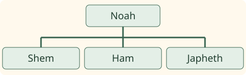

# Genesis 5 — Adam’s family from Seth to Noah

**About this chapter**

Follow the names from one generation to the next.

Look for what the family record says about Enoch.

## Adam and Seth

## Genesis 5:1

This is the written record of Adam’s family.

When God made human beings, he made them like himself.

## Genesis 5:2

God made them male and female.

He blessed them.

When he made them, he called them both human.

## Genesis 5:3

Adam was 130 when he had a son like himself.

Adam named him Seth.

## Genesis 5:4

After Seth was born, Adam lived another 800 years.

Adam had other sons and daughters.

## Genesis 5:5

Adam lived 930 years in all.

Then he died.

**Pause and answer**

What did Adam name the son who was like him?

## Seth and Enosh

## Genesis 5:6

Seth was 105 when he became the father of Enosh.

## Genesis 5:7

After Enosh was born, Seth lived another 807 years.

Seth had other sons and daughters.

## Genesis 5:8

Seth lived 912 years in all.

Then he died.

## Genesis 5:9

Enosh was 90 when he became the father of Kenan.

## Genesis 5:10

After Kenan was born, Enosh lived another 815 years.

Enosh had other sons and daughters.

## Genesis 5:11

Enosh lived 905 years in all.

Then he died.

**Pause and answer**

What was the name of Enosh’s son?

## Kenan and Mahalalel

## Genesis 5:12

Kenan was 70 when he became the father of Mahalalel.

## Genesis 5:13

After Mahalalel was born, Kenan lived another 840 years.

Kenan had other sons and daughters.

## Genesis 5:14

Kenan lived 910 years in all.

Then he died.

## Genesis 5:15

Mahalalel was 65 when he became the father of Jared.

## Genesis 5:16

After Jared was born, Mahalalel lived another 830 years.

Mahalalel had other sons and daughters.

## Genesis 5:17

Mahalalel lived 895 years in all.

Then he died.

**Pause and answer**

Who was Jared’s father?

## Jared and Enoch

## Genesis 5:18

Jared was 162 when he became the father of Enoch.

## Genesis 5:19

After Enoch was born, Jared lived another 800 years.

Jared had other sons and daughters.

## Genesis 5:20

Jared lived 962 years in all.

Then he died.

## Genesis 5:21

Enoch was 65 when he became the father of Methuselah.

## Genesis 5:22

After Methuselah was born, Enoch walked with God for 300 years.

Enoch had other sons and daughters.

## Genesis 5:23

Enoch lived 365 years in all.

## Genesis 5:24

Enoch walked with God.

Then Enoch was gone, because God had taken him away.

**Reading help**

Walking with God means living in close friendship with him.

**Pause and answer**

Who took Enoch away?

## From Methuselah to Noah

## Genesis 5:25

Methuselah was 187 when he became the father of Lamech.

## Genesis 5:26

After Lamech was born, Methuselah lived another 782 years.

Methuselah had other sons and daughters.

## Genesis 5:27

Methuselah lived 969 years in all.

Then he died.

## Genesis 5:28

Lamech was 182 when he had a son.

## Genesis 5:29

Lamech named his son Noah.

He said, “The LORD has cursed the ground.

We work it with our hands, and the work is hard.

May this child bring us comfort.”

## Genesis 5:30

After Noah was born, Lamech lived another 595 years.

Lamech had other sons and daughters.

## Genesis 5:31

Lamech lived 777 years in all.

Then he died.

## Genesis 5:32

After Noah was 500, he became the father of Shem, Ham and Japheth.

Each branch leads to one of Noah’s sons.

**Reading help**

**Follow the family**

Read each row from left to right. Each father is followed by his son.

| Father | Son |
| --- | --- |
| Adam | Seth |
| Seth | Enosh |
| Enosh | Kenan |
| Kenan | Mahalalel |
| Mahalalel | Jared |
| Jared | Enoch |
| Enoch | Methuselah |
| Methuselah | Lamech |
| Lamech | Noah |

**Pause and answer**

What did Lamech hope Noah would bring?
