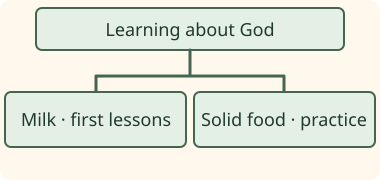

# Hebrews 5 — God calls Jesus to be high priest

**About this chapter**

The writer explains how God calls a high priest.

Then he asks the readers to keep learning.

## What a high priest does

## Hebrews 5:1

A high priest comes from among the people.

God appoints him to represent them before him.

The priest brings gifts to God and offers sacrifices for sins.

## Hebrews 5:2

He knows what it is like to be weak.

So he can be gentle with people who do wrong because they do not understand.

## Hebrews 5:3

He must offer sacrifices for his own sins too.

## Hebrews 5:4

No one can claim this honor for himself.

God calls a person to this work, as he called Aaron.

**Pause and answer**

Why can a high priest be gentle with people who go wrong?

## God calls his Son

## Hebrews 5:5

Christ did not claim the honor of being high priest for himself.

God called him.

God said to him, “You are my Son.

Today I have become your Father.”

## Hebrews 5:6

Elsewhere in Scripture God says, “You are a priest forever, in the order of Melchizedek.”

**Help with these words**

Melchizedek was a priest long before Jesus came.

Here “in the order of Melchizedek” means serving as the same kind of priest.

## Hebrews 5:7

When Jesus lived on earth, he prayed with loud cries and tears.

He begged God, who could save him from death, for help.

God heard Jesus because Jesus honored him.

## Hebrews 5:8

Jesus was God’s Son.

Even so, he learned obedience through what he suffered.

## Hebrews 5:9

When God had made him perfect for his work, Jesus became the source of lasting salvation for all who obey him.

## Hebrews 5:10

God named him high priest in the order of Melchizedek.

**Pause and answer**

Who called Jesus to be high priest?

## Milk and solid food

## Hebrews 5:11

We have much more to say about this.

It is hard to explain because you have grown slow to listen.

## Hebrews 5:12

By now you ought to be teaching others.

Yet someone must teach you the first lessons of God’s message again.

It is as if you still need milk and cannot eat solid food.

**Help with these words**

Milk pictures the first lessons about God.

Solid food pictures teaching that takes practice to understand.

## Hebrews 5:13

Anyone still living on milk is like a baby.

That person has little practice with the teaching about what is right.

## Hebrews 5:14

Solid food is for people who have grown up.

With practice they have learned to tell good from evil.

| Milk | Solid food |
| --- | --- |
| First lessons | Teaching we grow ready for through practice |

Food is a picture here of growing in understanding.

**Pause and answer**

What does practice help people learn to tell apart?
