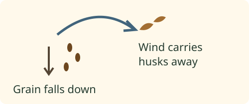

# Hosea 13 — Israel forgets who helped them

**About this chapter**

Hosea remembers a time when Israel depended on the LORD in the desert. Later the people had plenty to eat. They grew proud and forgot who had cared for them.

## Silver idols

## Hosea 13:1

The tribe of Ephraim once held great honor in Israel.

When Ephraim spoke, people shook with fear.

But Ephraim worshiped the false god Baal.

This brought guilt and death.

## Hosea 13:2

Now the people sin more and more.

Skilled workers melt silver and shape it into idols.

People say, “They offer people as sacrifices!

They kiss the calves made of silver!”

## Hosea 13:3

So they will disappear like mist in the morning.

They will vanish like drops of dew.

They will be like grain husks that the wind blows away.

They will be like smoke drifting out a window.

## The LORD remembers the desert

## Hosea 13:4

The LORD says, “I have been your God since you lived in Egypt.

You are to know Me alone as God.

I alone can save you.

## Hosea 13:5

“I knew you and cared for you in the desert.

That was a land with very little water.

## Hosea 13:6

“Then My people found good pasture and ate their fill.

Once they had enough, they grew proud.

Then they forgot Me.

## Hosea 13:7

“So I will spring on them like a lion.

Like a leopard, I will wait beside the path.

## Hosea 13:8

“I will attack like a mother bear whose cubs are gone.

I will tear open their chests.

Like a hungry lion, I will tear them apart.”

## Where is your king?

## Hosea 13:9

“Israel, you have turned against Me, the One who helps you.

That is why ruin comes upon you.

## Hosea 13:10

“Where is your king now?

Can he save the people in your cities?

Where are the rulers you asked for when you wanted a king and princes?

## Hosea 13:11

“In My anger I gave you a king.

In My anger I took him away.

## The LORD remembers Ephraim’s sins

## Hosea 13:12

“Ephraim’s sins are like things tied up and stored away.”

The LORD remembers what the people have done.

## Hosea 13:13

The time of trouble comes like the pains of childbirth.

Ephraim is like an unwise child.

The time for birth has come, yet the child does not come out.

## Hosea 13:14

The LORD says, “I will set them free from Sheol, the place of the dead.

I will rescue them from the power of death.

Death, where are your deadly diseases?

Sheol, where is your sting?

I will show no pity.”

## Hosea 13:15

Ephraim may be thriving among his brothers now.

But the LORD will send an east wind from the desert.

The water in Ephraim’s springs will dry up.

The wind will sweep away every treasure he has stored.

## Hosea 13:16

Samaria, Israel’s capital, has turned against her God.

Her people will bear the guilt.

Enemies will kill them with swords.

Even small children and pregnant women will suffer cruel deaths.

**Pause and answer**

Who cared for Israel in the desert?
