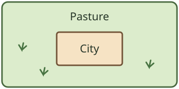

# Hosea 4 — The LORD speaks against Israel’s people and priests

**About this chapter**

The LORD tells Israel what has gone wrong in the land.

The people hurt one another.

Even the priests have turned away from God’s teaching.

## The whole land suffers

## Hosea 4:1

People of Israel, listen to the LORD.

He brings a charge against the people of this land.

He says, “No one speaks the truth.

No one shows faithful love.

No one knows God here.

## Hosea 4:2

“People curse and lie.

They murder and steal.

They sleep with people who are married to someone else.

One killing follows another.

## Hosea 4:3

“That is why the whole land grieves.

Everyone who lives there grows weak.

Wild animals and birds suffer too.

Even the fish disappear from the sea.”

## The priests have rejected God’s teaching

## Hosea 4:4

The LORD says, “Stop arguing and accusing one another.

You are like people who pick a quarrel with a priest.

## Hosea 4:5

“You will stumble even in daylight.

At night the prophet will stumble with you.

I will destroy your mother.”

Here Israel is like a mother to her people.

## Hosea 4:6

The LORD says, “My people are dying because they lack knowledge.

You priests refused to learn from me.

So I refuse to have you as my priests.

You have forgotten your God’s law.

I too will forget your children.

## Hosea 4:7

“The more priests there were, the more they sinned against me.

I was their glory, but they traded me for something shameful.

## Hosea 4:8

“The priests feed on the sins of my people.

They want my people to go on doing wrong.

## Hosea 4:9

“The same thing will happen to the people and the priests.

I will punish both for the way they live.

They will answer for what they have done.

## Hosea 4:10

“They will eat and still be hungry.

They will have many sexual partners, yet their families will not grow.

They have abandoned the LORD.

## Hosea 4:11

“They give themselves to sex and drink wine, including new wine.

These things rob them of good sense.”

## The people ask idols for guidance

## Hosea 4:12

The LORD says, “My people ask wooden idols for advice.

They expect sticks to give them answers.

They have been unfaithful to me, their God.”

Hosea compares worshiping other gods to being unfaithful in marriage.

## Hosea 4:13

The people offer sacrifices on mountaintops.

They burn offerings on the hills.

They like the shade of oak, poplar, and terebinth trees.

Their daughters turn to prostitution, taking money for sex.

Their daughters-in-law sleep with men other than their husbands.

## Hosea 4:14

The LORD says, “I will not punish the daughters for prostitution.

I will not punish the daughters-in-law for adultery.

The men themselves go to prostitutes.

They offer sacrifices with prostitutes at places of worship.

People who refuse to understand will come to ruin.”

## A warning to Judah

## Hosea 4:15

Israel, you have been unfaithful to your God.

Judah, keep clear of this sin.

Stay away from Gilgal and Beth-aven.

Do not swear there by saying, “As surely as the LORD lives!”

## Hosea 4:16

Israel is like a young cow that refuses to move.

Can the LORD lead people like that as a shepherd leads lambs into open pasture?

## Hosea 4:17

Ephraim is another name for Israel here.

Ephraim clings to its idols.

Leave Ephraim alone!

## Hosea 4:18

When their drink runs out, they turn to prostitution.

Their rulers love doing shameful things.

## Hosea 4:19

A whirlwind has caught them up in its wings.

Picture a wind so strong it carries people away.

The sacrifices they offered will bring them shame.

**Pause and answer**

What did the people ask their wooden idols to give them?
