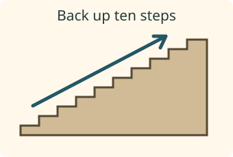

# Isaiah 38 — Hezekiah gives thanks for his life

**About this chapter**

King Hezekiah prays when he learns he is dying. After he gets well, he writes about what it felt like to face death and what it means to be alive.

## Hezekiah turns to the wall

## Isaiah 38:1

King Hezekiah became so sick he was about to die.

The prophet Isaiah, son of Amoz, came to see him.

Isaiah said, “The LORD says to put your affairs in order.

You are going to die.

You will not get well.”

## Isaiah 38:2

Hezekiah turned his face toward the wall.

He prayed to the LORD.

## Isaiah 38:3

“Please remember me, LORD.

I have followed You with my whole heart.

I have done what You saw was good.” Then Hezekiah wept bitterly.

## A shadow moves back

## Isaiah 38:4

The LORD gave Isaiah a message.

## Isaiah 38:5

“Go back to Hezekiah.

Tell him that I am the LORD, the God of his ancestor David.

I have heard his prayer.

I have seen his tears.

I will give him fifteen more years to live.

## Isaiah 38:6

“I will rescue him and Jerusalem from the king of Assyria.

I myself will protect this city.”

## Isaiah 38:7

The LORD promised Hezekiah a sign.

It would show him that the LORD would keep His word.

## Isaiah 38:8

The LORD said, “Watch the shadow on the stairway of Ahaz.

I will make it move back ten steps.” And the sunlight went back the ten steps it had come down.

**Follow the steps**

Find the shadow on the stairs. Imagine it moving back over ten steps. This was the sign the LORD gave Hezekiah.

## Hezekiah remembers his fear

## Isaiah 38:9

After Hezekiah got well, the king wrote these words about his illness.

## Isaiah 38:10

“I thought I would die in the middle of my life.

I pictured myself entering the gates of Sheol, the place of the dead.

I would lose all the years I hoped to live.

## Isaiah 38:11

“I said to myself, ‘I will never see the LORD again here among the living.

I will never see the people of this world again.’

## Isaiah 38:12

“My home is going away like a shepherd’s tent that someone packs up.

My life is like cloth I have rolled up.

God cuts it free from the loom, the frame for weaving cloth.

From morning to night, LORD, You bring my life to an end.

## Isaiah 38:13

“I tried to stay calm until morning.

The pain felt like a lion breaking my bones.

From morning to night, LORD, You bring my life to an end.

## A cry for help

## Isaiah 38:14

“My voice sounds like the thin call of a swallow or a crane.

I moan like a dove.

My eyes grow tired from looking up.

Lord, I am in trouble.

Stand up for me!

## Isaiah 38:15

“What can I say?

God spoke to me.

He Himself has acted.

I will walk slowly through the years ahead because of the sorrow I have known.

## A song for the living

## Isaiah 38:16

“Lord, what You say and do gives people life.

It gives me life too.

You have made me well and let me live.

## Isaiah 38:17

“That bitter time turned out for my good.

In Your love You kept me from the pit where everything is forgotten.

You threw my sins behind Your back.

You no longer hold them against me.

## Isaiah 38:18

“The place of the dead cannot thank You.

Death cannot sing Your praise.

Those who go down to the pit cannot look forward to seeing You keep Your promises.

## Isaiah 38:19

“It is the living who can thank You.

I am thanking You today!

Fathers will tell their children how You keep Your promises.

## Isaiah 38:20

“The LORD will save me.

We will play our songs on stringed instruments in the LORD’s house.

We will do this all our lives.”

## What Isaiah and Hezekiah had said

## Isaiah 38:21

Earlier, Isaiah had told the people caring for the king, “Press some figs together.

Put them on Hezekiah’s boil.

He will get well.” A boil is a painful lump on the skin.

## Isaiah 38:22

Hezekiah had asked, “What sign will show me that I will go up to the LORD’s house again?”

**Pause and answer**

What does Hezekiah want fathers to tell their children?
