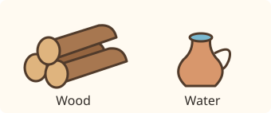

# Isaiah 44 — The God who made Israel

**About this chapter**

Isaiah describes people making gods with their own hands. The LORD reminds Israel who made them and promises that people will live in Jerusalem again.

## Children like trees beside a stream

## Isaiah 44:1

The LORD says, “Listen, people of Jacob.

You are my servants.

Israel, I chose you.”

## Isaiah 44:2

The LORD formed you before you were born.

He will help you.

He says, “Do not fear, Jacob my servant.

I chose you, Jeshurun.” Jeshurun is another name for Israel.

## Isaiah 44:3

“I will pour water on thirsty land.

Streams will run across dry ground.

In the same way, I will pour out my Spirit on your children.

I will bless the generations that come after you.

## Isaiah 44:4

“They will grow among the grass like willow trees beside running water.

## Isaiah 44:5

“One will say, ‘I belong to the LORD.’ Another will call himself part of Jacob’s family.

Another will write ‘The LORD’s’ on his hand and take the name Israel.”

## The LORD is Israel’s Rock

## Isaiah 44:6

The LORD is Israel’s King.

He is their Redeemer, the one who sets them free.

He commands heaven’s armies.

He says, “I am the first and the last.

I alone am God.

## Isaiah 44:7

“Who is like me?

Let him step forward and tell me!

Long ago I established my people.

Let him tell them what will happen next.

## Isaiah 44:8

“Do not shake with fear.

Long ago I told you what would happen.

You are my witnesses.

Is there another God?

I know of no other Rock like me.” A rock pictures someone firm and dependable.

## People make their own idols

## Isaiah 44:9

An idol is a statue that people worship.

The people who make idols come to nothing.

The statues they treasure can do nothing for them.

Those who speak up for idols neither see nor understand.

They will be ashamed.

## Isaiah 44:10

Why would anyone shape a god or pour metal into a mold to make one?

What help can it give?

## Isaiah 44:11

Everyone who joins in will be ashamed.

The workers who make these gods are only human.

Let them all stand together to defend what they do.

Fear and shame will come over them all.

## Isaiah 44:12

A metalworker works over hot coals.

He swings his hammer with strong arms and shapes an idol.

Then hunger takes away his strength.

Without water he feels faint.

## Isaiah 44:13

A woodworker measures a piece of wood and marks his lines.

He draws curves and cuts the wood with chisels.

He gives it the shape and beauty of a human being.

Then he sets it in a place of worship.

## One tree serves two purposes

## Isaiah 44:14

The worker cuts down a cedar or chooses a cypress or oak.

He lets a tree grow strong in the forest.

He plants a laurel tree, and rain makes it grow.

## Isaiah 44:15

Some of the wood gives him fuel.

He warms himself by the fire.

He bakes his bread.

He also makes a god from that wood and bows down to it.

## Isaiah 44:16

He burns half the wood to roast meat.

He eats until he is full.

He says, “Ah!

I can see the fire.

Now I am warm.”

## Isaiah 44:17

With the wood that is left, he carves his god.

He bows down and prays to it.

“Save me!

You are my god.”

**Find the cut wood**

Point to one piece of wood. Imagine cutting it in two. The worker burns one half to cook his meal. What does he ask the other half to do?

## A question the worker never asks

## Isaiah 44:18

People who do this do not understand.

God has closed their eyes and minds.

They cannot see what they are doing.

## Isaiah 44:19

No one stops to think, “I burned half that wood.

I baked bread on its coals.

I roasted meat and ate it.

Why make something hateful from what is left?

Why bow down to a block of wood?”

## Isaiah 44:20

Trusting that statue is like trying to live on ashes.

The man has fooled himself.

He cannot rescue himself.

He cannot even ask, “Is this thing in my hand a lie?”

## The LORD remembers His people

## Isaiah 44:21

The LORD says, “Remember these things, people of Jacob.

Israel, I made you.

You are my servant.

I will never forget you.

## Isaiah 44:22

“I have wiped away your wrongs.

Your sins are gone like mist when it clears.

Come back to me.

I have set you free.”

## Isaiah 44:23

Sing for joy, you heavens!

The LORD has done this.

Shout from deep in the earth!

Mountains, forests and every tree, burst into song!

The LORD has set Jacob’s people free.

He has shown His glory in Israel.

## Jerusalem will be built again

## Isaiah 44:24

The LORD formed you before you were born.

He is the one who sets you free.

He says, “I made everything.

I stretched out the sky alone.

I spread out the earth by myself.

## Isaiah 44:25

“I make the signs of false prophets fail.

Those who claim to read the future look foolish.

I turn the experts’ thinking upside down.

What they claim to know makes no sense.

## Isaiah 44:26

“I make my servant’s message come true.

What my messengers announce happens.

I say people will live in Jerusalem again.

People will rebuild Judah’s towns.

I will restore the places that lie in ruins.

## Isaiah 44:27

“I tell the deep sea to dry up.

I will dry up its flowing waters.

## Isaiah 44:28

“I call Cyrus my shepherd.

He will do all I want him to do.

Jerusalem will be built again.

Workers will lay the foundation of the temple.”

**Pause and answer**

What does the LORD promise the people of Israel He will never do?
