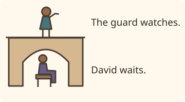

# Isaiah 52 — Good news on the mountains

**About this chapter**

Jerusalem hears that God is coming to rescue His people. At the end of the chapter, the LORD asks everyone to look at His servant.

## Jerusalem rises from the dust

## Isaiah 52:1

Wake up, Zion!

Wake up and be strong.

Jerusalem, holy city, put on your beautiful clothes.

Those who are uncircumcised or unclean before God will no longer enter you.

## Isaiah 52:2

Shake the dust off, Jerusalem.

Stand up and take your seat on the throne.

Zion, you have been a prisoner.

Take the chains off your neck.

Isaiah speaks to the city as if it were a captive woman going free.

## Isaiah 52:3

The LORD says, “No one paid to take you away.

No one will need money to set you free.”

## The LORD speaks to His people

## Isaiah 52:4

The Lord GOD says, “Long ago my people went to live in Egypt.

Later the Assyrians treated them cruelly for no reason.

## Isaiah 52:5

“And what do I see now?

Others have taken my people away without cause.

Their rulers mock them.

All day long people insult my name.

## Isaiah 52:6

“So my people will know my name.

On that day they will know who is speaking.

It is I.

I am here!”

## Messengers bring good news

## Isaiah 52:7

What a welcome sight on the mountains!

Messengers are coming on foot with good news.

They announce peace.

They tell Zion that God is saving His people.

They say, “Your God is King!”

## Isaiah 52:8

Listen to the guards on the lookout!

Together they shout for joy.

They will see with their own eyes when the LORD comes back to Zion.

**Look for the guard**

Find the guard up high. Imagine being the first to see someone coming over the mountains. In Isaiah’s message, the guards shout for joy together.

## Isaiah 52:9

Even the ruins of Jerusalem have reason to sing!

Sing together for joy.

The LORD has comforted His people.

He has set Jerusalem free.

## Isaiah 52:10

The LORD has uncovered His holy arm for every nation to see.

Isaiah pictures God showing His strength.

Even people at the ends of the earth will see our God rescue His people.

## God goes with the travelers

## Isaiah 52:11

Leave!

Come out of that place!

Keep away from anything unclean before God.

You who carry the things used in the LORD’s house, make yourselves clean for His service.

## Isaiah 52:12

You will have no need to run away in a hurry.

The LORD will go ahead of you.

The God of Israel will guard you from behind.

## The servant whom kings will see

## Isaiah 52:13

The LORD says, “Look at my servant.

He will succeed in His work.

He will rise high and receive great honor.

## Isaiah 52:14

“Many were horrified when they saw Him.

His face and body were so badly hurt that He hardly looked human.

## Isaiah 52:15

“Yet He will sprinkle many nations.” Sprinkling was a sign of cleansing.

“Kings will fall silent before Him.

They will see something no one told them about.

They will understand something they never heard before.”

**Pause and answer**

What good news do the messengers tell Zion about God?
