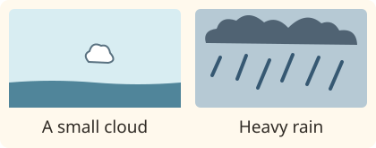

# Jeremiah 10 — The living God made the earth

**About this chapter**

A worker can carve an idol, but the idol cannot take a single step. Jeremiah praises the God who made the earth. Later he asks God to correct him fairly.

## Idols have to be carried

## Jeremiah 10:1

People of Israel, listen to the LORD's message for you.

## Jeremiah 10:2

The LORD said, “Other nations fear strange signs in the sky.

Do not learn to live in fear of those signs.

## Jeremiah 10:3

“Look at their custom of making an idol to worship.

What good does it do?

Someone cuts a tree in the forest.

A worker uses a sharp tool to carve the wood.

## Jeremiah 10:4

“Workers decorate it with silver and gold.

They hammer in nails to keep it from falling over.

## Jeremiah 10:5

“Their idols stand like scarecrows in a cucumber field.

They cannot speak. Someone must carry them because they cannot walk.

You have no reason to fear them.

They can neither hurt you nor help you.”

## The LORD rules over every nation

## Jeremiah 10:6

LORD, no one is like you.

You are great. Your name is known for its power.

## Jeremiah 10:7

You are King over all nations.

Who would fail to honor you with deep respect?

You deserve that honor.

Among all their wise people, no kingdom has anyone like you.

## Jeremiah 10:8

People show how foolish they are when they look for teaching from wooden idols.

## Jeremiah 10:9

Workers bring sheets of silver from Tarshish and gold from Uphaz.

Skilled hands shape the metal.

Workers dress the idols in blue and purple cloth.

People make every part of them.

## Jeremiah 10:10

The LORD is the true God.

He lives and rules as King forever.

The earth shakes when he is angry.

No nation can stand against his anger.

## Jeremiah 10:11

Tell the nations, “Your gods made neither earth nor sky.

They will disappear from the earth and from under the sky.”

## The Maker of earth and sky

## Jeremiah 10:12

The LORD used his power to make the earth.

In his wisdom he set the world firmly in place.

With understanding he spread out the sky.

## Jeremiah 10:13

When he thunders, water roars in the sky.

He makes clouds rise from the ends of the earth.

He sends lightning with the rain.

He brings the wind out as if from storerooms.

## Jeremiah 10:14

People show how little they understand.

Every metalworker who makes an idol has reason for shame.

The worker melts metal and pours it into a mold.

The image looks like a god, yet it cannot breathe.

## Jeremiah 10:15

These idols are worthless. They deserve only laughter.

When judgment comes, they will disappear.

## Jeremiah 10:16

Jacob's people have the God who made everything.

They are Israel, the people he chose as his own.

His name is the LORD who commands heaven's armies.

## The people grieve for their homes

## Jeremiah 10:17

Enemies have surrounded you. Gather your belongings.

## Jeremiah 10:18

The LORD said, “I am about to throw the people out of this land.

I will bring trouble on them.

Their enemies will take them captive.”

## Jeremiah 10:19

How I suffer! My wound is deep.

I said to myself, “This pain is mine.

I must bear it.”

## Jeremiah 10:20

“My tent has fallen. Every rope has snapped.

My children have gone. I have lost them.

No one is left to put my tent back up

or hang its curtains.”

The broken tent pictures a home that has fallen apart.

## Jeremiah 10:21

The leaders were like shepherds who had lost their sense.

They did not ask the LORD to guide them.

So they failed, and their people scattered like sheep.

## Jeremiah 10:22

Listen to the news! A great noise comes from the north.

The towns of Judah will lie empty.

Wild dogs called jackals will live among the ruins.

## A prayer for fair judgment

## Jeremiah 10:23

LORD, I know that no one controls the course of their life.

We cannot guide our own steps.

## Jeremiah 10:24

LORD, correct me fairly.

If you correct me in anger, nothing of me will remain.

## Jeremiah 10:25

Let your anger fall on nations that refuse to acknowledge you.

Remember the families who never call on your name.

They have swallowed up Jacob's people.

They have destroyed them and laid waste to their homeland.

**Think about it**

**Why did people have to carry the idols they made?**
