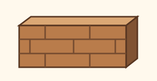

# Jeremiah 15 — God promises to stand with Jeremiah

**About this chapter**

God tells Jeremiah why Jerusalem faces trouble. Jeremiah tells God how lonely and hurt he feels. God answers him with a promise.

## God sends the people away

## Jeremiah 15:1

The LORD said to me, “Imagine Moses and Samuel standing here.

Even if they pleaded for these people, I would still send the people away.

Tell the people to leave my presence.

## Jeremiah 15:2

“They may ask you, ‘Where can we go?’

Tell them what I, the LORD, say.

Some will meet death. Others will die by the sword.

Some will starve. Enemies will take others captive.

## Jeremiah 15:3

“I will send four things to destroy them.

The sword will kill. Dogs will drag away the bodies.

Birds and wild animals will eat what remains.

## Jeremiah 15:4

“King Manasseh, son of Hezekiah, did evil in Jerusalem.

Because of what he did, kingdoms everywhere will look on Judah with horror.

## Jeremiah 15:5

“Jerusalem, who will feel sorry for you?

Who will mourn for you?

Who will stop and ask how you are?

## Jeremiah 15:6

“You left me. You turned your back on me.

Now I will use my power against you.

I will bring you to ruin.

I have grown tired of holding back out of pity.

## Families in Judah will grieve

## Jeremiah 15:7

“At the gates of the land, I will scatter my people.

Think of a farmer tossing grain with a fork.

The wind scatters the light husks.

My people refused to change their ways.

I will take away their children and bring them to ruin.

## Jeremiah 15:8

“There will be more widows than grains of sand by the sea.

At noon an attacker will come upon the mothers of young men.

Grief and terror will strike them without warning.

## Jeremiah 15:9

“Even a mother with seven children will grow weak and die.

Her life will end like the sun setting at midday.

She will suffer shame and disgrace.

Those who are left will face their enemies.

I will give them over to the sword.”

## Jeremiah grieves over the way people treat him

## Jeremiah 15:10

Jeremiah said, “Mother, what sorrow came with my birth!

People throughout the land quarrel with me.

I have never lent them money or borrowed from them.

Yet everyone curses me.”

## Jeremiah 15:11

The LORD said, “Jeremiah, I will free you for a good purpose.

When trouble comes, I will speak to your enemy for you.

## Jeremiah 15:12

“Can anyone break iron from the north or smash bronze?

## Jeremiah 15:13

“People of Judah, you have sinned throughout your land.

I will let others take your wealth and treasures.

They will pay nothing for them.

## Jeremiah 15:14

“I will make you serve your enemies as slaves.

You will live in a land you do not know.

My anger will burn against you like a fire.”

## Jeremiah tells God about his pain

## Jeremiah 15:15

Jeremiah prayed, “LORD, you know what is happening.

Remember me and come to my aid.

Call those who persecute me to account for the harm they do.

While you wait patiently, please keep me alive.

People insult me because I stand for you.

## Jeremiah 15:16

“When your words came to me, I ate them.”

Jeremiah meant that he took God's words deep into himself.

“Your words brought me great joy.

I bear your name, LORD God who commands heaven's armies.

## Jeremiah 15:17

“I stayed away from the crowds who gathered to celebrate.

I sat alone because your hand was on me.

You filled me with anger at what was wrong.

## Jeremiah 15:18

“Why does my pain never end?

It is like a wound that will never heal.

I look to you for help, but I feel let down.

It is like seeing water and finding none there.”

## God answers Jeremiah

## Jeremiah 15:19

The LORD said, “Come back to me, Jeremiah.

I will take you back to serve in my presence.

Choose words of worth and leave empty talk behind.

Then you will speak for me.

Let the people turn to you.

Do not follow them into their ways.

## Jeremiah 15:20

“I will make you like a strong wall of bronze.

The people will fight you, but they will not defeat you.

I am with you. I will save you.”

## Jeremiah 15:21

The LORD said, “I will rescue you from people who do evil.

I will free you from those who show no mercy.”

**Think about it**

**Why could Jeremiah stand firm when people fought against him?**
