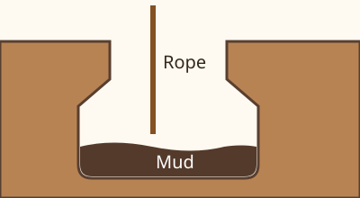

# Jeremiah 2 — Israel leaves the spring of fresh water

**About this chapter**

God remembers when Israel followed him through the desert. Now the people look elsewhere for help. God compares their choice to leaving a spring and digging a water pit that leaks.

## Israel once followed God

## Jeremiah 2:1

The LORD spoke to me, Jeremiah.

## Jeremiah 2:2

“Tell Jerusalem what I remember.

When you were young, you loved me like a new bride.

You followed me through the wilderness where no one planted crops.

## Jeremiah 2:3

“Israel belonged to me, like the first grain set aside at harvest.

I held those who attacked Israel guilty.

Disaster came upon them,” says the LORD.

## Jeremiah 2:4

Hear the LORD's words, family of Jacob.

Listen, all you families of Israel.

## Jeremiah 2:5

The LORD asks, “What wrong did your ancestors find in me?

Why did they go so far away?

They followed worthless idols and became like those idols.

## Jeremiah 2:6

“They never asked, ‘Where is the LORD who led us out of Egypt?’

I led them through dry country full of pits.

It was dark and dry, with no one on the roads.

No one made a home there.

## Jeremiah 2:7

“I brought you to rich land with plenty to eat.

You spoiled the land that belongs to me.

You made it a place I could hardly bear to see.

## Jeremiah 2:8

“The priests never asked where I was.

The teachers of my law no longer knew me.

The leaders turned against me.

The prophets spoke for Baal and followed idols that could never help.

## A spring and a broken water pit

## Jeremiah 2:9

“So I bring my case against you again.

I will bring it against your grandchildren too.

## Jeremiah 2:10

“Cross the sea to Cyprus and look.

Send someone to Kedar to ask.

Has anyone ever seen anything like this?

## Jeremiah 2:11

“Do other nations trade their gods for different ones?

Those gods have no power at all.

Yet my people have traded me, their glorious God, for useless idols.

## Jeremiah 2:12

“Heavens above, look at what they have done!

Shudder at the sight!

## Jeremiah 2:13

“My people have done two wrong things.

They have left me, the spring of fresh, flowing water.

They have dug their own pits to store water.

The pits are cracked. All the water leaks out.”

God gives life like a spring that keeps flowing.

The things his people trust cannot sustain them.

## Israel looks to other nations

## Jeremiah 2:14

“Was Israel born a slave?

Why can others take him like prey?

## Jeremiah 2:15

“Young lions roar over Israel.”

The lions picture Israel's enemies.

“They have ruined the land and left the towns empty.

## Jeremiah 2:16

“Men from Memphis and Tahpanhes, cities in Egypt, have shaved your head.

They have brought you shame.

## Jeremiah 2:17

“You left the LORD your God while he was guiding you.

Isn't that how you brought this on yourself?

## Jeremiah 2:18

“Why go to Egypt to drink from the Nile?

Why go to Assyria to drink from the Euphrates?

What help will you get from those nations?

## Jeremiah 2:19

“Your own evil deeds will teach you a hard lesson.

See how bitter it is to leave the LORD your God.

You have lost your respect for me.”

These are the words of the Lord GOD who commands heaven's armies.

## The people run after other gods

## Jeremiah 2:20

“Long ago you threw off the yoke and broke the chains.

You said, ‘I refuse to serve!’

On every high hill and under every green tree you lay down like a prostitute.”

God compares worshiping other gods to going after many lovers.

## Jeremiah 2:21

“I planted you like a fine grapevine from the best seed.

How did you become a sickly wild vine?

## Jeremiah 2:22

“You could scrub with the strongest soap you have.

I would still see your guilt like a stain.

## Jeremiah 2:23

“You say, ‘I am clean. I never followed the gods called Baals.’

Look at what you did in the valley. Admit it.

You rush about like a young camel,

## Jeremiah 2:24

“or like a wild donkey sniffing the wind for a mate.

Who can turn her aside when she is ready to mate?

Those who want her can find her easily.

## Jeremiah 2:25

“Stop before your feet are bare and your throat is dry.

But you say, ‘I cannot stop.

I love foreign gods. I must follow them.’

## Who will help when trouble comes?

## Jeremiah 2:26

“A thief feels shame when someone catches him.

Israel faces that same shame.

So do its kings, officials, priests, and prophets.

## Jeremiah 2:27

“They call a tree their father.

They tell a stone, ‘You gave birth to me.’

They turn their backs on me.

Yet when trouble comes, they cry to me, ‘Get up! Save us!’

## Jeremiah 2:28

“Where are those gods you made?

Let them save you now, if they can!

Judah, you have as many gods as towns.

## Jeremiah 2:29

“Why do you accuse me of doing wrong?

All of you have turned against me.

## Jeremiah 2:30

“I punished your children, but they learned nothing.

You killed your own prophets with the sword,

like a hungry lion tearing into its prey.”

## God calls the people to account

## Jeremiah 2:31

People living today, listen to the LORD.

“Have I been like a desert to Israel?

Have I been like a land without light?

Why do my people say, ‘We can go where we want.

We will never come back to you’?

## Jeremiah 2:32

“Does a young woman forget her jewelry?

Would a bride forget her wedding sash?

Yet my people have forgotten me for more days than anyone can count.

## Jeremiah 2:33

“How skilled you have become at chasing lovers!

Even women known for unfaithfulness could learn from you.

## Jeremiah 2:34

“The blood of innocent poor people stains your clothes.

You never caught them breaking into your homes.

Yet after all this,

## Jeremiah 2:35

“you say, ‘I am innocent. God will stop being angry.’

I will judge you for saying you have done nothing wrong.

## Jeremiah 2:36

“How quickly you change direction!

You trusted Assyria, and it let you down.

Egypt will let you down too.

## Jeremiah 2:37

“You will leave Egypt with your hands on your head in shame.

I have rejected those you count on.

Their help will bring you no success.”

**Think about it**

**Why could the water pits never give the people what the spring gave them?**
