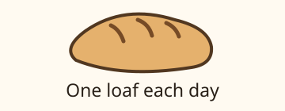

# Jeremiah 37 — The king asks Jeremiah for news from God

**About this chapter**

Jerusalem is in danger. The king wants Jeremiah to pray for the city. Later, the king speaks to Jeremiah in secret.

## The king asks for prayer

## Jeremiah 37:1

Nebuchadnezzar was the king of Babylon.

He made Zedekiah king of Judah.

Zedekiah was the son of Josiah.

He took the place of Coniah, son of Jehoiakim.

## Jeremiah 37:2

Jeremiah was a prophet.

A prophet speaks God's message to people.

The LORD spoke through Jeremiah.

But Zedekiah, his officers and the people refused to obey.

## Jeremiah 37:3

Even so, King Zedekiah sent two men to Jeremiah.

Jehucal was the son of Shelemiah.

Zephaniah was a priest and the son of Maaseiah.

They said, “Please pray to the LORD our God for us.”

## Jeremiah 37:4

At that time, Jeremiah could still move freely among the people.

No one had put him in prison yet.

## Jeremiah 37:5

Soldiers from Babylon had surrounded Jerusalem.

These soldiers were called Chaldeans.

They heard that the king of Egypt had sent out his army.

So the soldiers from Babylon pulled away from Jerusalem.

## God says the soldiers will return

## Jeremiah 37:6

Then the LORD gave Jeremiah a message.

## Jeremiah 37:7

The LORD, the God of Israel, told Jeremiah what to say.

“Give this message to the king who sent you.

The army from Egypt has come to help you.

But that army will go back to Egypt.

## Jeremiah 37:8

“Then the soldiers from Babylon will return.

They will fight against Jerusalem.

They will take the city and burn it down.”

## Jeremiah 37:9

The LORD said, “You tell yourselves the soldiers have gone for good.

You are fooling yourselves. They will come back.

## Jeremiah 37:10

“Suppose you defeated the whole army from Babylon.

Suppose only wounded men lay in their tents.

Even those men would get up and burn Jerusalem down.”

## A guard stops Jeremiah

## Jeremiah 37:11

The soldiers from Babylon feared the army from Egypt.

That was why they had pulled away from Jerusalem.

## Jeremiah 37:12

During that time, Jeremiah set out for the land of Benjamin.

He wanted to claim his share of the property there.

## Jeremiah 37:13

Jeremiah reached the city gate called the Gate of Benjamin.

Irijah, the captain of the guards, grabbed him.

Irijah was Shelemiah's son and Hananiah's grandson.

He said, “You are leaving to join Babylon's army!”

## Jeremiah 37:14

Jeremiah answered, “That is a lie!

I am not going to join them.”

But Irijah refused to listen.

He arrested Jeremiah and took him to the officials.

## Jeremiah 37:15

The officials were angry with Jeremiah.

They beat him and locked him in Jonathan's house.

Jonathan was a scribe, someone who wrote official records.

The officials were using his house as a prison.

## Jeremiah 37:16

They kept Jeremiah in an underground cell.

He stayed there a long time.

## The king speaks to Jeremiah alone

## Jeremiah 37:17

Later, King Zedekiah sent for Jeremiah.

At the palace, the king spoke to him in private.

He asked, “Does the LORD have a message?”

Jeremiah answered, “Yes. Babylon's king will take you prisoner.”

## Jeremiah 37:18

Jeremiah asked, “What wrong have I done to you?

Have I harmed your servants or these people?

Why have you put me in prison?

## Jeremiah 37:19

“Your prophets told you Babylon's king would never attack you or your land.

Where are those prophets now?

## Jeremiah 37:20

“My king, please listen to my request.

Please do not send me back to Jonathan's house.

I will die there.”

## Jeremiah 37:21

King Zedekiah ordered the guards to keep Jeremiah in their courtyard.

This was an open space where the guards stayed.

He ordered them to bring Jeremiah one loaf each day from the bakers' street.

They did this until the city ran out of bread.

Jeremiah stayed in the guards' courtyard.

**Think about it**

**What did Jeremiah ask the king to do about Jonathan's house?**
