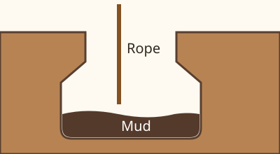

# Jeremiah 38 — Ebed-melech helps Jeremiah out of the mud

**About this chapter**

Jeremiah warns the people of Jerusalem about Babylon's army. Some officials want Jeremiah dead. A man who works in the palace speaks up for him.

## The officials hear Jeremiah's warning

## Jeremiah 38:1

Four men heard the message Jeremiah gave the people.

They were Shephatiah son of Mattan and Gedaliah son of Pashhur.

The others were Jucal son of Shelemiah and Pashhur son of Malchijah.

## Jeremiah 38:2

Jeremiah said, “The LORD says this about Jerusalem.

Anyone who stays here will die.

War, hunger, or sickness will kill them.

Anyone who surrenders to Babylon's soldiers will live.”

Babylon's soldiers were also called Chaldeans.

People who surrendered would get away with their lives.

## Jeremiah 38:3

Jeremiah also said, “The LORD says this city will fall.

The king of Babylon's army will capture it.”

## Jeremiah 38:4

The officials told the king, “Jeremiah deserves to die.

His words make our remaining soldiers lose courage.

The people in the city lose courage too.

He wants to harm these people.”

## Jeremiah 38:5

King Zedekiah answered, “Jeremiah is in your hands.

I can do nothing to stop you.”

## Jeremiah 38:6

The officials took Jeremiah to the guards' courtyard.

Malchiah, the king's son, had a cistern there.

A cistern is a deep pit for storing water.

The officials lowered Jeremiah into it with ropes.

The water was gone. Only mud remained.

Jeremiah sank into the mud.

## Ebed-melech asks the king for help

## Jeremiah 38:7

Ebed-melech was from the land of Cush.

He worked as an official in the palace.

He heard what the men had done to Jeremiah.

King Zedekiah was sitting at the Gate of Benjamin.

## Jeremiah 38:8

Ebed-melech left the palace.

He went to the gate to speak to the king.

## Jeremiah 38:9

He said, “My king, these men have done wrong.

They put Jeremiah the prophet in the cistern.

There is no more bread in the city.

Jeremiah will die of hunger down there.”

## Jeremiah 38:10

The king told Ebed-melech, “Take 30 men with you.

Pull Jeremiah out before he dies.”

## Jeremiah 38:11

Ebed-melech took the men to the palace.

Below the storeroom he found rags and worn clothes.

He lowered these to Jeremiah with ropes.

## Jeremiah 38:12

Ebed-melech called down, “Put the cloth under your arms.

It will keep the ropes from rubbing against you.”

Jeremiah did as Ebed-melech said.

## Jeremiah 38:13

The men pulled on the ropes.

They lifted Jeremiah out of the cistern.

Jeremiah stayed in the guards' courtyard.

## The king asks Jeremiah to speak freely

## Jeremiah 38:14

King Zedekiah sent for Jeremiah the prophet.

They met at the third entrance to the LORD's temple.

The king said, “I want to ask you something.

Keep nothing from me.”

## Jeremiah 38:15

Jeremiah answered, “If I tell you, you will kill me.

If I give you advice, you will ignore it.”

## Jeremiah 38:16

In secret, the king made Jeremiah a promise.

“As surely as the LORD lives, I will spare you.

The LORD is the one who gave us life.

I will keep you from the men who want you dead.”

## Jeremiah 38:17

Jeremiah said, “The LORD commands heaven's armies.

He is the God of Israel.

He says to surrender to the king of Babylon's officers.

If you surrender, you and your household will live.

The soldiers will spare the city from fire.

## Jeremiah 38:18

“If you refuse, Babylon's soldiers will capture Jerusalem.

They will burn it down.

You will have no way to escape them.”

## Jeremiah 38:19

Zedekiah said, “I am afraid of my own people who joined Babylon.

Babylon's soldiers may hand me over to them.

Then those people may hurt me.”

## Jeremiah 38:20

Jeremiah answered, “The soldiers will keep you from those people.

Listen to the message I brought from the LORD.

Obey him so things go well and you live.

## Jeremiah 38:21

“If you refuse to surrender, the LORD has shown me what will happen.

## Jeremiah 38:22

“Men will take the women still in your palace to Babylon's officers.

The women will say, ‘The friends you trusted fooled you.

They got their way.

Your feet sank in the mud, and your friends left you.’”

The mud is a picture of trouble.

The king's friends would leave him trapped in trouble.

## Jeremiah 38:23

Jeremiah went on, “The soldiers will take all your wives and children.

You will have no way to escape.

Babylon's king will capture you.

His soldiers will burn Jerusalem down.”

## The officials question Jeremiah

## Jeremiah 38:24

Zedekiah warned Jeremiah, “Keep our talk secret.

If anyone hears about it, you will die.

## Jeremiah 38:25

“The officials may hear that we spoke together.

They may ask, ‘What did you tell the king?

What did the king tell you?

Tell us everything, or we will kill you.’

## Jeremiah 38:26

“Tell them you asked me for one thing.

You asked me to keep you from Jonathan's house.

You feared you would die in that prison.”

## Jeremiah 38:27

All the officials came and questioned Jeremiah.

Jeremiah answered exactly as the king had told him.

No one had overheard the talk with the king.

So the officials stopped questioning Jeremiah.

## Jeremiah 38:28

Jeremiah stayed in the guards' courtyard until the day Babylon's army captured Jerusalem.

**Think about it**

**Who asked the king to help Jeremiah in the cistern?**
