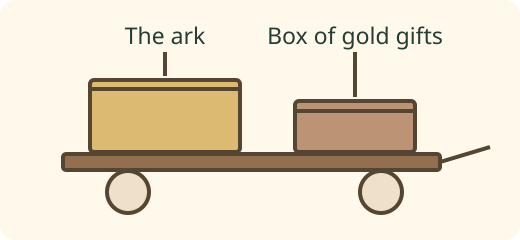

# Jeremiah 3 — God calls Israel and Judah back

**About this chapter**

Israel and Judah are two kingdoms. God speaks about them as sisters. He describes worshiping other gods as breaking a marriage promise.

## Words and actions do not match

## Jeremiah 3:1

The LORD asked, “Suppose a man divorces his wife.

She leaves and marries another man.

Can her first husband go back to her?

Wouldn't that make the land unclean?

You have been like a wife with many lovers.

And now you want to return to me?

## Jeremiah 3:2

“Look up at the bare hilltops.

Where is there a place where no one has used you?

Like a traveler in the desert, you waited beside the roads for lovers.

Your unfaithfulness and evil deeds have spoiled the land.

## Jeremiah 3:3

“That is why the showers stopped.

Even the spring rains failed.

Yet you refuse to show any shame.

## Jeremiah 3:4

“Only now you call to me, ‘My Father!

You have been my friend since I was young.’

## Jeremiah 3:5

“You ask, ‘Will God stay angry forever?’

Those are your words.

Yet you keep doing all the evil you can.”

## Judah sees what happens to Israel

## Jeremiah 3:6

When Josiah was king, the LORD spoke to Jeremiah.

“Have you seen how Israel has been unfaithful to me?

On every high hill and under every green tree she sought other lovers.”

God was speaking about Israel's worship of other gods.

## Jeremiah 3:7

God said, “I thought Israel would come back to me afterward.

She did not come back.

Her unfaithful sister Judah saw it all.

## Jeremiah 3:8

“Israel had broken faith with me.

I gave her a written notice of divorce and sent her away.

Judah saw this. Still she showed no fear.

She too went after other lovers.

## Jeremiah 3:9

“Israel thought little of being unfaithful.

She worshiped things made of stone and wood.

In this way she spoiled the land.

## Jeremiah 3:10

“Judah saw all this and still only pretended to return.

She did not come back to me with her whole heart.”

## God sends a message to the north

## Jeremiah 3:11

The LORD told Jeremiah, “Israel has been unfaithful.

Yet compared with Judah, Israel has acted more justly.

## Jeremiah 3:12

“Go and call out toward the north.

Say, ‘Come back to me, unfaithful Israel.

I will look on you with mercy.

I will not stay angry forever.

## Jeremiah 3:13

“‘Admit that you have done wrong.

You turned against me, the LORD your God.

You gave your love to foreign gods under every green tree.

You refused to obey me.’”

## Jeremiah 3:14

The LORD said, “Come back, my unfaithful children.

I am your master.

I will take one of you from a city and two from a family.

I will bring you to Zion, in Jerusalem.

## Jeremiah 3:15

“I will give you leaders who care for you as I do.

Like shepherds feeding sheep, they will give you what you need.

They will teach you and help you understand.

## The two kingdoms will come home together

## Jeremiah 3:16

“Your families will grow in the land.

No one will talk about the ark of the LORD's covenant.”

The ark was a sacred chest that reminded Israel of God's covenant.

God said, “No one will think of it or miss it.

No one will make another one.

## Jeremiah 3:17

“People will call Jerusalem ‘The Throne of the LORD.’

People from every nation will gather there to honor my name.

They will give up stubbornly following their own evil desires.

## Jeremiah 3:18

“Judah and Israel will walk side by side.

Together they will come home from the north.

They will return to the land I gave their ancestors.

## Jeremiah 3:19

“I longed to call you my children.

I wanted to give you a land of great beauty,

a gift more lovely than the lands of other nations.

I thought you would call me Father and always follow me.

## Jeremiah 3:20

“But a wife can break her promise to her husband.

People of Israel, you broke your promise to me.”

## The people answer God

## Jeremiah 3:21

Listen to the people of Israel on the bare hilltops.

They weep and beg for mercy.

They have done wrong and forgotten the LORD their God.

## Jeremiah 3:22

God says, “Come back, my unfaithful children.

I will help you become faithful again.”

The people answer, “Here we are. We come to you.

You are the LORD our God.

## Jeremiah 3:23

“All the noise of worship on the hills fooled us.

You, the LORD our God, are the one who saves Israel.

## Jeremiah 3:24

“Since we were young, we have seen what worshiping that shameful god cost us.

We lost what our ancestors worked for, their sheep and cattle.

We lost their sons and daughters too.

## Jeremiah 3:25

“Let us lie down in shame.

We and our ancestors have sinned against the LORD our God.

From our youth until today, we have refused to obey him.”

**Think about it**

**Which two kingdoms does God promise to bring home together?**
