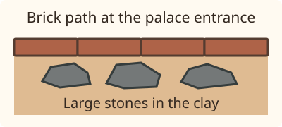

# Jeremiah 43 — The people go to Egypt

**About this chapter**

The LORD tells the people to stay in Judah.

Their leaders take them to Egypt anyway.

There the LORD gives Jeremiah a message about Babylon’s king.

## The leaders accuse Jeremiah of lying

## Jeremiah 43:1

The LORD their God had sent Jeremiah to speak.

Jeremiah told all the people everything the LORD had said.

## Jeremiah 43:2

Two leaders spoke up.

One was Azariah, son of Hoshaiah.

The other was Johanan, son of Kareah.

These leaders and the other proud men told Jeremiah, “You’re lying!

You tell us to stay out of Egypt.

The LORD our God never sent you to say that.

## Jeremiah 43:3

“Baruch, son of Neriah, is turning you against us!

He wants to hand us over to the Babylonians.

They could kill us or take us away to Babylon.”

## The leaders take everyone to Egypt

## Jeremiah 43:4

The LORD had commanded the people to stay in Judah.

But Johanan and all the army commanders disobeyed the LORD.

## Jeremiah 43:5

Johanan and the commanders took all the people who remained.

These people had once scattered to many countries.

They had come back to Judah from those countries.

## Jeremiah 43:6

The commanders took men, women, and children.

They took the king’s daughters too.

Nebuzaradan, captain of the guard, had let people stay with Gedaliah.

Gedaliah was Ahikam’s son and Shaphan’s grandson.

The commanders took everyone who had stayed with Gedaliah.

They also took Jeremiah the prophet and Baruch, son of Neriah.

A prophet speaks God’s message to the people.

## Jeremiah 43:7

So the people went into Egypt.

They went against what the LORD had told them.

They reached an Egyptian town called Tahpanhes.

## Stones at the palace entrance

## Jeremiah 43:8

In Tahpanhes the LORD spoke to Jeremiah.

## Jeremiah 43:9

The LORD said, “Pick up some large stones.

Let the people of Judah see what you do.

Take the stones to the entrance of Pharaoh’s palace here.”

Pharaoh was the title of Egypt’s king.

The LORD said, “Bury the stones in the clay of the brick path.”

## Jeremiah 43:10

The LORD told Jeremiah what to say to the people.

“This message comes from the LORD who commands heaven’s armies.

He is the God of Israel.

He says, ‘I will send for my servant Nebuchadnezzar.

Nebuchadnezzar is king of Babylon.

I will put his throne above the stones I had you bury.

A throne is a king’s seat.

He will spread his royal tent over those stones.

## What Babylon’s king will do in Egypt

## Jeremiah 43:11

‘Nebuchadnezzar will come and attack Egypt.

Those marked for death will die.

His army will take away those marked for captivity.

His soldiers will kill others with their swords.

## Jeremiah 43:12

‘I will start a fire in the temples of Egypt’s gods.

Nebuchadnezzar will burn the temples.

He will carry away the statues of their gods.

A shepherd wraps his coat around himself.

Just as easily, Nebuchadnezzar will take Egypt for himself.

Then he will leave Egypt unharmed.

## Jeremiah 43:13

‘In Egypt there is a temple for worshiping the sun.

Nebuchadnezzar will smash the tall stone pillars there.

He will burn down the temples of Egypt’s gods.’”

**Pause and answer**

Where did the LORD tell Jeremiah to bury the stones?
